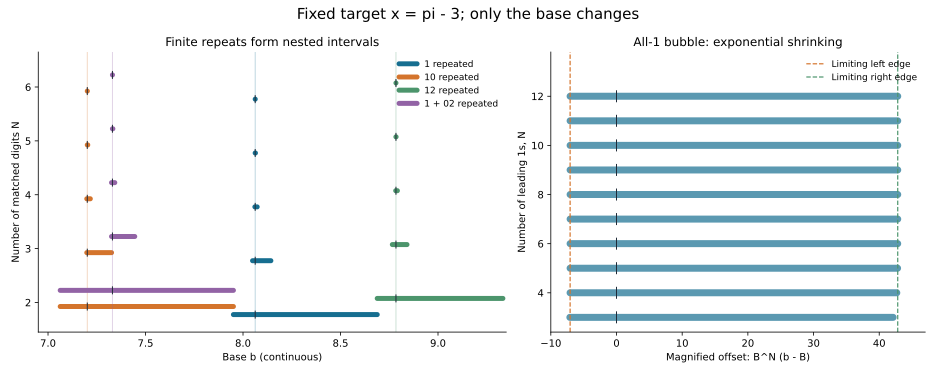

# 固定 π、改变底数：循环模板的参数区间

2026-10-30。按用户建议，以底数为连续自变量，研究“非循环前缀＋循环块”的压缩模板在底数空间里的变化。本文用“泡泡”指有限精度下的参数区间；这是一个明确的数学定义，不假定气泡具有圆形几何。相关文献研究的对象包括固定数在连续底数下展开的参数空间柱集，见 [Lü–Wang–Wu, arXiv:2103.00546](https://arxiv.org/abs/2103.00546)。下面的具体推导固定 x=π−3，未证明 π 的坏逼近性，也不主张文献新颖性。

## 1. 固定前缀对应一个区间，增加数位产生嵌套

固定 x=π−3∈(0,1)，底数 b>1。贪心展开余数定义为 r₀=x、dⱼ=⌊b rⱼ₋₁⌋、rⱼ=b rⱼ₋₁−dⱼ。固定非负整数数字字 w=(w₁,…,wₙ)，令 Sⱼ(b)=Σᵢ₌₁ʲ wᵢ b⁻ⁱ。该字成为 x 的前 n 位，当且仅当每个 j≤n 满足

\[
S_j(b)\le x<S_j(b)+b^{-j}.
\tag{1}
\]

证明：rⱼ=bʲ(x−Sⱼ(b))；(1) 等价于每步余数位于 [0,1)，从而恰好满足取整递推。每个 Sⱼ(b) 为不增函数，Sⱼ(b)+b⁻ʲ 严格递减，故 (1) 是若干右半线与左半线的交集，形成一个区间或空集。增加下一位会将原区间划分为子区间，不同子区间的内部互不重叠。

于是用户所说的“泡泡”可以具体取为 I(w)={b>1:x 的贪心展开以 w 开头}。模板为“前缀 A＋循环 W”时，观察 I(AW)、I(AWW)、I(AWWW)、……。这些区间嵌套，直观上呈现泡泡逐层收紧、不同下一位对应分支的结构。

## 2. 无限循环模板的中心

设前缀长度 k、循环长度 L，定义

\[
R_{A,W}(b)=\sum_{j=1}^k a_jb^{-j}
+b^{-k}\frac{\sum_{j=1}^{L}w_jb^{-j}}{1-b^{-L}}.
\tag{2}
\]

这是关于 b 的有理函数，并在至少一个数字非零时严格递减。因此 R_{A,W}(b)=x 至多有一个底数解。还需检验该表示是否为贪心展开；仅有求和等式不够。此次四个例子的数字均不超过 2，中心底数均大于 7，任一移位尾部均小于 2/(b−1)<1，所以均满足贪心条件。

| 模板 | 中心底数，约 |
|---|---:|
| 1 无限重复 | 8.062513305931045 |
| 10 无限重复 | 7.201375663176672 |
| 12 无限重复 | 8.784331958058280 |
| 前缀 1，随后 02 无限重复 | 7.330366202537026 |

对固定 π 和固定模板，精确无限重复一般不是正宽度的底数区间：有限数位匹配区间逐层收敛到中心（若有 admissible 中心）。因此应区分“精确循环中心”和“有限精度泡泡”。

对有理底数 b，(2) 的值为有理数，所以无法精确等于 π−3；实数底数下的循环则能表示无理数。研究有理逼近时，应查看有限泡泡内的有理底数及其最终既约分母。

## 3. 全 1 泡泡的宽度和不对称性

记 B=1+1/x≈8.062513305931045，则 x=Σⱼ≥₁B⁻ʲ。令 Iₙ 为前 n 位均为 1 的底数集合。因所有相关底数均大于 7，只检查最后一个余数在 [0,1) 就足够：向前倒推 rⱼ₋₁=(1+rⱼ)/b 仍位于 [0,1)。因此

\[
I_n=[\ell_n,u_n),\quad
\sum_{j=1}^n\ell_n^{-j}=x,\quad
\sum_{j=1}^nu_n^{-j}+u_n^{-n}=x.
\tag{3}
\]

边界方程等价于

\[
\ell_n-B=-(B-1)\ell_n^{-n},\qquad
u_n-B=(B-1)(u_n-2)u_n^{-n}.
\tag{4}
\]

从边界趋于 B、偏移指数趋零，得到

\[
B^n(\ell_n-B)\to-(B-1),\quad
B^n(u_n-B)\to(B-1)(B-2),
\]

\[
\boxed{u_n-\ell_n\sim(B-1)^2 B^{-n}.}
\tag{5}
\]

这是一个可以严格推导的形变规律：每多要求一位 1，泡泡宽度渐近除以 B；同时左右两侧不对称，右侧极限宽度约是左侧的 B−2≈6.0625 倍。

| n | 左边界，约 | 右边界，约 | 宽度，约 |
|---:|---:|---:|---:|
| 2 | 7.950791340582 | 8.688271308847 | 0.737480 |
| 4 | 8.060840529267 | 8.072612307778 | 0.0117718 |
| 6 | 8.062487593394 | 8.062669171471 | 0.000181578 |
| 8 | 8.062512910386 | 8.062515703922 | 0.00000279354 |
| 12 | 8.062513305837 | 8.062513306499 | 6.61109×10⁻¹⁰ |

左图横轴为底数，纵轴为匹配的前缀数位数，不同颜色表示四个模板。10 循环和 1＋02 循环前两位相同，最初属于同一个区间，到第三位后出现分支。右图把全 1 泡泡的横向偏移乘 Bⁿ，显示其边界趋近固定常数；右图的原始区间事实上在指数缩小。

## 4. 22/7 和 355/113 落在何处

b=8 时，x 的数位开头为 110，所以落在 I₂ 内、I₃ 外。把全 1 无限模板作为有理替代，得到 3+1/(8−1)=22/7。

b=129/16 时，开头为 1111110，所以落在 I₆ 内、I₇ 外；相应模板值为 3+1/(129/16−1)=355/113。它与 B 的距离约 1.33059×10⁻⁵。

这把此前孤立的底数点放进了连续参数区间：两个好分数对应有理底数在全 1 泡泡内停留了不同的深度。

## 5. 泡泡宽度与最终分母需要一起研究

若 b=A/D 是既约有理数，把 (2) 通分可知最终分母整除

\[
A^k(A^L-D^L).
\tag{6}
\]

约分量由模板数字与 A、D 共同决定。对于无前缀、循环为单个 1 的模板，最终既约分母恰为 q=A−D。只要 b∈Iₙ，便有

\[
\left|\pi-\left(3+\frac1{b-1}\right)\right|\le b^{-n},
\qquad
q^2\left|\pi-\left(3+\frac1{b-1}\right)\right|\le q^2b^{-n}.
\tag{7}
\]

因此，若能找到 b=A/D 位于越来越深的泡泡内，且 n−2log_b(A−D)→∞，就足以构造归一化误差趋零的 π 有理逼近。本轮没有证明存在这样的序列。有理底数稠密只保证每个非空开区间里有有理点，不保证这些点的既约分母达到所需尺度。

相关文献关于“几乎所有底数”的度量结论也不能直接用于有理底数这一个可数集合。这是参数空间研究与 π 的原有算术目标之间仍需打通的一步。

## 6. 验证

[脚本](base_bubbles_2026_10_30.py)以 Machin 有理 π 区间，对边界做 130 步精确有理二分，保留每个宽度为 14/2¹³⁰ 的根区间；检查四个模板前 2–6 位的贪心数位和区间嵌套，及底数 8、129/16 的数位。图由这些区间的中点生成，浮点仅用于绘图。一般推导未做 Lean 核验。
