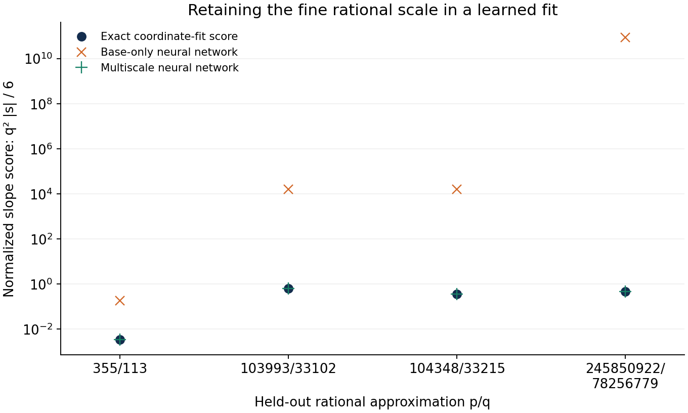

# 跨进制坐标拟合：实际神经网络实验与多尺度分解

2026-10-28。按用户要求，实际训练跨进制回归模型，研究此前坐标分布、拟合斜率与进制之间的关系。本轮既有有限实验，也有尺度分解的数学推导；没有证明 π 的坏逼近性。普通推导未进行 Lean 核验，不主张文献新颖性。

## 1. 本轮实际做了什么

延续[坐标回归定义](BASE_DISTRIBUTION_REGRESSION_2026-10-28.md)：x=π−3，n 为底数，h_n 是归一化数位阶梯曲线。沿横轴均匀取点，对每个 n 做带截距的直线最小二乘，得到斜率 s_n 与绝对均方残差 M_n。它们的参考标签由严格 π 区间和几何尾界计算，再转成浮点供神经网络训练。

本轮采样 n=8+i/1000，i=0,…,1000，共 1,001 个有理底数。固定分割为：

- i mod 5∈{1,2,3}：600 个训练点；
- i mod 5=4：200 个验证点；
- i mod 5=0：201 个留出评估点。

比较三个模型：

1. 基础线性回归：输入底数，输出全局斜率、残差；
2. 原始神经网络：输入底数，输出全局斜率、残差；
3. 多尺度神经网络：输入底数和首次离线后的局部坐标均值，学习下文的 H、V，再显式恢复尺度和全局斜率、残差。

后两者均使用两层各 32 个 tanh 隐藏单元、LBFGS、训练集标准化、种子 2848。采用 scikit-learn 的 [MLPRegressor](https://scikit-learn.org/stable/modules/generated/sklearn.neural_network.MLPRegressor.html)。本机 NumPy 2.3.5、scikit-learn 1.8.0。初次 2,000 次迭代触及上限，随后仅调整优化停止容差和上限；最终分别在 6,226、8,589 次迭代停止，均无收敛警告。网络结构没有按评估集选择。

这是探索性的固定分割插值实验：邻近底数不是独立随机样本，不能把误差表读成总体置信区间。两种网络输入的信息和输出约束不同；实验比较的是表示方式与结构约束，不是相同信息条件下的算法优劣。

## 2. 原始网络能拟合粗曲线，但未保住高分母尺度

201 个留出点上的结果为：

| 模型 | 斜率平均绝对误差 | 斜率最大绝对误差 | 均方残差的平均绝对误差 |
|---|---:|---:|---:|
| 基础线性回归 | 0.00285161 | 0.00532957 | 0.00194252 |
| 仅输入底数的神经网络 | 0.0000546738 | 0.00259190 | 0.000148108 |
| 多尺度神经网络 | 0.0000247085 | 0.000348190 | 0.0000794900 |

多尺度网络对 H 的留出平均绝对误差约为 1.07435。高分母指标的准确度不能解释为网络已把所有局部细节学到极高精度；下文的尺度恢复公式在其中起主要作用。

另外留出五个不在训练网格中的有理底数，其中 b=129/16 对应 355/113。若 n=A/D 已约分，令 q=A−D，研究此前定义的斜率指标
\[
J(n)=\frac{q^2|s_n|}{6}.
\]

| 对应有理逼近 | 参考斜率指标 J | 仅输入底数的网络预测 | 多尺度网络预测 |
|---|---:|---:|---:|
| 333/106 | 0.934872916807 | 1.08387129523 | 0.934824041160 |
| 355/113 | 0.00340628943505 | 0.181212401685 | 0.00340628927388 |
| 103993/33102 | 0.633219272404 | 15839.1242396 | 0.633219272441 |
| 104348/33215 | 0.365863802215 | 15946.4593375 | 0.365863802104 |
| 245850922/78256779 | 0.478780090585 | 88521653332.0 | 0.478780090593 |



这些底数都在输入区间 [8,9] 内，所以这里暴露的是细算术尺度下的插值精度要求，并非输入域外外推。原始网络在特殊底数 B=1+1/x 处的数值预测斜率约为 −8.67×10⁻⁵，其预测零点与 B 相差约 −7.31×10⁻⁴。这样的偏差对粗曲线可能不醒目，乘 q² 后却会放大。

这个敏感性有一般性证明：若一个固定连续预测函数 g 满足 g(B)≠0，则沿 B 的任意趋近有理序列且分母趋于无穷，q²|g(n)|/6→∞。沿 Dirichlet 好逼近子列，真实 J 仍有界。因此对所有高分母点保持一致控制，不能仅依靠一个固定的非零绝对误差。此结论针对未保护零点的预测函数，不是否定所有神经网络架构。

## 3. 放大首次离线之后，局部回归的误差不再按 q² 放大

记同进制全 1 横线高度 c_n=1/(n−1)，目标误差 ε=x−c_n。设前 N 位都是 1，第 N+1 位首次不同于 1。放大 t≤n^(−N) 的尾部后，得到余数 R_N 的同类曲线，而且
\[
R_N-c_n=n^N\varepsilon.
\tag{1}
\]
对放大后的局部曲线重新拟合直线
\[
\ell_{n,N}(u)=s_{n,N}u+r_{n,N},\qquad0<u\le1.
\]
最小二乘带截距时保留均值，所以
\[
R_N=r_{n,N}+\frac{s_{n,N}}2,
\]
从而
\[
\boxed{\varepsilon=n^{-N}\left(r_{n,N}+\frac{s_{n,N}}2-c_n\right).}
\tag{2}
\]
这给出了用户坐标拟合提议的一个具体多尺度版本：先定位首次离线，再拟合局部曲线，用局部截距、斜率与进制恢复全局误差。

令 τ=R_N−c_n。因为下一位不为 1，或者 R_N<1/n，或者 R_N≥2/n。对 8≤n≤9，均有
\[
|\tau|\ge\frac1{72}.
\tag{3}
\]
如果局部拟合参数的误差为 Δr、Δs，则由 (2)
\[
\boxed{\frac{|\widehat\varepsilon-\varepsilon|}{|\varepsilon|}
\le72\left(|\Delta r|+\tfrac12|\Delta s|\right).}
\tag{4}
\]
右侧没有既约分母 q。整体小斜率拟合的绝对误差和放大后局部拟合的绝对误差，向算术指标传递的方式因此不同。

## 4. 固定数量的离线后数位足以控制相对计算误差

只保留首次离线后的 L 个数位，令
\[
R^{(L)}=\sum_{j=1}^L d_{N+j}n^{-j},\qquad
\widehat R=R^{(L)}+\tfrac12n^{-L}.
\]
由于剩余贪心余数在 [0,1)，|R_N−Rhat|≤n^(−L)/2。结合 (3)，定义 εhat=n^(−N)(Rhat−c_n)，得到
\[
\boxed{\frac{|\widehat\varepsilon-\varepsilon|}{|\varepsilon|}
\le36n^{-L}\le36\cdot8^{-L}.}
\tag{5}
\]
L=12 时统一上界约为 5.23869×10⁻¹⁰。

Rhat 也可直接来自一条有限局部曲线的直线回归：保留 L 层，在未观察的小尾区间填入高度 1/2，其均值就是 Rhat；拟合截距加半个斜率也恰好等于 Rhat。实验数据保存了这两个局部拟合参数。

这一计算界不限制 N 的大小，也不限制 N 与 q 的关系。它保证已找到首次离线位置之后的相对精度，不构成 π 的坏逼近下界。

## 5. 神经网络实际学习的两个尺度不变量

对一般余数 z，记全图的回归斜率为 S_n(z)，定义
\[
D_n(z)=S_n(z)+6(z-c_n),\qquad
Q_n(z)=\int_0^1(h_n^z-c_n)^2.
\]
由前 N 位均为 1，可以逐项证明
\[
D_n(x)=n^{-2N}D_n(R_N),\qquad
Q_n(x)=n^{-N}Q_n(R_N).
\tag{6}
\]
因此，令
\[
H(n,R_N)=\frac{D_n(R_N)}{(R_N-c_n)^2},\qquad
V(n,R_N)=\frac{Q_n(R_N)}{|R_N-c_n|},
\]
就有精确的尺度恢复公式
\[
\boxed{s_n=-6\varepsilon+\varepsilon^2H,\qquad
M_n=|\varepsilon|V-\varepsilon^2-\frac{s_n^2}{12}.}
\tag{7}
\]
H、V 不依赖此前贴线了多少位 N。在当前窗口，已有解析界给出
\[
|H|\le8160,\qquad1/8\le V\le17.
\tag{8}
\]
H 的符号与 ε 相同：把数位按 n^(−2j) 压缩后，第一处差异的权重超过所有后续差异可能的抵消量。

多尺度网络以 n 和 Rhat 为输入，学习 log|H|、log V，随后恢复已知符号并将预测限制在 (8) 的范围内，最后用 εhat 和 (7) 恢复全局量。它使用了原始网络没有获得的局部数位信息和明确尺度结构。后续研究应保留这个信息差别。

实验中两个网络都没有获得高分母 q 作为输入。N 只在尺度恢复步骤使用，不交给神经网络近似。高分母例子 N 可达 17，超出训练粗网格的贴线长度范围，但 (6) 无须通过训练学习 N 的缩放律。

## 6. 即使网络近似不精确，也可给混合指标一个界

设 ρ=36·8^(−L)，网络输出满足 |Hhat|≤8160，按 (7) 定义 shat=−6εhat+εhat²Hhat。由 |H|≤8160 和 (5)，
\[
|\widehat s-s|\le6\rho|\varepsilon|
+\bigl[16320+8160(2\rho+\rho^2)\bigr]\varepsilon^2.
\]
若 κ=q²|ε|，并令 Jhat=q²|shat|/6、J=q²|s|/6，则
\[
\boxed{|\widehat J-J|\le\rho\kappa+
\bigl[2720+1360(2\rho+\rho^2)\bigr]\frac{\kappa^2}{q^2}.}
\tag{9}
\]
这是结构和输出范围带来的界，不是从有限测试误差外推的网络误差定理。沿 κ 有界、高分母趋于无穷的序列，它不会出现原始网络固定零点偏差引起的 q² 发散。

也必须说明：对很大的 q，单独使用 κhat=q²|εhat| 已经由 (5) 保证高相对精度。表中多尺度网络的高分母表现，主要来自局部信息和解析尺度恢复，不能全部归功于训练；神经网络对二阶斜率修正及残差形状的学习是附加部分。

## 7. 本轮真正剩下的算术任务

精确地有
\[
\kappa=q^2n^{-N}|\tau|,\qquad1/72\le|\tau|\le1.
\]
因此，若记 Λ=N−2log_nq，
\[
\frac1{72}n^{-\Lambda}\le\kappa\le n^{-\Lambda}.
\tag{10}
\]
模型中的局部形状函数 H、V 可以与漫长贴线阶段分离。是否存在统一坏逼近常数，仍要求控制 **首次离线时间 N 与既约分母 q 的关系**。本轮没有证明 Λ 有统一上界，也没有构造使其趋于无穷的有理底数序列。

## 8. 文件、图和复现

- [实验脚本](base_ml_multiscale_experiment.py)：生成有理区间标签、训练两个网络、导出模型和图；
- [训练数据](base_ml_multiscale_output/dataset.json)：1,001 个底数的参考量、局部坐标及区间宽度；
- [实验结果](base_ml_multiscale_output/results.json)：完整配置、留出误差和高分母评估；
- [训练权重](base_ml_multiscale_output/models.json)：JSON 格式的归一化参数、网络权重与偏置；
- [完整三图](base_ml_multiscale_output/base_ml_multiscale.svg)；
- [高分母指标对比](base_ml_multiscale_output/critical_scale_summary.svg)。

运行命令：
```bash
OPENBLAS_NUM_THREADS=1 OMP_NUM_THREADS=1 python research/base_ml_multiscale_experiment.py
```
相邻模块 rational_base_gamma_checks.py、base_regression_checks.py、same_base_curve_line_checks.py 也在仓库 research 目录中。

本轮参考斜率标签区间宽度最大约 7.1×10⁻⁹⁴，参考残差区间宽度最大约 1.2×10⁻⁴⁷，因此训练误差主要不来自标签精度。500 组精确有理构造核对了尺度恒等式和局部斜率递推。导出的两组 JSON 权重经独立 NumPy 前向计算，与保存时的 scikit-learn 预测最大绝对差均为 0（本机浮点运算）。图像已检查。有限计算与模型训练不替代一般数学证明。
