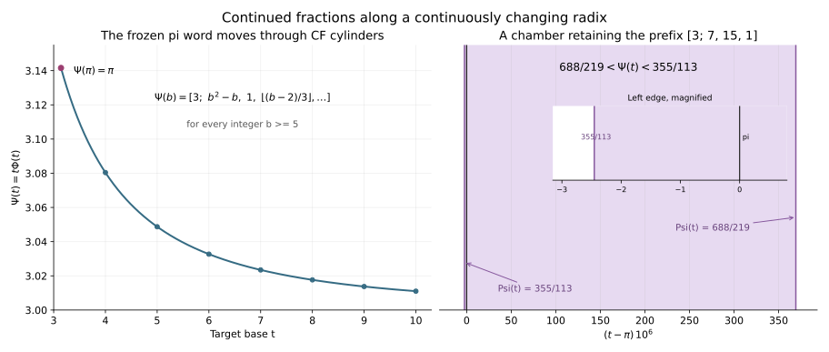

# 迁移曲线上的连分数：稳定区间、跨层不变量与整数底数规律

2026-10-31。接续最新的[交叉网络](../cross-base-transport-2026-10-31/CROSSING_NETWORKS.md)、[谱交点](../cross-base-transport-2026-10-31/SPECTRAL_CROSSINGS.md)及[算术层](ARITHMETIC_LAYERS_AND_CONSTRUCTIVE_BASES.md)。

**状态：给出明确曲线、证明和有限认证。没有证明或证伪 P2848，没有证明指定整数底数下的运输值超越。** 形式 Laurent 级数的连分数及其整数特化属于已有方法；本记录研究它们在仓库这条 π 原生数位曲线上的具体表现，不主张一般方法首创。

## 1. 选择一条在原生底数处确实经过 π 的曲线

沿用原生单位串
\[
d=301102111002022113\cdots,\qquad
\Phi(t)=\sum_{n\ge1}d_nt^{-n},\qquad \Phi(\pi)=1.
\]
把这个固定位置对象左移一位，定义
\[
\boxed{\Psi(t)=t\Phi(t)=3+t^{-2}+t^{-3}+2t^{-5}+t^{-6}+\cdots.}
\tag{1}
\]
于是 \(\Psi(\pi)=\pi\)。这使出发点的普通连分数确实是 π 的连分数。

选择表示对象是必要的：有限对象 \((10)_\pi\) 同样表示 π，但它运输后是 \(t\)；无限对象 \((3.01102111\ldots)_\pi\) 运输后是 \(\Psi(t)\)。它们在原生底数相等，之后分离。在整数底数 b≥4，前者是整数 b，后者是无理数 \(b\Phi(b)\)。所以迁移保留的是选定的位置对象，并没有定义一个与表示无关的“所有实数换底同态”。

由非负系数与 d₃=1，
\[
\Psi'(t)=-\sum_{n\ge3}(n-1)d_nt^{-n}<0.
\]
因为 d 不最终循环，它有无限多个非零数位，故单调收敛给出 t↓1 时 Ψ(t)→∞；t→∞ 时 Ψ(t)→3。于是它把 (1,∞) 解析地一一映到 (3,∞)。记逆函数为 \(\sigma\)。在原生点，
\[
m=\sum_{n\ge1}nd_n\pi^{-n},\qquad
\boxed{\Psi'(\pi)=1-m<0.}
\tag{2}
\]
下文 t>π 描述向更大底数的迁移；涉及 π 的双侧有理逼近时，明确允许 t 在 π 两侧的小邻域变化。同一数位级数在 t>1 始终有意义；t<π 时不声称它仍是目标底数的规范贪心展开。

## 2. 连分数前缀就是底数轴上的嵌套区间

把“连分数基因”具体定义为有限前缀 w=(a₀; a₁,…,aₙ)。设相应收敛分数为 pₙ/qₙ，采用
\[
p_{-2}=0,\ p_{-1}=1,\quad q_{-2}=1,\ q_{-1}=0,
\quad p_j=a_jp_{j-1}+p_{j-2},\ q_j=a_jq_{j-1}+q_{j-2}.
\]
所有具有此前缀的无理数处在两个有理端点之间：
\[
e_0=\frac{p_n}{q_n},\qquad
e_1=\frac{p_n+p_{n-1}}{q_n+q_{n-1}}.
\tag{3}
\]
这是由尾变量 u∈(1,∞) 的公式
\[
x=\frac{p_nu+p_{n-1}}{q_nu+q_{n-1}}
\]
直接得到的。端点的有理数双展开不影响开区间内无理数的前缀。

当两个端点均大于 3 时，相同前缀在迁移曲线上的稳定区间就是
\[
\boxed{J_w=\bigl(\sigma(\max(e_0,e_1)),\sigma(\min(e_0,e_1))\bigr).}
\tag{4}
\]
若端点为 3，则以 \(\sigma(3)=+\infty\) 理解。添加一个部分商，会把这个区间分成更小的子区间。每一条有理边界都是曲线 \(q\Psi(t)-p\) 的唯一零点。

行列式恒等式 \(|p_nq_{n-1}-p_{n-1}q_n|=1\) 给出数值区间宽度
\[
|e_1-e_0|=\frac1{q_n(q_n+q_{n-1})}.
\]
因此若 \(J_w\subset[A,B]\subset(1,\infty)\)，且
\(0<\ell\le-\Psi'\le L\)，则
\[
\boxed{\frac1{Lq_n(q_n+q_{n-1})}\le |J_w|
\le\frac1{\ell q_n(q_n+q_{n-1})}.}
\tag{5}
\]
例如可直接取 \(\ell=2/B^3\)，以及
\(L=3\sum_{k\ge2}kA^{-k-1}\)。这是把分母的平方尺度转化为底数稳定区间的严格方式。

对 π 的任一固定前缀，π 都处在对应 J_w 内部，所以足够小的迁移保留这个前缀。**没有一个共同的正半径能保留全部无限前缀**：否则同一开区间上 Ψ 恒等于 π，与严格单调性矛盾。

还要区分两种小尺度。在当前数值柱集中，指定下一部分商恰为整数 A≥1 的子区间宽度是
\[
\frac1{(Aq_n+q_{n-1})((A+1)q_n+q_{n-1})};
\]
允许下一部分商大于等于 A 的整个端部宽度则为
\[
\frac1{q_n(Aq_n+q_{n-1})}.
\]
前者是单个子区间的约 1/(A²qₙ²) 尺度，后者是靠近收敛分数端点的约 1/(Aqₙ²) 尺度；经 σ 迁移还要乘局部逆导数。这两个尺度不能混同。

## 3. 分段解析的完整商，以及真正跨层不变的量

在固定前缀的区间内，第 n+1 个完整商是
\[
X_{n+1}(t)=
\frac{p_{n-1}-q_{n-1}\Psi(t)}{q_n\Psi(t)-p_n}.
\tag{6}
\]
它满足 \(a_{n+1}(t)=\lfloor X_{n+1}(t)\rfloor\)。因此曲线连续解析，而部分商呈分段常值；跳变发生在完整商穿越整数、即 Ψ 命中相应有理数时。

对 (6) 求导，得到
\[
\boxed{|X_{n+1}'(t)|=
\frac{|\Psi'(t)|}{|q_n\Psi(t)-p_n|^2}.}
\tag{7}
\]
靠近有理交点时，深层连分数坐标会放大微小底数变化。曲线本身不需要出现奇点；奇点可以来自用于读取连分数的分式坐标。

定义 Schwarzian 导数
\[
\mathcal S_t f=\frac{f'''}{f'}-\frac32\left(\frac{f''}{f'}\right)^2.
\]
每个 X 是 Ψ 的可逆 Möbius 后复合，故在其定义区间内
\[
\boxed{\mathcal S_tX_{n+1}=\mathcal S_t\Psi.}
\tag{8}
\]
证明可以直接将 (6) 的三阶导数代入；等价地使用 \(\mathcal S(M\circ f)=\mathcal Sf\)，其中 Möbius 变换 M 的 Schwarzian 为零。式 (8) 的含义是**不同连分数深度共享一个函数**，不是说这个函数随底数 t 保持常数。

## 4. 整数底数的明确规律：整数部分之后的前三个部分商

对每个整数 b≥5，都有
\[
\boxed{\Psi(b)=
\left[3;\ b^2-b,\ 1,\ \left\lfloor\frac{b-2}{3}\right\rfloor,\ldots\right].}
\tag{9}
\]
第一项 \(a_1=b^2-b\) 也对 b=4 成立；b=4 的 a₂=2 是后面公式的例外。

以下证明只需很短的原生前缀和全部未知数位的统一界 0≤dₙ≤3，不依赖有限实验外推。

令 w=Ψ(b)−3、a=b²−b。由已知前缀，
\[
L=b^{-2}+b^{-3}+2b^{-5}<w<
U=L+b^{-6}+\frac3{b^6(b-1)}.
\tag{10}
\]
两边严格是因为已知后续非零数位，且余下数位不恒为 3。

先用较粗的界
\[
b^{-2}+b^{-3}<w< b^{-2}+b^{-3}+\frac3{b^4(b-1)}
\]
可得对于 b≥4，\(1/(a+1)<w<1/a\)，故 \(a_1=a\)。具体地，左下界比 1/(a+1) 大；右上界不超过 1/a，因为相乘后的剩余量是 \((b-3)/b^3\)。

对 b≥5，直接清正分母验证
\[
\frac{b+2}{(b-1)(b+1)^2}<L<U<\frac{b+1}{b^3-2}.
\tag{11}
\]
第一个差的正分子为 \(b^2-2b-2\)；最后一个差的正分子为 \((b-2)(b^3-2b^2-2)\)。

置
\[
V=\frac{1-aw}{(a+1)w-1}.
\]
由 (11) 及 V 关于 w 严格递减，
\[
\frac{b-2}{3}<V<\frac{b-1}{3}.
\tag{12}
\]
于是 V>1，而
\(X_2=1/(1/w-a)=1+1/V\in(1,2)\)，故 a₂=1、X₃=V。对整数 b，(12) 两端之间不跨整数边界，得到 (9)。

b=4 的例外也可直接用 (10) 验证：L(4)>2/25、U(4)<3/37，所以 \(X_2=w/(1-12w)\in(2,3)\)，确有 a₂=2。

## 5. 任意固定深度：最终按余数类给出多项式

**命题。** 对每个固定 k，存在整数 M、阈值 B 和有理系数多项式 \(P_{j,r}(T)\)，使得所有整数 b≥B、b≡r (mod M) 都满足
\[
a_j(\Psi(b))=P_{j,r}(b),\qquad 0\le j\le k.
\tag{13}
\]
这称为部分商关于整数底数的“最终准多项式”性质。M、B 可以依赖 k，不存在本记录已经证明的统一阈值或统一周期。

**独立证明。** Ψ 在无穷远有收敛的、有理系数 Laurent 展开，且不是有理函数：若 Ψ 是有理函数，则 Φ=Ψ/t 也是有理函数，与 Φ(π)=1、π 超越及 Φ 非恒定矛盾。

归纳地，在某个整数等差数列 b=Mℓ+r 上，已经确定的部分商是 ℓ 的有理多项式，当前完整商 f(ℓ) 是 Ψ(Mℓ+r) 的可逆分式线性变换，其系数属于 Q(ℓ)。因此 f 非有理，并在 ℓ=∞ 处亚纯，具有收敛的有理 Laurent 展开。写成
\[
f(\ell)=P(\ell)+c\ell^{-h}+O(\ell^{-h-1}),
\quad P\in\mathbb Q[\ell],\ c\ne0,\ h\ge1.
\]
非有理性保证多项式部分之后确有首个非零项。

取 P 的系数公分母 D，再按 ℓ mod D 细分。在每个子等差数列上，P(ℓ) 的小数部分是一个固定有理数 θ。若 θ>0，足够大时 floor f=P−θ；若 θ=0，则由 c 的符号决定 floor f=P 或 P−1。于是本层部分商在各子类上成为有理多项式。减去该多项式再取倒数，仍是上述同类非有理亚纯函数。重复有限 k 次，合并有限个模数与阈值，得 (13)。∎

这解释了为何把底数也当作变量可以显露普通数表中不明显的规律。它研究的是 **k 固定、b→∞**；P2848 研究的是 **b=π 固定、k→∞**。交换这两个极限需要新的、一致的估计，不能由 (13) 自动完成。

## 6. 如何接回 π 的逼近指标

对趋于 π 的有理数 p/q>3，定义其交点底数 \(t_{p/q}=\sigma(p/q)\)。由逆函数 Taylor 展开，
\[
\boxed{t_{p/q}-\pi=
-\frac{p/q-\pi}{m-1}+O((p/q-\pi)^2).}
\tag{14}
\]
因而对 π 的收敛分数 pₙ/qₙ，
\[
q_n^2|t_{p_n/q_n}-\pi|
=\frac{q_n^2|\pi-p_n/q_n|}{m-1}+O(q_n^{-2}).
\tag{15}
\]
所以 P2848 等价于：存在 q→∞ 的有理标签 p/q，其交点在 **π 的双侧邻域** 内满足
\[
q^2|t_{p/q}-\pi|\longrightarrow0.
\tag{16}
\]
若只允许 t>π，则只观察 p/q<π 的一侧逼近；不能未经证明便把这一侧条件说成 P2848 的等价形式。

式 (14)—(16) 诚实保留了原问题的难度。曲线的解析性、严格单调性和有限阶导数本身不会证明异常交点无限接近。需要从 π 特定数位获得随连分数深度增长仍有效的估计。

## 7. 实际认证：π 附近的稳定区间和整数底数

[验证程序](verify_continued_fraction_migration.py)使用 192 个经过严格区间认证的原生数位。98 个整数底数（4—100 以及 1000）各认证了 12 项普通连分数。表中列出部分输出，省略号后的项目没有在表中断言：

| 底数 b | Ψ(b) 的已认证连分数前缀 |
|---|---|
| 4 | [3; 12, 2, 3, 1, 1, 8, 24, …] |
| 5 | [3; 20, 1, 1, 9, 4, 2, 2, …] |
| 6 | [3; 30, 1, 1, 2, 3, 1, 2, …] |
| 10 | [3; 90, 1, 2, 1, 3, 2, 2, …] |
| 20 | [3; 380, 1, 6, 9, 3, 1, 9, …] |
| 100 | [3; 9900, 1, 32, 1, 3, 2, 16, …] |
| 1000 | [3; 999000, 1, 332, 1, 3, 2, 166, …] |

这些有限检查支持但不代替第 4 节的全称证明。更深的模 3、模 6 规律及其多项式正性证书见[余数类定律](CF_RESIDUE_LAWS.md)。

π 的前缀 [3;7,15,1] 对应数值区间
\[
688/219<\Psi(t)<355/113.
\]
两个底数端点经过有理区间认证，宽度均为 2⁻¹¹²。下表小数仅是严格证书的阅读近似：

| 端点定义 | 端点与 π 的差 |
|---|---:|
| Ψ(t)=355/113 | −0.000002453604924371617390795… |
| Ψ(t)=688/219 | +0.000369294569194146164081326… |

因此从 π 向上移动底数时，在第二个端点之前仍保留 [3;7,15,1]；更深的部分商会在其内部变化。另认证了 22/7、333/106、103993/33102 的交点，总计五个有理边界，并实际触发检查了二分法中“中点区间含目标”的导数回退步骤。

认证得到
\[
m=1.10872321030470022127174327218917409517\ldots,
\quad \frac1{m-1}=9.19766807103532450496530139606188065678\ldots.
\]
这些常数将交点底数距离与原有理逼近误差联系起来。

图像用浮点绘制；放大图先对有理证书作精确相减，再转换显示，避免 π 附近的浮点消减误差。完整外包区间与检查范围见 [cf_migration_results.json](cf_migration_results.json)。

另一个具体几何结果及验证见 [Schwarzian 与共同二阶方程](SCHWARZIAN_ODE_BRIDGE.md)：本曲线在 t≥3 上的 Schwarzian 严格为负，并把所有带整数标签的逼近误差组织成同一个二阶线性微分方程的解。

## 8. 文献位置与本轮可复现内容

形式级数的“取多项式部分—求逆”算法和特化后正则化可参见：

- A. J. van der Poorten, [Continued fractions of formal power series](https://web.williams.edu/Mathematics/sjmiller/public_html/mathlab/public_html/book/papers/vdp/Poorten_ContFracsOfFormalPowerSeries.pdf)，§2 明确定义形式 Laurent 连分数，并讨论与实数连分数的区别。
- A. J. van der Poorten, J. Shallit, [A Specialised Continued Fraction](https://doi.org/10.4153/CJM-1993-058-5)，1993。其方法包括将形式变量特化为整数；不是所有形式多项式部分商都可直接视为正整数部分商。
- Qian Hu, [Certain Hidden Stabilities of Continued Fraction Arithmetic, with applications to classical constants and functions of analysis](https://scholars.unh.edu/dissertation/2988/)，2026 博士论文。官方摘要明确描述有理渐近 Laurent 级数与最终准多项式部分商之间的联系。本轮读到了官方摘要，全文下载被服务器拒绝，因此没有声称核对其全部定理假设或证明。第 5 节针对本例给出了独立证明。

本记录的具体新增连接是：选择经过 π 的原生对象 Ψ；将仓库已有交叉网络与连分数柱集连接；证明整数底数上的显式前三项规律；说明固定深度规律与固定底数无穷深度问题之间尚缺的估计。
