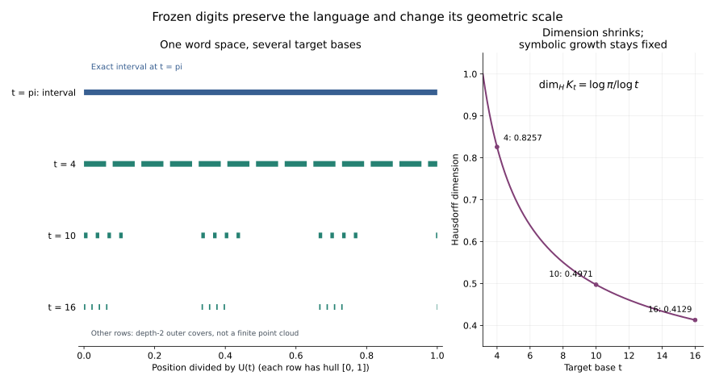

# 连续改变底数：对象迁移、裂缝计数与微分不变量

2026-10-31。接续 [π 原生算术](../pi-intrinsic-arithmetic-2026-10-31/README.md)及[绝对收敛边界](../pi-intrinsic-arithmetic-2026-10-31/BOUNDARY_KERNEL_AND_MODULAR_STRUCTURE.md)。本轮研究的是底数从 π 连续增大时，保留同一数位对象会发生什么。

**状态：下列结果有明确证明，有限实验用于核验。没有证明或证伪 P2848，也没有证明本记录中的十进制值 Φ(10) 是超越数。** 非整数底数变换与 Cantor 型函数已有文献；这里将它们与仓库的整数返回计数、进位核和收敛空间接在一起，不主张基本框架或所有命题的文献首创。

本轮最直接的结果是：整个 π 合法数位空间在任意 t>π 下成为一个 Cantor 集；旧计数 c_n 恰好数出第 n 层裂缝，且“维数 × 对数底数”保持不变。单个对象的迁移另有精确的算术分类、向量场和接触阶数。

同日的[单串跨底数运输](../cross-base-transport-2026-10-31/README.md)和[代数/超越值纤维](../cross-base-transport-2026-10-31/ALGEBRAIC_TRANSCENDENTAL_FIBERS.md)已记录整数底数无理性、Laplace 矩流及可数稠密的代数值参数集。本文保留这些必要定义与短证明作为衔接，进一步加入函数超越性、泛型代数独立性、整体空间裂缝/维数、临界深度分布及进位关系的 Taylor 阶数。

## 1. 固定运输规则：保留数位对象

采用通常位值约定：单位仍是 1；一位左移乘以底数。选择一条有界数位串 a=(a_1,a_2,...) 后，定义它在底数 t>1 的值

\[
E_t(a)=\sum_{n\ge1}a_nt^{-n}.
\tag{1}
\]

本轮固定 a，改变 t。数位与位置是被运输的对象；数值允许变化。若改为固定一个实数、每次重新计算其 t 进制展开，则该数的整数、有理、超越性质都保持不变，那是另一种运输规则。

π 的单位串记为 d=(d_n)，由 r_0=1、d_n=⌊πr_{n-1}⌋、r_n=πr_{n-1}−d_n 生成。沿用

\[
d=301102111002022113000102\cdots,
\qquad
D(z)=1-\sum_{n\ge1}d_nz^n,
\qquad C(z)=D(z)^{-1}=\sum_{n\ge0}c_nz^n.
\tag{2}
\]

这里 z 是形式变量；c_0=1，c_n=Σ_{j=1}^n d_jc_{n-j}。令

\[
\rho=1/\pi,\qquad m=\sum_{n\ge1}n d_n\rho^n,
\qquad \Phi(t)=E_t(d),\qquad \delta(t)=1-\Phi(t)=D(1/t).
\tag{3}
\]

旧结果给出 c_nρ^n→1/m，以及误差 O((2/π)^n)。本轮只在 t≥π 下运输 π 合法串；任意数字 0,...,3 的串不一定在 π 底数下合法。

## 2. 有限、周期与无限对象的算术迁移

### 2.1 有限或最终循环对象

有限位置表达式是整数 Laurent 多项式。最终循环数位串求和后是有理函数。因此对任意非恒定 R∈Q(T)，在没有极点的位置，

\[
\boxed{t\text{ 是代数数}\quad\Longleftrightarrow\quad R(t)\text{ 是代数数}.}
\tag{4}
\]

正向来自代数数的四则运算封闭。反向若 R(t)=α 是代数数，则将 R=A/B 写成互素有理多项式之比；A(T)−αB(T) 不是零多项式，故 t 在代数数域上代数，从而在 Q 上代数。非恒定条件不能删去。

例如 (100)_t=t²：在 t=π 时为超越数，在 t=√10>π 时为整数 10，在 t=10 时为整数 100。轨迹是光滑的；算术标签并不随底数单调变化。

进一步，在统一位置环 Z[T,T^{-1}] 中，求值 T↦t 的核为

\[
\ker E_t=
\begin{cases}
0,&t\text{ 超越},\\
(m_t),&t\text{ 代数},
\end{cases}
\tag{5}
\]

其中 m_t 是 t 的本原不可约整系数最小多项式。代数情形用 Gauss 引理，再允许乘 T 的整数次幂；t>1 保证 T 不在核中。有限进位关系在代数底数出现，在超越底数消失。例如 √10 的关系为 T²−10，10 的关系为 T−10。

不同有限对象之间在 π 处成立的有理多项式关系，也在全部底数保持：代入各对象后得到一个有理 Laurent 多项式，它在 π 处为零，只能是恒等式。代数底数可能增加额外关系。对整个域 Q(π) 则不能无条件运输到 10，因为对象 1/(π−10) 会遇到极点。

### 2.2 无限单位串：整数 1 如何迁移

Φ 在 (1,∞) 实解析，Φ(π)=1，Φ'(t)=−Σn d_nt^{-n-1}<0，且趋于 0。因此 Φ 将 (π,∞) 一一映到 (0,1)。

**整数底数结论。** 对每个整数 b≥4，Φ(b) 都是无理数。

证明：d 若最终循环，等式 Σd_nπ^{-n}=1 清分母后会给出 π 的非零整系数多项式。故 d 不最终循环。它在整数底数 b≥4 下仍是合法数字串，而有理数的整数底数展开最终循环，所以 Φ(b) 无理。整数底数的边界双展开都最终循环，不构成例外。

因而同一个 d 在 π 底数中表示整数 1，在十进制中表示

\[
\Phi(10)=0.301102111002022113000102\cdots,
\tag{6}
\]

在十六进制中也表示无理数。**这里没有证明 Φ(10) 或 Φ(16) 超越。**

对连续参数可证明更多：有理值与代数无理值各自的命中底数都是可数稠密集；其余底数给出超越值。因为 Φ 是到 (0,1) 的严格单调连续双射，而两类代数目标值各自可数稠密。这意味着每个底数区间内三类取值都存在；“慢慢变化”适用于数值轨迹，不适用于单调的算术分类。

**函数超越性与泛型代数独立性。** Φ(t) 在 Q(t) 上是超越函数。否则选不可约 P(T,Y)∈Q[T,Y]，满足 P(t,Φ(t))≡0。令 t=π 得 P(π,1)=0，因此 P(T,1) 恒为零；于是 Y−1 整除 P。不可约性迫使 Φ 恒等于 1，矛盾。

对任意非零 P，解析函数 P(t,Φ(t)) 因而不恒为零，零集至多可数。Q[T,Y] 也可数，所以

\[
\boxed{\text{除至多可数个 }t>\pi\text{ 外，}t\text{ 与 }\Phi(t)\text{ 在 Q 上代数独立。}}
\tag{7}
\]

所有代数底数本来就在例外集合内；(7) 仍不能决定 Φ(10)。

## 3. 微分方程作用在位置权重上

取固定的非零、有界、非负数位串 a，令 s=log t，位置权重为 z_n(s)=a_ne^{-ns}，总值为 Z(s)=Σz_n(s)。在任何 s>0 的紧区间上可逐项微分：

\[
\frac{dz_n}{ds}=-nz_n,\qquad
\frac{dZ}{ds}=-\sum n z_n.
\tag{8}
\]

这是位置权重空间中的对角向量场。整数数位 a_n 本身不变；这里没有把实数缩放后的系数误认成原整数系数环的元素。

把各位置的贡献归一化成概率 P_n=z_n/Z，并令 μ=ΣnP_n，则

\[
\boxed{P_n'=(\mu-n)P_n,\qquad
\mu'=-\sum(n-\mu)^2P_n.}
\tag{9}
\]

所以升高底数会把相对权重推向较浅的位置，平均位置 μ 不增；同时 (log Z)''=Var_P(n)≥0。这里的概率是确定数位的贡献比例，不是假设数位随机。

一个具体不变量是：对三个非零数位的位置 i<j<k，

\[
\boxed{\frac{P_j^{k-i}}{P_i^{k-j}P_k^{j-i}}
=\frac{a_j^{k-i}}{a_i^{k-j}a_k^{j-i}}.}
\tag{10}
\]

指数中的 s 与归一化因子 Z 同时消掉。π 单位串 d_1=3、d_3=d_4=1 给出 P_3³/(P_1P_4²)=1/3，沿整个底数轨迹保持。

保留数值一个坐标不足以定义共同的运输速度。例如有限表达式 1 与无限串 d 在 π 处同值，但前者的 s 方向速度为 0，后者为 −m。必须保留展开状态，才能区分它们的迁移。

## 4. 整个 π 空间迁移为 Cantor 集

令 Σπ 是 [0,1) 的贪心 π 展开的闭包，保留边界双展开。等价地，Σπ 是数字 0,...,3 上每个后缀都在字典序下不大于 d 的串集合。令

\[
\mathscr K_t=\{E_t(a):a\in\Sigma_\pi\}.
\tag{11}
\]

这是源 π 空间的移植像，不是目标 t 底数的全部合法数。

### 4.1 合法性、分离与连续变化

对任一源合法后缀 a，Eπ(a)≤1，并且

\[
E_t(a)\le(\pi/t)E_\pi(a)\le\pi/t<1\quad(t>\pi).
\]

所以这些串在新底数下都是贪心合法串。若两串首次在第 k 位不同，第 k 位差至少为 1，后面的尾值最多为 π/t，故目标距离至少为 (1−π/t)t^{-k}，并保持字典序。由于 d 是最大的合法串，所有目标尾值实际上至多 Φ(t)，因此可加强为

\[
\boxed{\delta(t)t^{-k}\le|E_t(a)-E_t(b)|\le4t^{-k}.}
\tag{12}
\]

于是任意 t>π 都能区分 Σπ 中所有展开历史。在 π 处同值的 1000... 与 0d，到 t 后分开 δ(t)/t。

Σπ 是紧致、无孤立点的符号空间。无孤立点可从有限前缀的源贪心圆柱区间有正长度得到；π 超越排除了有限源前缀恰好等于边界 1。结合 (12)，K_t 是紧致、无孤立点的全不连通集，即 Cantor 集。

整个集合族仍以 Hausdorff 距离连续变化，因为有界数字逐项求导给出

\[
d_H(\mathscr K_t,\mathscr K_s)
\le\frac{3|t-s|}{(\min\{s,t\}-1)^2},\qquad s,t\ge\pi.
\tag{13}
\]

在 t=π 时 Kπ=[0,1]。集合连续变化不意味着各 K_t 嵌套，也不意味着对应的源数值映射连续。

### 4.2 几何不变量

**定理。** 对 t>π，

\[
\boxed{\dim_H\mathscr K_t=\frac{\log\pi}{\log t},
\qquad (\dim_H\mathscr K_t)\log t=\log\pi.}
\tag{14}
\]

证明：长度 n 的合法前缀数 N_n=Σ_{j=0}^n c_j，计数证明见下一节。将返回递推乘以 ρ^n，因 Σd_kρ^k=1，可归纳得 0<c_nρ^n≤1。因此 N_n≤π^{n+1}/(π−1)。每个前缀在目标空间中的直径至多 t^{-n}，覆盖给出维数上界 logπ/logt。

下界可直接看逆方向的投影 G=Eπ∘E_t^{-1}:K_t→[0,1]。令 η=logπ/logt。两串首次不同位为 k 时，源距离至多 π^{-(k-1)}；用 (12) 得

\[
|G(y)-G(y')|\le\pi\delta(t)^{-\eta}|y-y'|^\eta.
\]

G 是满射且 η-Hölder，覆盖定义给出 1=dim_H[0,1]≤dim_HK_t/η，完成下界。特别地每个 t>π 时 K_t 的 Lebesgue 长度为零。

维数随底数增大而减小；其与 log t 的乘积保持。对应的符号前缀增长率始终为 π。这是保留同一符号空间、改变位置尺度得到的几何不变量。

## 5. 旧计数 c_n 成为裂缝数量

### 5.1 前缀与有限端点计数

合法 n 位前缀按与 d 的首次不同位置分类，给出

\[
N_0=1,\qquad N_n=1+\sum_{j=1}^n d_jN_{n-j}.
\]

第一项是 d 的 n 位前缀；在第 j 位首次严格减小有 d_j 个选择，随后可接任意合法后缀。生成函数因此为 1/((1-z)D(z))，故 N_n=Σ_{j=0}^n c_j。

末位为 0 的 n 位前缀与全部 n−1 位前缀一一对应。所以末位非零、最短有限展开长度为 n 的词，恰有 N_n−N_{n-1}=c_n 个。

### 5.2 每条裂缝的精确宽度

对这样的词 w=w_1...w_n，定义

\[
R_w=w_1\cdots w_n0^\infty,
\qquad L_w=w_1\cdots w_{n-1}(w_n-1)d.
\]

两串在 π 处同值，都属于闭空间 Σπ。L_w 是从该源端点左侧趋近的展开极限。两者在字典序下相邻：较低的第 n 位后接最大合法尾 d，较高的第 n 位后接最小尾 0。于是

\[
\boxed{(E_t(L_w),E_t(R_w))\text{ 是裂缝，宽度为 }\delta(t)t^{-n}.}
\tag{15}
\]

反过来，任一裂缝的右端点在首次不同位后必须全为 0，否则截断串落在中间；该位只能差 1，否则可插入另一有限串；左端点的尾必须是 d，否则可插入上述 L_w。因此 (15) 穷尽全部裂缝。

不同末位非零词的源有限值不同，否则 π 满足非零整数多项式，故没有重复记账。第 n 层恰有 c_n 条裂缝，全部宽度之和为

\[
\boxed{\sum_{n\ge1}c_n\delta(t)t^{-n}
=\delta(t)(C(1/t)-1)=\Phi(t).}
\tag{16}
\]

这正好等于外包区间 [0,Φ(t)] 的长度。旧形式恒等式 DC=1 因而获得一个几何解释：返回计数控制跨底数裂缝的全部长度。

### 5.3 对源数值的映射是纯跳跃函数

对 x∈[0,1) 选唯一的源贪心展开 a(x)，定义 T_t(x)=E_t(a(x))。它严格递增、右连续，在有限 π 展开点跳跃，在其他点连续。长度 n 的跳点幅度为 δ(t)t^{-n}。

有限端点在源区间稠密；全部跳幅总和 Φ(t) 等于 T_t(1−)−T_t(0)。所以 T_t 是纯跳跃函数，关于 x 的导数几乎处处为 0。也可精确写成

\[
T_t(x)=\delta(t)\sum_{x_w\le x}t^{-|w|},
\tag{17}
\]

其中求和遍历末位非零的合法有限词，x_w=Eπ(R_w)。跳点虽稠密，级数绝对收敛。

**两种方向不同：** 固定源展开，关于底数 t 的轨迹解析；固定目标底数，关于源数值 x 的映射有稠密跳点。并且 T_t 随 t↓π 一致趋于恒等映射，尽管每个 t>π 都是纯跳跃函数。

## 6. 临界位置：原来越界的形式逆开始收敛

令 ε=log(t/π)>0，并定义 p_n=d_nπ^{-n}，所以 Σp_n=1、Σnp_n=m。则

\[
\Phi(\pi e^\varepsilon)=\sum p_ne^{-n\varepsilon},
\qquad
\delta(\pi e^\varepsilon)=m\varepsilon-\frac12\Big(\sum n^2p_n\Big)\varepsilon^2+O(\varepsilon^3).
\]

旧形式逆满足

\[
\boxed{C(1/t)=\frac1{\delta(t)}\sim\frac1{m\varepsilon}.}
\tag{18}
\]

在 π 处 c_nπ^{-n} 不趋 0，故不能求和；每个 t>π 却绝对收敛。若定义 B_t 为系数指数增长率严格小于 t 的整数级数环，则 C∈B_t，D 在 B_t 中成为单位。特别地 D B_t=B_t。因此不能把旧 π 求值关系 D=0 原封不动保留到更大的环；那样会把 1 也商成 0。

### 6.1 裂缝深度的尺度极限

在 [0,Φ(t)] 中均匀选一点，它几乎必落入裂缝。记这条裂缝的层数为整数随机变量 N。这里随机的是选点，不是 π 的数位。由 (15)—(16)，

\[
\Pr_t(N=n)=\frac{\delta(t)c_nt^{-n}}{\Phi(t)},\qquad n\ge1.
\tag{19}
\]

利用 c_nπ^{-n}→1/m、δ(t)/ε→m，得到

\[
\boxed{\varepsilon N\ \Longrightarrow\ \mathrm{Exp}(1)
\quad(t\downarrow\pi).}
\tag{20}
\]

证明：其 Laplace 变换为 δ/Φ·Σ_{n≥1}(c_nπ^{-n})e^{-(1+λ)εn}；把 c_nπ^{-n} 替换为极限 1/m，有限前缀贡献趋 0，尾部误差任意小，几何级数给出极限 1/(1+λ)。这就是均值为 1 的指数分布的 Laplace 变换。

另有精确均值

\[
\mathbb E_tN=\frac{M_1(t)}{\Phi(t)\delta(t)},
\qquad M_1(t)=\sum n d_nt^{-n},
\qquad \varepsilon\mathbb E_tN\to1.
\tag{21}
\]

式 (21) 由对 C=1/δ 关于 s=logt 求导得到。底数刚离开 π 时，总裂缝长度已经占满外包区间，但典型裂缝层数约为 1/log(t/π)，退到越来越深的位置。

## 7. 进位关系的微分接触阶是不变量

沿用旧环 Bπ={Σa_nz^n:a_n∈Z, limsup|a_n|^{1/n}<π}。旧结论为 ker Eπ=D Bπ。对 F∈Bπ，定义底数方向轨迹

\[
\Psi_F(\varepsilon)=F(\rho e^{-\varepsilon}).
\]

它在 ε=0 的邻域解析。因 Ψ_D(ε)=mε+O(ε²)，逐次使用旧主理想定理得到

\[
\boxed{\Psi_F(\varepsilon)=O(\varepsilon^k)
\quad\Longleftrightarrow\quad F\in D^k B_\pi.}
\tag{22}
\]

每次在源底数求值为零，就在 Bπ 中除去一个 D；D 的零点是单的，恰降低一阶。非零 F 的阶数有限。若 F=D^kA 且 A(ρ)≠0，则

\[
\Psi_F(\varepsilon)=m^kA(\rho)\varepsilon^k+O(\varepsilon^{k+1}).
\tag{23}
\]

该阶数在导数非零的底数重参数化下保持，乘法时相加。D 在一阶分裂，D² 的一阶速度为零、二阶分裂；这保留了单纯求值会遗忘的信息。

还可把全部有限阶信息组织为环同构：对整数 k≥0，

\[
\boxed{B_\pi/(D^{k+1})\cong\mathbb R[\varepsilon]/(\varepsilon^{k+1}).}
\tag{24}
\]

映射取 Ψ_F 的 k 阶 Taylor 多项式。核由 (22) 给出。满射证明：Eπ:Bπ→R 满射，因为任意实数可用有限整数部分与有界 π 数位表示；先匹配常数项，再逐阶加入 D^jA_j，用 Eπ(A_j) 任意选定第 j 阶系数，不改动较低阶。此证明不要求预先选定 R→Bπ 的环截面。

### 7.1 收敛边界允许非解析响应

上一轮构造 b_n=⌊c_n/(n+1)⌋、B=Σb_nz^n、F=DB。它在 π 处绝对收敛且求值为零，但 B 不绝对收敛。由旧渐近

\[
b_n\rho^n=\frac1{m(n+1)}+O((2/\pi)^n)
\]

以及 Σ_{n≥0}r^n/(n+1)=−log(1−r)/r，得到

\[
B(\rho e^{-\varepsilon})=\frac1m\log(1/\varepsilon)+O(1),
\qquad
\boxed{\Psi_F(\varepsilon)=\varepsilon\log(1/\varepsilon)+O(\varepsilon).}
\tag{25}
\]

所以这个边界对象连续迁移，但在出发点没有有限的右导数。它不属于 Bπ，故不与 (22) 的解析整数阶结论冲突。空间选择会影响能否使用通常的微分模型。

## 8. 本轮完成的内容与尚缺的算术信息

现在有三种明确的不变量：固定的合法语言及每层裂缝数 c_n；维数乘 logt；同值关系的微分接触阶。另外 (10) 给出位置权重向量场的显式不变量。

迁移同时改变三种性质：数值的算术类别、空间的几何维数、某些形式逆是否进入可求值空间。将它们分别定义，才能避免把有限串的超越性结论误用于无限串，或把目标底数的全空间与源空间的移植像混淆。

这里的裂缝律、维数律和临界分布大部分适用于一般源底数，不足以区分 π 与坏逼近数。连续参数中“除可数例外”的结论也不能决定固定底数 10，更不能决定 P2848。要接回 P2848，仍需 π 特有的定量信息；本轮没有获得控制增长模数和归一化有理逼近误差的估计。

## 9. 复现与文献位置

本次实际认证了 192 个原生数位，以两种独立判据核验 1—7 位合法词，并在每个目标底数 4、10、16 检查 404 条深度不超过 5 的裂缝互不相交。下表数值截短用于阅读，严格外包区间见 JSON；维数的小数仅用于显示。

| 目标底数 t | 单位串的运输值 Φ(t) | 空间维数 logπ/logt |
|---|---:|---:|
| π | 1（整数） | 1 |
| 4 | 0.770099768749851452…（已证无理） | 0.825748… |
| 10 | 0.301102111002022113…（已证无理） | 0.497149… |
| 16 | 0.187759522596032043…（已证无理） | 0.412874… |

图中 U(t) 与本文 Φ(t) 为同一个单位串运输值。左图各行都将位置除以 Φ(t)，只比较形状，不比较原始区间长度；t>π 的绿色部分为第 2 层外包，最终空间还会在其中继续出现裂缝。

- [verify_transport.py](verify_transport.py)：严格数位认证、有限合法词与裂缝计数、整数底数的有理外包区间。
- [transport_results.json](transport_results.json)：实际运行结果；以最终 JSON 记录的验证范围为准。
- [transport_geometry.svg](transport_geometry.svg)：有限层覆盖与维数曲线。图像使用浮点显示；无限定理依靠正文证明，不由图片或有限检查推出。

文献背景：

1. C. Baiocchi, V. Komornik, P. Loreti, [*Cantor type functions in non-integer bases*](https://arxiv.org/abs/1605.01470), 2016 preprint / Acta Math. Hungar. 153 (2017), 83–108。本文已核对其引言和 Theorems 1.1–1.6：固定数位的换底映射及其连续性、单调性和分形性质属于已有研究。该文主要采用二元数字及相应可表示区间；本记录针对整个 π 贪心闭空间，独立证明裂缝计数及所需维数公式。
2. Yao-Qiang Li, [*Hausdorff dimension of frequency sets in beta-expansions*](https://arxiv.org/html/1905.01481v3), §2 的 Parry 合法性准则与 §1 的符号空间/自然投影区分。自然投影的逆一般不 Lipschitz；本记录只对 t>π 的分离嵌入使用 (12)，没有假设源 π 求值本身具有 Lipschitz 逆。

以上引用定位标准背景；不将本文全部推导归给这些论文，也不宣称穷尽文献。未运行 Lean。

## 10. 后续：算术分辨率与可构造的超越底数

[有理命中层与可构造底数](ARITHMETIC_LAYERS_AND_CONSTRUCTIVE_BASES.md) 给出分母上限 Q 下的首次命中位置、Farey 目标的迁移密度、逆底数的带余项展开，并用嵌套有理区间构造可计算的代数独立对 (t*,Φ(t*))。还核对并应用 Pila 的有理/代数点计数与 McMullen 的 winning 定理，明确低复杂度值的稀疏性以及双 Liouville／双坏逼近点的共存。附 192 位认证的有限层检查和 16 阶段构造证书；Φ(10) 的超越性与 P2848 仍未解决。

## 11. 后续：迁移曲线上的连分数

[连分数迁移](CONTINUED_FRACTION_MIGRATION.md) 选择 Ψ(t)=tΦ(t)，使原生点满足 Ψ(π)=π。它给出有限连分数前缀的底数稳定区间、完整商的共同 Schwarzian，以及整数底数上明确的二次首商与模 3／模 6 规律；并独立证明每个固定深度的部分商最终为底数的准多项式。附 98 个底数、各 12 项连分数和五个有理交点的严格认证。补充记录分别证明[深层余数类定律](CF_RESIDUE_LAWS.md)与[负 Schwarzian／共同二阶方程](SCHWARZIAN_ODE_BRIDGE.md)。固定深度、底数趋大与固定底数 π、深度趋大仍是两个不同极限；P2848 未解决。

## 12. 后续：有理底数偏移与整数逃逸

[有理底数偏移](RATIONAL_BASE_DISPLACEMENT.md) 将 π 单位串在 p/q 底数中偏离 1 的大小与有理逼近质量精确连接。[整数余量与逃逸深度](RATIONAL_CARRY_ESCAPE.md) 进一步证明纯整数存活判据、两侧模窗口和分母不可约性质，并给出 √10 自身非循环单位串的统一有界对照。附 192 位原生数位、40 个收敛分数和 3 个对照底数的严格证书；π 的额外存活深度是否无界仍未解决。
