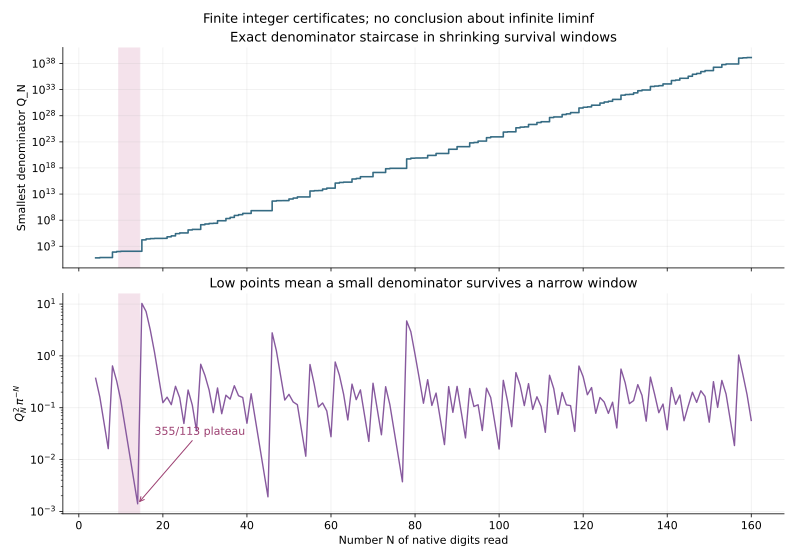

# 存活窗口、最小分母阶梯与长平台判据

2026-10-31。继续 [有理底数的整数逃逸](RATIONAL_CARRY_ESCAPE.md)。本轮实际执行“固定读取深度，寻找存活窗口内分母最小的有理数”的研究构想。

**状态：证明窗口的区间结构、渐近几何、严格最小分母算法，以及 P2848 与平台长度无界的等价性。认证第 4—160 层。没有证明平台长度无界，也没有证明或证伪 P2848。** 最小分母与 Stern–Brocot 算法是经典对象；本记录将其接到仓库的原生整数余量，不主张这些一般方法首创。

## 1. 从第 4 层起，整个存活集就是一个开区间

固定 π 的单位数位 d_n∈{0,1,2,3} 与原生余数
\[
r_0=1,\quad r_n=\pi r_{n-1}-d_n\in(0,1).
\]
定义整数系数多项式
\[
K_0(t)=1,\qquad K_N(t)=tK_{N-1}(t)-d_N
=t^N-\sum_{j=1}^Nd_jt^{N-j}.
\tag{1}
\]
在 t∈[3,4] 上取存活集
\[
I_N=\{t:|K_N(t)|<2\}.
\tag{2}
\]
这里固定输入数位，不在每个目标底数重新生成贪心展开。

**定理 1。** I_N 是包含 π 的区间，且 I_N⊂I_{N−1}。对 N≥4，存在唯一端点
\[
3<\ell_N<\pi<u_N<4,
\quad I_N=(\ell_N,u_N),
\quad K_N(\ell_N)=-2,\quad K_N(u_N)=2.
\tag{3}
\]
N≥4 时，两端在下一层都严格向内移动。

**证明。** 旧逃逸吸收性给出：K_j≥2 则 K_{j+1}≥3；K_j≤−2 则 K_{j+1}≤−6。因此存活到 N 必然存活到此前全部层，得到嵌套性。在 I_{N−1} 内，
\[
K_N'(t)=\sum_{j=0}^{N-1}t^{N-1-j}K_j(t)
\ge t^{N-1}-2\frac{t^{N-1}-1}{t-1}\ge1.
\tag{4}
\]
由归纳，上一层是区间，K_N 在其中严格递增，故它的 (−2,2) 原像仍是区间。π 始终在内，因为 K_N(π)=r_N∈(0,1)。又 K₄(3)=−4，而 K₂(4)=4，吸收性保证 N≥4 时左右两端均在 (3,4) 内。上一层端点的 ±2 会在下一层变为 ≤−6 或 ≥3，因此新端点严格内移。∎

两个端点都是代数无理数：它们是首一整系数多项式 K_N±2 的根；若端点有理，则必须为整数，但 (3,4) 内没有整数。因此有理数查询不会恰好命中端点。

## 2. 宽度主项统一，偏心位置保留原生余数

令旧常数
\[
m=\sum_{j\ge0}r_j\pi^{-j}=\sum_{n\ge1}nd_n\pi^{-n}>1.
\]
从两条递推相减得到有限恒等式
\[
\boxed{K_N(t)=r_N+(t-\pi)L_N(t),\qquad
L_N(t)=\sum_{j=0}^{N-1}r_jt^{N-1-j}>0.}
\tag{5}
\]
因此端点满足精确公式
\[
\ell_N-\pi=\frac{-2-r_N}{L_N(\ell_N)},\qquad
u_N-\pi=\frac{2-r_N}{L_N(u_N)}.
\tag{6}
\]

**定理 2。** N→∞ 时，以下误差常数与 N 无关：
\[
\boxed{\ell_N-\pi=
\frac{-2-r_N}{m}\pi^{1-N}+O(N\pi^{-2N}),}
\]
\[
\boxed{u_N-\pi=
\frac{2-r_N}{m}\pi^{1-N}+O(N\pi^{-2N}).}
\tag{7}
\]
故
\[
\boxed{|I_N|=\frac4m\pi^{1-N}+O(N\pi^{-2N}),}
\tag{8}
\]
\[
\boxed{\frac{\pi-\ell_N}{u_N-\ell_N}
=\frac{2+r_N}{4}+O(N\pi^{-N}).}
\tag{9}
\]
窗口中心偏移的展开为
\[
\frac{\ell_N+u_N}{2}-\pi
=-\frac{r_N}{m}\pi^{1-N}+O(N\pi^{-2N}).
\]

**误差控制。** 沿用 D(t)=1−F(t)=(t−π)R(t)，其中 1/t≤R(t)≤1/(t−1)，并有
\[
K_N(t)=t^ND(t)+T_N(t),\qquad 0\le T_N(t)\le3/(t-1)\le3/2.
\]
右端点给出 0<u_N−π≤8π⁻ᴺ。左端点先给 π−ℓ_N≤14ℓ_N⁻ᴺ≤14·3⁻ᴺ；再用
\[
(\pi/\ell_N)^N\le
\exp((14/3)N3^{-N})<2\quad(N\ge4)
\]
得 π−ℓ_N≤28π⁻ᴺ。另一方面，
\[
L_N(\pi)=m\pi^{N-1}+O(1),\qquad
L_N'(t)=O(N\pi^{N-2})
\]
在上述 O(π⁻ᴺ) 邻域内一致成立。因此 L_N(ℓ_N)、L_N(u_N) 均为 mπ^{N−1}+O(N)。代入 (6) 得 (7)，再相减、相除得 (8)—(9)。

特别地，存在固定 c,C>0 和 N_*，使所有 N≥N_* 都有
\[
(\pi-c\pi^{-N},\pi+c\pi^{-N})\subset I_N
\subset(\pi-C\pi^{-N},\pi+C\pi^{-N}).
\tag{10}
\]
这份平衡半径估计是下文两个无限判据的前提。宽度几乎统一，不代表最小分母也统一；原生余数决定 π 在窗口中的相对位置，而有理点还受整数高度约束。

## 3. 不扫描所有分母，也能严格认证最小分母

定义 Q_N 为 I_N 中既约有理数的最小正分母。最小值存在，因为开区间内有有理数，正分母集合有最小元。

取 Farey 相邻分数
\[
L=a/b<R=c/d,\qquad bc-ad=1,
\]
使整个窗口位于 (L,R) 内，初始可取 3/1、4/1。检查中项
\[
M=(a+c)/(b+d).
\]
如果 K_N(M)≤−2，将 L 向 M 移动；如果 K_N(M)≥2，将 R 向 M 移动；否则停止。

**最小性证书。** 首次在窗口内的中项 M 是唯一的最小分母有理数，且 Q_N=b+d。

证明：任何既约 p/q∈(a/b,c/d) 都有唯一表示
\[
(p,q)=s(a,b)+v(c,d),
\quad s=cq-dp>0,\quad v=bp-aq>0.
\]
行列式为 1 保证 s、v 为正整数，因此 q=sb+vd≥b+d，等号仅在 s=v=1 时成立。窗口是 (L,R) 的子集，中项又确实在内，所以证书覆盖全部较小分母。∎

对有理数 p/q，K_N 的比较完全用整数完成：
\[
A_0=1,\quad A_j=pA_{j-1}-d_jq^j,\quad
K_N(p/q)=A_N/q^N.
\]
只需将 A_N 与 ±2qᴺ 比较，不必数值逼近代数端点，也不必把连分数作为输入。

程序还使用同方向跳步：若中项在下方，检查
\((a+kc)/(b+kd)\)，用指数搜索和二分找到仍在下方的最大 k；上方对称处理。每次保持 Farey 行列式为 1；终止性来自窗口非空及有理数的 Stern–Brocot 编码。

## 4. 最小分母候选必在 π 的连分数路径上

窗口包含 π。因此首次命中之前，每次中项判断的方向都与直接将中项和 π 比较相同。算法沿的正是 π 的 Stern–Brocot 路径。这条路径的节点是收敛分数与中间收敛分数；连续同向的中项操作正对应连分数的整数部分商。

**所以 Q_N 的候选不会形成连分数之外的一种全新逼近分数族。** 这里增加的是固定原生数位多项式决定的进入、退出时间，以及对全部小分母的有限最小性证书。

将路径节点依分母递增记为 v_j=p_j/q_j，首次逃逸深度记为 E_j，则
\[
\boxed{Q_N=\min\{q_j:E_j>N\}.}
\tag{11}
\]
只有 E_j 创历史新高的路径节点，才会成为窗口的最小分母见证。若新纪录 E_new 接在旧纪录 E_old 后，则该新节点占据 N=E_old,…,E_new−1 的平台（取 N≥4 的部分）。

嵌套性与最小性的唯一性还说明：Q_N 不减；Q_N 相同的一段连续深度对应同一个有理数，而不是同分母的不同分子轮换。每个平台有限，因为窗口收缩到无理数 π，从而 Q_N→∞。

## 5. 两个等价判据：低谷与长平台

首先，由 (10)，
\[
\boxed{\mathrm{P2848}\iff
\liminf_{N\to\infty}Q_N^2\pi^{-N}=0.}
\tag{12}
\]
正向：取 κ=q²|p/q−π|→0 的好逼近，选 N 使 |p/q−π|<cπ⁻ᴺ 且 π⁻ᴺ 至多为误差的固定倍数，则 Q_N≤q，得到 Q_N²π⁻ᴺ→0。反向：取最小分母见证，(10) 给出 κ≤C Q_N²π⁻ᴺ→0，且 Q_N→∞。

还有一个不必在表述中保留分母大小的判据。

**定理 3（长平台判据）。**
\[
\boxed{\mathrm{P2848}\iff
Q_N\text{ 的连续常值平台长度没有统一上限}.}
\tag{13}
\]

**正向证明。** 取 r=p/q，令 δ=|r−π|、κ=q²δ<1/2。其他分母不超过 q 的有理数 s 均满足
\[
|s-r|\ge1/q^2,\quad |s-\pi|>1/(2q^2).
\]
只要
\[
\delta/c<\pi^{-N}<1/(2Cq^2),
\tag{14}
\]
r 在窗口内，而所有其余分母不超过 q 的分数均被排除。因此这些连续深度都以 r 为唯一最小分母见证。满足 (14) 的整数 N 数量为
\[
\log_\pi\frac{c}{2C\kappa}+O(1),
\]
当 κ→0 时趋于无穷。

**反向证明。** 设同一最小分母见证 r=p/q 连续占据 N=s,…,s+L−1。取 r 的两个 Farey 父节点，分母之和为 q，且各自均小于 q，所以都在 I_s 外。至少一个父节点分母≥q/2，记为 z，则
\[
|z-r|\le2/q^2.
\]
使用 (10) 的内半径和末层外半径，有
\[
c\pi^{-s}\le|z-\pi|\le\delta+2/q^2,
\qquad\delta\le C\pi^{-(s+L-1)}.
\]
当 L 足够大，使 Cπ^{−(L−1)}≤c/2，便推出
\[
q^2\pi^{-s}\le4/c,\qquad
\boxed{\kappa\le(4C/c)\pi^{-(L-1)}.}
\tag{15}
\]
所以无界平台长度给出 κ→0。无界长度的平台起点必趋于无穷，因每个固定平台有限，故使用充分大 N 的 (10) 合法。∎

进一步，对 κ 足够小的最小分母见证，其最大平台长度满足
\[
L(r)=\log_\pi(1/\kappa)+O(1).
\tag{16}
\]
下界由 (14) 给出，上界由 (15) 给出。对收敛分数，旧完整商公式再将其写成 L=log_π(a_next)+O(1)。因此长平台是下一部分商很大的另一种离散表现，尚未证明它在 π 上无限发生。

## 6. 实际认证的阶梯：333/106 被跳过，355/113 后出现大跳跃

使用 192 个认证原生数位，程序对 N=4,…,160 共 157 层构造最小性证书，完成 21,253 次整数多项式查询。另独立认证 π 的 100 个连分数项，仅用于事后识别候选类型，不参与最小分母搜索。

| 连续深度 | 唯一最小分母有理数 | 最小分母 |
|---|---|---:|
| 4 | 19/6 | 6 |
| 5—7 | 22/7 | 7 |
| 8 | 245/78 | 78 |
| 9 | 311/99 | 99 |
| 10—14 | 355/113 | 113 |
| 15 | 53938/17169 | 17169 |
| 16 | 79853/25418 | 25418 |
| 17 | 94053/29938 | 29938 |
| 18 | 101863/32424 | 32424 |
| 19 | 103638/32989 | 32989 |
| 20 | 103993/33102 | 33102 |

例如 N=14 的 Farey 父节点是 333/106 和 22/7，两者行列式为 1，中项恰为 355/113。这一证书证明所有分母小于 113 的分数都不在该窗口内。

333/106 在任何 N≥4 都不会成为最小分母见证：旧整数逃逸证书给出 E(333,106)=10，所以 N≥10 时它已被排除；而 N≤9 时，嵌套性与 Q₉=99 保证 Q_N≤99<106。这不是对无限深度的数值外推，而是有限证书加吸收性的推论。

355/113 连续占据 5 层后，最小分母从 113 跳到 17169。后者是系数 151 对应的中间收敛分数，而下一完整部分商为 292。这说明小分母离开后，窗口不必立刻得到同一平方根尺度的替代候选。

在整个检查范围内，指标最低值仍出现在 N=14：
\[
Q_{14}^2\pi^{-14}\in
[0.001399776406908459025756065186023470576551,
\ 0.001399776406908459025756065186023470576552].
\]
共观察到 108 个平台，最长长度为 5；355/113 的 N=10—14 与 21053343141/6701487259 的 N=41—45 均达到这一长度。最后一个平台在 N=160 的截断处只记录已观察范围。

九层端点被严格隔离，宽度证书与 (8) 一致，归一化宽度趋近
\[
|I_N|\pi^N\longrightarrow 4\pi/m
\approx11.334091771115419044287402217\ldots.
\]
前 11 层另用独立小分母穷举核验最小性。全部候选均被识别为收敛分数或中间收敛分数。没有产生新的 π 逼近纪录。

图像使用浮点显示；判定、最小性和区间外包全部使用整数或 Fraction。

## 7. 当前缺口与复现

现在可以不依赖猜测的连分数输入，从有限原生数位精确得到最小分母阶梯。窗口的主宽度、偏心相位与候选的记录式退出时间也有证明。还缺的是一个 π 特有的估计，迫使平台长度无界，或给出全部平台的统一上界。

不能从曲线光滑、窗口指数缩小、数位不最终循环或有限范围内平台最长为 5，推断这个无限结论。也没有证明 Q_N 对全部 N 都是 O(π^{N/2})。

- [verify_survival_windows.py](verify_survival_windows.py)：精确 Stern–Brocot 搜索、Farey 最小性证书、独立穷举、代数端点隔离及绘图。
- [survival_window_results.json](survival_window_results.json)：157 层的见证和父节点、108 个有限平台及九层端点的严格有理区间。
- [window_denominator_geometry.svg](window_denominator_geometry.svg)：有限范围的阶梯和低谷。

Stern–Brocot/Farey 方法属于经典连分数理论；本文自证了所需最小性引理。相关的“小区间中最小分母”已有更广泛研究，例如 Jens Marklof 的 [Smallest denominators](https://arxiv.org/abs/2310.11251) 讨论随机平移小区间的分布与矩。本文没有将随机平移的分布定理用于固定 π 的这些确定窗口，也没有据此假设 π 的数位或窗口相位随机。未运行 Lean。
