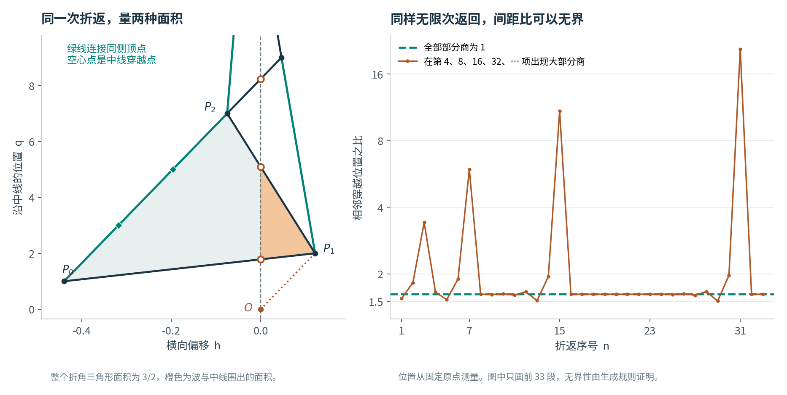

# 反复穿过中线的波与整数格

2026-11-19。研究一般波形。将手绘图的中线视为带有原点的直线，标记是波与中线的交点。先把画中弯曲的波视为自由路径，再选用连接转折点的折线来问，什么时候几何图形本身足以确定一个整数递推。图的两侧在折线模型中取为分别连接同侧转折点的两条线，属于建模选择。这保留了左右折返和穿越次序，原图没有指定微分方程、刻度、整数格或波速。

左图把推进方向画成纵向，公式一律用有序对 $(q,h)$，其中 $q$ 是沿中线的位置，$h$ 是带符号的横向偏移。交换画图时的两轴不改变面积绝对值。灰底大三角形包含橙色小三角形。绿色菱形把同侧边分成三个格步，原点到 $P_1$ 的点线平行于这条绿边。

## 1. 四个转折点就能检验递推，五个点可以反驳它

取折线上的点 $P_n$，选定原点 $O$ 后记 $v_n=P_n-O$，记 $\det(u,v)$ 为两向量的有向平行四边形面积。我们考察的等面积条件是
$$
 \det(v_{n-1},v_n)=-\det(v_n,v_{n+1}),\qquad
 |\det(v_{n-1},v_n)|=D>0.
$$
第一式等价于 $\det(v_n,P_{n+1}-P_{n-1})=0$。**对每个中间点 $P_n$，从它画一条平行于首尾连线 $P_{n-1}P_{n+1}$ 的直线，所有这样的直线共过原点 $O$。** 这个结论有逆命题。若这些直线确实共点，且有一对相邻向量的行列式非零，那么相邻行列式必逐项变号且绝对值全相等。假定所用同侧弦非零，此时存在唯一实系数 $k_n$ 满足
$$
 P_{n+1}-P_{n-1}=k_n(P_n-O),\qquad v_{n+1}=k_n v_n+v_{n-1}.
$$
在递增的正纵向位置模型中 $k_n>0$。转折点与左右两边可以直接读出步数。在三个相邻转折点构成的三角形里，底边是 $k_n v_n$，相对底边的高由原先相邻向量的行列式给定。用行列式计算即
$$
 \operatorname{area}(P_{n-1}P_nP_{n+1})=\tfrac12 |k_n|D .
$$
取单位格、$D=1$ 时，整个折角三角形的面积恰为步数的一半。波与中线实际围起的橙色面积另见第 3 节。

具体地，给四个依次出现的点 $A,B,C,E$，令 $u=C-A,\ v=E-B,\ f=C-B$。在下式三个行列式均非零的情形，两个步数及原点都可由坐标解出：
$$
 k=\frac{\det(u,v)}{\det(v,f)},\qquad
 \ell=\frac{\det(u,v)}{\det(u,f)},\qquad
 O=B-u/k=C-v/\ell .
$$
证明只须在 $f=v/\ell-u/k$ 两侧分别取行列式。平移、旋转、剪切或其他可逆仿射变换都保持这两个比值，原点按同一变换移动。四个一般位置的点总会给一个交点，因此四点算出的 $O$ 本身不能确认一长段折线都满足同一条件；换到下一组四点必须得到相同的 $O$。第五个点已经可以破坏共点性。

## 2. 整数是什么时候进入图形的

若 $v_0,v_1$ 是某个面积为 $D$ 的平面格的一组基，所有 $k_n$ 都是整数，则由递推，每一对相邻向量都是同一格的一组基。反过来，若折线处处满足上面的交替面积条件，且所有相邻向量都是同一格的一组基，在前一组基中展开后一向量，所得 $k_n$ 必为整数。于是共点性检验等面积，面积比的整数性检验保格。预先给定某个特定格时，还要单独检查初始向量属于它且为基。

普通连分数提供无限多例。给无理数 $\alpha=[a_0;a_1,\ldots]$，写其收敛分数为 $p_n/q_n$，取
$$
 v_n=(q_n,p_n-\alpha q_n),\qquad k_n=a_{n+1}.
$$
普通连分数的两条递推 $p_{n+1}=a_{n+1}p_n+p_{n-1}$、$q_{n+1}=a_{n+1}q_n+q_{n-1}$ 给出上述向量关系。这些点落在 $\{(q,p-\alpha q):(q,p)\in\mathbb Z^2\}$ 这个面积为 1 的剪切格。相邻误差异号且绝对值递减，行列式为 $\pm1$。左图取 $\alpha=[0;2,3,\overline{1}]$，三个顶点对应 $0/1,1/2,3/7$。它们满足 $P_2-P_0=3(P_1-O)$。基础连分数矩阵关系和整数几何框架分别见 [Frame 的讲义论文](https://oerior.uniud.it/wp-content/uploads/2018/12/Frame1949.pdf) 与 [Karpenkov 的专著](https://link.springer.com/book/10.1007/978-3-662-65277-0)。

## 3. 振幅、间距与面积有各自的有界性

在普通无穷连分数模型中，设 $b_n=|p_n-\alpha q_n|$，$X_n$ 是边 $v_nv_{n+1}$ 穿过中线的位置，从同一固定原点量起。相邻向量的面积为 1，插值就给出 $X_n=1/(b_n+b_{n+1})$。又有 $b_{n-1}=k_n b_n+b_{n+1}$。令 $r_n=b_{n+1}/b_n\in(0,1)$，可得
$$
 R_n:=\frac{X_n}{X_{n-1}}=1+\frac{k_n}{1+r_n},\qquad
 1+\frac{k_n}{2}<R_n<1+k_n .
$$
每条这样的波都有 $b_n\to0$、$X_n\to\infty$。又因 $k_n\ge1$，有 $X_n-X_{n-1}>X_{n-1}/2$，所以每条波的绝对穿越间距都趋于无穷。相对间距 $R_n$ 才可以区分各条波。它一致有界当且仅当部分商一致有界；它趋于无穷当且仅当部分商趋于无穷。只沿子列无界的情形也可以构造。

| 指定普通部分商的规则（略去整数部分） | 相对间距 $R_n$ | 波瓣面积的表现 |
|---|---|---|
| 全部为 1 | 每段等于黄金比 $\varphi$ | 每段等于 $1/(2\varphi^3)$ |
| 第 $2^j$ 项取 $2^j$（$j\ge2$），其余为 1 | 有无界子列，也无穷多次回到 2 以内 | 每段严格小于 $1/3$ |
| 第 $j$ 项取 $j$ | 趋于无穷 | 趋于 $1/2$ |

上述是无限规则的结果。右图的有限折线用于展示。波瓣面积记为 $A_n$，取两次中线穿越及中间顶点围成的三角形。直接计算为
$$
 A_n=\tfrac12 b_n(X_n-X_{n-1})
     =\frac{k_n}{2(1+r_n)(k_n+1+r_n)}.
$$
若 $k_n$ 单独很大但 $k_{n+1}=1$，则 $r_n=1/(1+r_{n+1})>1/2$，所以 $A_n<1/3$。若 $k_n=1$，上式甚至给出 $A_n<1/4$。要让波瓣面积沿某子列逼近 $1/2$，必须且只须这段和下一段的步数沿同一子列一起趋于无穷。这解释了为何一次极长的折返可以有很小的侧向振幅和有限的围合面积。进一步，对所有这些波，无符号面积总和发散，带符号的部分面积和虽然有界却不能收敛。[推导、三标记反演与无穷标记的实现条件](CROSSINGS.md)

## 4. 同一串中线记号在哪些条件下能识别波

对自由的光滑曲线，取同一通道 $|h|<s+2$、$s\ge0$。$h=\sin(\pi s)$ 与 $h=(s+1)\sin(\pi s)$ 都在全部非负整数处穿过中线，除此以外没有其他穿越。前者振幅固定为 1，后者在 $s=n+1/2$ 处的绝对值趋于无穷。两条边和全部穿越点都相同，横向行为仍有本质区别。若另有曲率或二阶导数界，可以得到精确的间距—振幅不等式。[光滑波、周期恢复力与曲率估计](SMOOTH-WAVES.md)

在上述普通连分数折线里，**知道固定原点以及连续三个穿越位置，便能唯一恢复相邻两个整数步数**。理由是三个倒数给出 $k_n b_n,\ k_{n+1} b_{n+1},\ b_n+b_{n+1}$，而 $b_n/b_{n+1}$ 无理，排除了两组不同的整数解。保持原点固定，同时缩放三个穿越点的纵向位置，也不改变解出的两个整数。实际用有理区间包住三个穿越位置，在仅给出这些区间且已知模型类型的条件下，从 90 对候选中筛出唯一的 $(17,9)$。这不表示任意精度的手绘图能恢复精确数字。[区间证书与数学条件](CROSSINGS.md)

另一个等价于逼近问题的几何观测，使用模曲面上的高度。每个既约有理方向对应一个宽度可算的波峰。对无理目标，峰高无界时仍有任意晚的返回；对有理目标，轨迹最终逃向无穷。这里的高度、时间以及面积属于双曲模型，与前面图上的长度和三角形面积有明确分别。[波峰的精确公式、返回及分类](MODULAR-WAVES.md) · [Ford 的相切圆](https://www.maths.ed.ac.uk/~v1ranick/papers/ford.pdf) · [Haas 的尖点行程研究](https://arxiv.org/abs/0709.0313)

## 复现

前三个脚本只需 Python 标准库。绘图需要 Matplotlib 和支持中文的字体。图中浮点数只用于显示，右图的连分数尾部在转成绘图坐标前先用有理区间控制。以上推导依赖的经典结论与本笔记的具体模型均已标出，未主张文献首创。

~~~sh
python3 verify_vertices.py
python3 verify_crossings.py
python3 verify_modular.py
python3 figure.py
~~~
