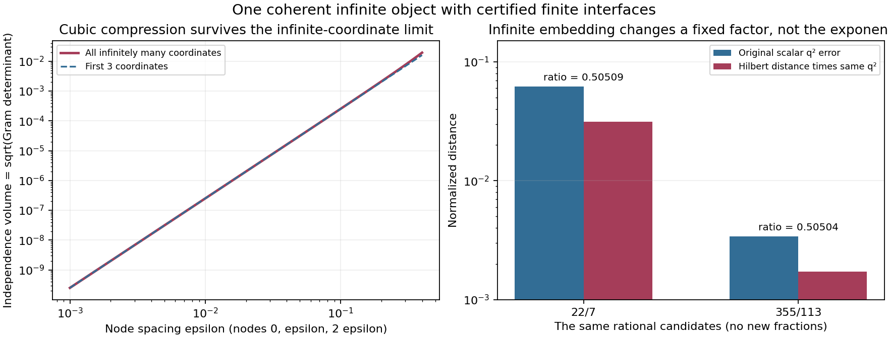

# 无穷维延拓检验：曲线、核与算术接口

2026-11-01。用户希望把此前的曲线挤压与 π017 插值行列式研究拓展到无穷维。本轮建立了一个真正拥有无穷坐标、有限截面彼此兼容且尾部可认证的对象，并检查几何收益、非零性与分母成本能否一起通过极限。

**结果：无穷维模型及可复现工具已经建立，三点的三次挤压仍然存在；但本模型没有自动改善同一个有理候选对 π 的逼近指数。** 此外，还得到一个所有相容有限截面均满秩、无限极限却有核的精确有理算子例子。不能只把“极限体积为零”当作新的算术矛盾。

本轮没有取得 π 的异常逼近，没有建立原论文完整几何定理的无穷维版本，也没有证明 π 是坏逼近数或非坏逼近数。

## 1. 原论文的“有限”需要准确理解

原文的维数 m 可以依固定 ν>2 选得很大，随后固定 m、权重、分母和中心，再让多项式预算 H 趋于无穷。它并不是只验证有限小数位，也不是固定在某个很低的维数后停止。

无穷维扩展应检验的是：能否把这些有限构造组织成同一个相容对象，并让 m 也增长，同时保留有效的插值、非零性、清分母与余项估计。准确源码位置和量词审计见 [limit_audit.md](limit_audit.md)。

## 2. 已建成的无穷维对象

令 `ℓ²` 表示所有平方和有限的实数序列。对实参数 `|t|<2`，定义

\[
 v(t)=(1,t/2,(t/2)^2,(t/2)^3,\ldots)\in\ell^2.
\]

每个有限截面都是同一 v 的前 L 个坐标，增加 L 不改变原有坐标。这与每次另选一批不相容的参数不同。

它的全部无穷坐标可以通过一个闭式内积核精确处理：

\[
 K(s,t)=\langle v(s),v(t)\rangle=\frac1{1-st/4}.
\]

因此不必假装计算机列出了无穷多个数。一般尾界和有限截面误差均可严格证明。本模型对应的是原构造中的解析曲线与 Taylor 相关性机制，不是将原多变量插值定理未经证明地换成无穷变量。

这是经典几何级数核的一种具体使用；其缩放形式属于 Szegő 核。背景可核对 Jennifer R. Good, *Interpolation and Commutant Lifting with Weights*, [arXiv:1608.04795](https://arxiv.org/abs/1608.04795)，本轮仅阅读其第1页相关定义，没有声称审计该文全部算子插值定理。本文使用的核、尾界与距离公式在附录笔记中直接推导。

## 3. 三点的三次挤压在无穷空间里保留下来了

对任意有限 N 个节点 t_i，取它们在完整无穷空间里的 Gram 矩阵；其平方根行列式衡量这 N 个位置向量的独立性体积。这里没有假设存在未经定义的“无穷行列式”或无限维 Lebesgue 体积。

令 `x_i=t_i/2`，精确公式是

\[
 \det[K(t_i,t_j)]
 =\frac{\prod_{i<j}(x_i-x_j)^2}
        {\prod_{i,j}(1-x_ix_j)}.
\]

它是 Cauchy 行列式恒等式的具体形式；可参照 [NIST DLMF 1.3.14](https://dlmf.nist.gov/1.3.E14)，一般证明也已写在 [kernel_geometry.md](kernel_geometry.md)。不把这一经典恒等式作为本轮发明。

对三个节点 `0,ε,2ε`，独立性体积满足

\[
 V_3=
 \frac{|\varepsilon|^3}
 {4\sqrt{(1-\varepsilon^2/4)(1-\varepsilon^2)(1-\varepsilon^2/2)^2}}
 \sim\frac{|\varepsilon|^3}{4}.
\]

所以在小尺度下，间距缩小十倍，体积约缩小一千倍。其原因仍是：首个能够同时撑开独立方向的展开次数必须互不相同。无穷多个高阶坐标没有消除这项机制。

但要区分两种增长：固定节点数量 N，只增加坐标数时，Gram 行列式是子式平方的累加，**增加坐标反而使体积非减**；增加 N 时，最小不同次数之和才按 `N(N−1)/2` 增长。坐标数、节点数、原论文的横向变量数 m 与多项式预算 H，不能混成同一个“维数”。

左图：全体无穷坐标仍保留三次挤压，略大于前三坐标的体积。右图：同一个 p/q 在无穷表示中的归一化距离，只改变固定倍数；图中没有创造新的有理数。

## 4. 把 π 真正接入这个对象后发生了什么

在 π 附近使用 `t=x−3`，使 t 落在核的定义域内。平移不改变原有理数 p/q 的既约分母。以同一个参数分母 q 标记候选，比较

\[
 q^2|\pi-p/q|
 \quad\text{与}\quad
 q^2\|v(\pi-3)-v(p/q-3)\|.
\]

在 `|s|,|t|≤1` 的固定区间中，一般证明给出

\[
 \tfrac12|s-t|\le\|v(s)-v(t)\|
 \le\sqrt{20/27}\,|s-t|.
\]

因此同一个候选的逼近好坏只改变固定倍数，不能凭这个表示多获得一个 q 的幂次。π 的两个具体候选 22/7、355/113 的范数比较，已经用严格有理区间认证，图中仅显示区间中点。

这里 q 始终是**原标量参数**的分母，不是免费赋给整个无限向量的高度。22/7 对应的第 k 个非恒定坐标为 `(1/14)^k`；355/113 对应 `(8/113)^k`。前 m 个坐标的共同分母分别需要 `14^m`、`113^m`。无穷多个有理坐标，并没有一个免费的有限共同分母。

同时得到一个可用的正面接口：有限截面对**弦长的相对尾误差**有与 q 无关的统一界，而且随截面长度趋零。它允许用有限计算认证这个特定无穷模型，而非逐个分母盲目增加精度。详见 [arithmetic_interface.md](arithmetic_interface.md)。

## 5. 无穷维中确实出现的新现象：有限全满秩，极限有核

我们另外构造了同一个有理无限矩阵的相容前缀 T_m。每个有限截面都满秩，并且

\[
 \det T_m=4^{-m}>0,
\]

但对应的有界无限算子真的有非零核。这个结论来自一般显式证明，不是从有限数值推断无限极限。

它展示了无穷维方向的实际价值：逐个有限截面看不见的极限退化可以被完整对象揭示。然而，清掉行列式分母后

\[
 4^m\det T_m=1.
\]

几何小量与算术成本精确抵消，没有出现小于 1 的非零整数。若逐行逐列清除分母，所得整数矩阵的行列式甚至为 `4^{m(m−1)/2}`。证明与可复现截面在 [limit_audit.md](limit_audit.md)。

三节点核也给出同类检查：令 `ε=1/Q`，其中整数 `Q≥2`，其精确 Gram 行列式为

\[
 \frac{Q^2}{(4Q^2-1)(Q^2-1)(2Q^2-1)^2}.
\]

这个分数已经约分，虽约为 `1/(16Q^6)`，清分母后却是整数 Q²。两种例子都说明：无穷维产生真实的小体积，与产生一个指定实数的更好有理数，是不同的任务。

## 6. 选目标的无穷构造，与固定 π 的任务不同

若目标也可由我们设计，确实能利用相容的无限过程制造极好有理逼近。例如定义 `L=Σ_{j≥1}10^{−j!}`，取前 m 项得到分母 `q_m=10^{m!}` 的有理数；余项小于 `2q_m^{−(m+1)}`。尾项估计来自将剩余稀疏位放宽成完整几何级数，因而有一般证明。

这支持“无穷结构可以承载极强逼近”的方向，但没有证明固定的 π 等于这个对象，或具有同样的尾部结构。本轮不将自由选择目标获得的逼近转移给 π。

## 7. 原论文直接取 m→∞ 时，已定位一个具体接口问题

原文每个 m 都允许重新选择权重。若坚持固定 θ、v₀、w₁ 及同一个无限权重前缀，其现有充分分离条件会要求 `w₁/v₀` 大于一个随 m 无界增长的阈值。这样不能直接取所有前缀同时满足原配方。

这是对**照搬现有充分阈值**的限制，不是无穷维不可能定理。可研究的修改包括重新规范坐标并定义兼容映射，或证明新的统一插值估计；这些尚未完成。另需控制变维数余项和每个截面的度数门槛，不能把固定 m 的渐近符号原样带入。

## 8. 接下来的明确数学目标

需要找到一个与 π 的精确周期及整数结构相容的无穷对象，使其有限截面同时满足：

1. 同一对象的投影兼容，尾部有统一界；
2. 选定的有限算术对象确实非零；
3. 几何节省超过分母与系数成本，且余项受到控制。

如果无穷维论证证明了严格统一的正余量，某个充分大的有限截面就能给出可复核的矛盾证书。无穷维仍可负责发现这种统一规律，有限证书不意味着这项工具没有价值。

本轮完成的是无穷维构造与接口检验，尚未找到满足以上条件的 π 端点新证书。

## 复现与范围

运行 `python3 research/infinite-dimensional-pi-2026-11-01/run_labs.py`。四组精确实验检查核公式/尾部、有理参数距离接口、无限算子相容截面，以及实际 π 候选与高度成本。一般无限命题依靠笔记中的证明，有限检查只核对实现。

π 区间来自先前已保存的 Machin 交错级数有理界，本轮再向外舍入为 40 位小数的有理区间后进行高次计算。依赖 Python 标准库，图另需 NumPy/Matplotlib。代码不调用 π 主定理来认证这些有限比较，也没有运行 Lean。

外部来源只用于核对经典公式与背景：本轮读取 DLMF §1.3 中 Vandermonde/Cauchy 行列式相关段落，以及上述算子插值论文第1页的核定义；未将背景阅读扩称为全篇审计。
