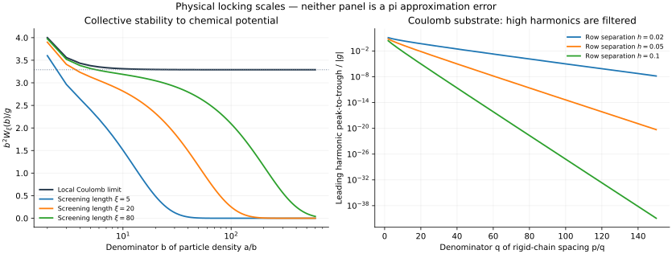

# 平方反比作用、自组织有理排列与 π：解析模型审查

2026-11-04。接续“让小球携带电荷、经相互作用与摇晃，自行形成整数配比”的提议。本轮以理论为主，不搜索巨大分母。

第二轮：[平台位置、统一弹性反馈与 π 质量证书](FEEDBACK.md)。已推导精确关系 Δκ·Cπ=πpqWξ(p)，给出连续链压力的非零偏移，以及另一刚性模型的负能量筛选；附六组新复核，仍未证明合格态的存在性或有限动力学可达性。

**结论：确有一个集体作用机制，把局部近似平方反比力接到有理排列的分母平方尺度；但它控制的是化学势稳定区间，不是 π 逼近误差。** 两种自然模型给出的尺度不同，说明必须保留排列方式、观测量和极限顺序。以下经典模型及文献公式不作为本项目的新发现；本轮工作是独立重推、屏蔽极限计算、反例与构造接口的整理。

## 1. 先确定真正的物理对象

采用粒子沿一维排列、按三维库仑势相互作用的模型。势能为 g/r 时，力的大小为 g/r²；严格一维 Poisson 方程的点电荷势不是 g/r。

只改变惯性质量通常改变演化速度，不改变给定势能的极小点。要选择最终结构，需要明确势能、边界和目标信息。π 可以通过自然长度或圆周/直径的几何关系进入，不要求把十进制数字作为唯一输入方式。

本轮避免先为每个 p/q 安排吸引井。整数配比来自粒子数、格点数和重复单元。固定粒子数和周期边界只适合验证指定密度；真正自选密度需允许与粒子库交换粒子，或使用可调长度/边界压力。

## 2. 一个有严格基态理论的模型

把整数格点看作很深的底板凹槽，每格至多一粒子。占据变量 η_i∈{0,1}，粒子库参数 μ 奖励加入粒子：

\[
H=\sum_{i<j}V_\xi(|i-j|)\eta_i\eta_j-\mu\sum_i\eta_i,
\qquad V_\xi(r)=g\frac{e^{-r/\xi}}r,
\quad g>0,\quad0<\xi<\infty.
\]

ξ 为屏蔽长度，以底板间距为单位；g 和 μ 以一致的能量单位计。对应的排斥力为

\[
F_\xi(r)=g e^{-r/\xi}\left(\frac1{r^2}+\frac1{\xi r}\right).
\]

只有 r≪ξ 时它近似纯平方反比，不能把任意有限 ξ 的全距离作用都称为精确库仑力。有限 ξ 使相互作用可和；V_ξ 正、递减、严格凸。

凸排斥下，固定密度 ρ 时，存在一种达到最低每格能量的“尽可能均匀”排列，使第 k 个邻居的距离取 floor(k/ρ)、ceil(k/ρ)。一个同时实现所有这些条件的排列为 x_j=floor(j/ρ+θ)。对既约密度 ρ=a/b∈(0,1)，它具有 x_{j+a}=x_j+b 的周期关系：每 b 个格点有 a 个粒子。这里讨论最低能量密度与可取的周期基态，不宣称排除所有零密度缺陷构型。这个基态机制来自 Hubbard／Pokrovsky–Uimin 的经典结果；Burnell [1] 和 Levi 等 [2] 复述并使用了它。

独立的最小化理由：固定第 k 邻居距离的平均值 k/ρ 后，凸函数在整数上的平均值，由相邻两个整数的混合取得最小；上述排列同时达到每个 k 的下界。有限 ξ 保证求和收敛。

## 3. 从集体重排推导稳定区间

令 e(ρ) 为不含 −μρ 的最低每格能量。无序粒子对只计一次，故

\[
e(\rho)=\rho\sum_{k\ge1}\left[(1-\{k/\rho\})V_\xi(\lfloor k/\rho\rfloor)
+\{k/\rho\}V_\xi(\lfloor k/\rho\rfloor+1)\right].
\]

在 floor(k/ρ)=d 的一个区段内，第 k 项可以写为

\[
[(d+1)\rho-k]V_\xi(d)+[k-d\rho]V_\xi(d+1),
\]

所以它是分段线性的凸函数。ρ=a/b 处，只有 k=na 的项产生折点，对应 d=nb；右导数减左导数为

\[
\boxed{W_\xi(b)=e'_+(a/b)-e'_-(a/b)
=\sum_{n\ge1}nb\,[V_\xi(nb-1)+V_\xi(nb+1)-2V_\xi(nb)].}\tag{1}
\]

这也正是使 a/b 保持为基态密度的 μ 区间宽度。它是同一个局部相互作用产生的集体结果，非预设 a/b 势阱。公式可与 [1] Eq. (25)，PDF 第9页直接核对；本文用每格基态能的导数独立重推其系数。

这里的稳定是**基态密度对 μ 改变的稳定**。它不是单粒子跳跃势垒，也不是有限温度寿命，更不证明任意退火轨道能找到全局基态。

## 4. 局部库仑极限确实出现分母平方

固定 b≥2，先令 ξ→∞。置 s=1/ξ，f_s(r)=g e^{-sr}/r。有

\[
f_s''(r)=\frac{2g}{r^3}e^{-sr}\left(1+sr+\frac{(sr)^2}2\right)
\le\frac{2g}{r^3}.
\]

离散曲率等于三角核对二阶导数的积分，因此对 x≥2，

\[
0<x[f_s(x-1)+f_s(x+1)-2f_s(x)]
\le\frac{2g}{x^2-1}.
\]

右侧在 x=nb 上可和，支配收敛给出

\[
\begin{aligned}
W_\infty(b)&:=\lim_{\xi\to\infty}W_\xi(b)
=2g\sum_{n\ge1}\frac1{n^2b^2-1}\\
&=\boxed{g\left[1-\frac\pi b\cot\left(\frac\pi b\right)\right]}\\
&=\frac{g\pi^2}{3b^2}+\frac{g\pi^4}{45b^4}+O_g(b^{-6}).
\end{aligned}\tag{2}
\]

闭式来自余切的经典部分分式展开 [5]。其机制是：库仑势的二阶差分约为 r^{-3}，集体缺陷的计数权重 nb 再乘回一个距离，得到 b^{-2}。

这个 π 是求和闭式中的几何常数；式(2)尚未让系统选择目标 π。

**不能忽略极限的性质。** 未屏蔽、非中性的无限链，能量及化学势基线发散；[1] Eq. (33) 的全部平台总宽度为 2Σ_r V(r)，对 g/r 也发散。中和背景若依密度改变，会改变跨密度比较，不能直接删掉。式(2)只证明有限屏蔽模型的固定 b 宽度极限，不宣布存在一个有限 μ 轴上的未屏蔽完整阶梯。

## 5. 固定屏蔽长度时，高分母最终被指数压制

固定 s=1/ξ>0，将(1)写成

\[
\frac{W_\xi(b)}g=\sum_{n\ge1}e^{-snb}B_s(nb),\qquad
B_s(x)=e^s\frac{x}{x-1}+e^{-s}\frac{x}{x+1}-2.
\]

由于 B_s(x)→2(cosh s−1)>0，且 x≥2 上一致有界，n=1 项主导，得到

\[
\boxed{W_\xi(b)\sim2g[\cosh(1/\xi)-1]e^{-b/\xi}}
\quad(b\to\infty,\ \xi\text{固定}).\tag{3}
\]

这是(2)的适用边界，不是矛盾：先去屏蔽再增大 b，与保持屏蔽长度不变地增大 b，尺度不同。

更精确的联合极限：令 b→∞、b/ξ→u≥0，则

\[
\boxed{\frac{b^2W_\xi(b)}g\longrightarrow
\Phi(u)=\sum_{n\ge1}e^{-un}
\left(u^2+\frac{2u}n+\frac2{n^2}\right).}\tag{4}
\]

其中 Φ(0)=π²/3。u>0 时亦可写为

\[
\Phi(u)=\frac{u^2}{e^u-1}-2u\log(1-e^{-u})+2\operatorname{Li}_2(e^{-u}).
\]

证明：令 s_b=1/ξ_b、u_b=bs_b→u。对每个固定 n，展开离散曲率（或使用三角核积分）得到第 n 项乘 b²/g 后趋于 e^{-un}(u²+2u/n+2/n²)。上一节的库仑上界给出对 b≥2 的统一支配 2b²/(n²b²−1)≤8/(3n²)，故可交换求和与极限，包含 u=0。

因此 ξ 至少与被研究的周期 b 同阶，才能在跨尺度过程中保留 b^{-2} 量级。这是可分析的参数规则，不是搜索速度保证。

## 6. 接到 π 时，分子分母不能混用

如果希望粒子平均间距为既约 p/q≈π，则粒子密度为 q/p。前面的密度分母 b 实际等于 p，故局部库仑宽度为

\[
W_\infty(p)\sim\frac{g\pi^2}{3p^2}
\sim\frac{g}{3q^2}\quad\text{仅在 }p/q\to\pi\text{ 的序列上}.
\]

这是一条真正的尺度联系，但相同密度分母 b 的所有既约 a/b，都有相同 W_ξ(b)。它没有优先识别哪个分数更接近 π。

缺少的环节是：把 π 所规定的长度/压力，与平台的**位置**而不只是宽度联系起来，并从中控制 C(p,q)=q²|π−p/q|。宽平台不等于小 C；平台宽度也不能直接当作数值误差。

## 7. 另一个自然库仑模型：分母是谐波筛子

考虑刚性均匀链，间距为既约 p/q，整体位移 θ，底板周期为1。若 U(x)=Σ_k U_k exp(2πikx)，则

\[
P_q(\theta)=\frac1q\sum_{j=0}^{q-1}U(\theta+jp/q)
=\boxed{\sum_mU_{mq}e^{2\pi imq\theta}}.\tag{5}
\]

这是根单位求和恒等式：只有 q|k 的项留下。分母 q 自然成为对谐波的选择规则。

精确反例：若 U(x)=−A cos(2πx)，所有 q>1 的 P_q 恒为0。加入每粒子的均匀弹性能 K(a−π)²/2 后，无理间距 a=π 的平均能量为0，整数间距中最优是3；所有 q>1 的有理间距均不可能成为全局最低态。这只否定此刚性单谐波模型，不否定可变形 FK 链。

再考虑真实库仑底板：单位间距的点电荷排成一行，链与它垂直相隔固定 h>0。减掉与横向位置无关的平均势后，Poisson 求和给出 [3]

\[
U_h(x)=4g\sum_{k\ge1}K_0(2\pi kh)\cos(2\pi kx),
\qquad
P_q(\theta)=4g\sum_{m\ge1}K_0(2\pi hqm)\cos(2\pi qm\theta).
\]

K_0 为第二类修正 Bessel 函数。用其标准渐近式 [6]，固定 h，q→∞ 时

\[
\max P_q-\min P_q\sim
\frac{4|g|}{\sqrt{hq}}e^{-2\pi hq}.\tag{6}
\]

这里每对电荷仍有平方反比力，但整链的平移势垒随分母指数缩小。与第4节不冲突：几何、约束和观测量均不同。h 可以作为逐步打开高分母谐波的几何分辨率参数；h→0 时需另行处理碰撞奇性。

## 8. 一个可检验的物理算法，而非预设成功

有限长度 L 的格点链，使用上述屏蔽势与粒子库。每步用与占据状态无关的固定概率，均匀抽取格点提议翻转占据，或均匀抽取最近邻边提议交换占据；另留正概率原地不动。配置之间的提议概率由此对称。按能量变化 ΔH 使用 Metropolis 接受率 min(1,exp(−ΔH/T))，逐渐减小 T。若改成其他非对称提议，必须补上 Metropolis–Hastings 的提议比率。

同一套局部动作可产生不同密度和周期；不先指定 p,q。每个给定的有限系统在固定 T>0 时，状态图连通且有原地停留，相应 Gibbs 分布为唯一平稳分布，链从任意初态趋向它。但有限时间冷却不保证达到全局最低点；更不证明其输出新的 π 纪录。

π 接口应另用几何长度或可调自然间距给出，研究目标是得到参数位置→C(p,q)的严格证书。下一轮最具体的任务是：分析平台位置在 ξ≈常数×周期的联合极限中怎样变换，并确定是否有一个不输入候选分数的目标反馈规则。

## 9. 复核与图

运行 `python3 verify.py`，依赖 mpmath；加 `--plot` 还需 numpy、scipy、matplotlib。仅进行小规模公式和基态检查，不搜索 π 候选：

1. 根单位筛选的整数排列条件及有限 Fourier 和；
2. 库仑离散差分的有理数恒等式、部分和与严格解析尾界；
3. 从基态能的左右斜率独立核对平台宽度；
4. 固定屏蔽/联合尺度两种渐近；
5. 12格有限环的全部4096个占据态，核对各粒子数下的均匀排列；这不是动力学收敛测试。

实际输出见 [verification.json](verification.json)。图中纵轴是物理稳定区间或平移能量幅度，不是 π 逼近误差。

## 文献与核验位置

1. F. J. Burnell, *The devil's staircase in 1-dimensional dipolar Bose gases in optical lattices*, arXiv:1004.5595v2 (2010), [PDF](https://arxiv.org/pdf/1004.5595)。第9页 Eq. (25) 为一般凸势平台宽度；第10页 Eq. (33) 为总宽度。主模型是偶极相互作用，本文代入屏蔽库仑势是另行检查其凸性与可和性后的应用。
2. E. Levi, J. Minář, I. Lesanovsky, *Crystalline structures in a one-dimensional two-component lattice gas with 1/r^α interactions*, [arXiv:1503.03268](https://arxiv.org/abs/1503.03268)，§3 复述单组分最均匀排列，Eq. (10) 给稳定宽度。
3. J. Landy, *Fourier expansions for the potentials of lattices of charge*, [arXiv:0804.3821](https://arxiv.org/abs/0804.3821)，Eq. (3) 为一维库仑电荷晶格的 K_0 展开。原文非零 Fourier 项已核验，零频率需按具体边界另处置。
4. R. Menu et al., *Fractal ground state of mesoscopic ion chains in periodic potentials*, Phys. Rev. B 110, 224103 (2024), [arXiv:2403.15843](https://arxiv.org/abs/2403.15843)，[作者托管PDF](https://eapg.mit.edu/wp-content/uploads/2024/12/Fractal_Ground_States_Ions_PhysRevB.110.224103.pdf)。摘要及结论警示其未屏蔽库仑链中热力学极限与有限链的区别；该可变形链与本文格点气体并非同一模型，不把其结论直接替代式(1)。
5. [NIST DLMF 4.22.3](https://dlmf.nist.gov/4.22.E3)：余切部分分式展开。
6. [NIST DLMF 10.40.2](https://dlmf.nist.gov/10.40.E2)：K_ν 大参数渐近。
7. J. Mellado Muñoz et al., *Realizing the Frenkel-Kontorova model with Rydberg-dressed atoms*, Phys. Rev. A 102, 043308 (2020), [arXiv:2006.16304](https://arxiv.org/abs/2006.16304)。给出弹簧型和长程排斥相互作用的物理实现提案；非 π 算法。

本轮没有证明 π 是坏逼近数或非坏逼近数，没有产生新纪录，也没有证明物理退火优于连分数算法。
