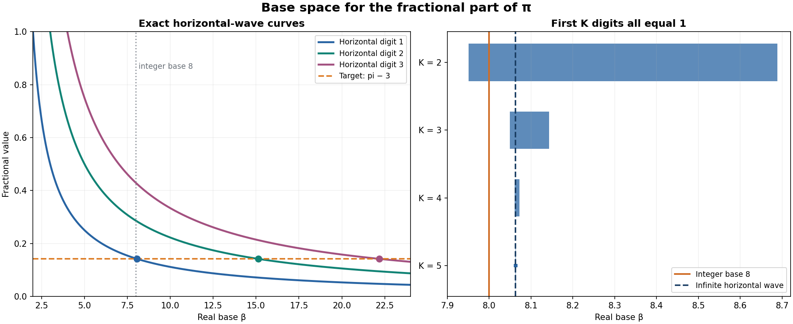

# 进制空间：数值、数位波与横线区域

2026-10-27。根据用户提出的 f(进制,数值,波形) 构造一个可计算的版本，并研究横线所在的区域。这里有一项具体选择：用 u 表示两个相邻数位之间的插值位置；如果用户以后希望 u 表示另一物理或几何变量，需要修改函数定义。

实数底数的贪心数位展开已有研究，例如 [Charlier 等，Periodic alternate base expansions](https://orbi.uliege.be/bitstream/2268/292097/1/SchmidtBasesAlternees-Charlier-Cisternino-Kreczman.pdf)。本记录从明确的递推和等比和直接推导所需性质，不声称提出了新的进制理论，也未得到 π 逼近问题的新解。未运行 Lean 或 Open Math。

## 1. 把用户的函数定义清楚

输入为：实数进制 β>1；实数目标 y；数位位置 v=1,2,…；和位置之间的插值参数 u∈[0,1]。将

\[
m=\lfloor y\rfloor,\qquad x=y-m\in[0,1).
\]

整数部分 m 单独记录，避免把可能大于 β 的 m 误当成一个合法数位。小数部分从余数 r₀=x 开始，逐次定义

\[
d_j=\lfloor\beta r_{j-1}\rfloor,\qquad
r_j=\beta r_{j-1}-d_j,\qquad j\ge1.
\tag{1}
\]

每个余数 r_j∈[0,1)，每个数位 d_j 是 0,…,⌈β⌉−1 中的整数。我们采用这个确定的逐位规则；非整数进制可能允许其他表示，本函数只指这一个选择。

定义数位波

\[
\boxed{F(\beta,y;v,u)=(1-u)d_v+u d_{v+1}.}\tag{2}
\]

v 给出数位位置，u 从 0 增加到 1 时，在两个数位高度间画直线。u=0 恰好读出一个数位；连续连线只是观察波的约定，并非假设目标数真的满足某个物理波动方程。

函数值始终是实数，且 0≤F≤⌈β⌉−1。要保留用户的“进制、数值、波”三个对象，可把状态记为 (β,y,F_{β,y})；第三项是一个函数对象，而非单个实数。

由 (1)，对每个 K≥1：

\[
y=m+\sum_{j=1}^K\frac{d_j}{\beta^j}
+\frac{r_K}{\beta^K},\qquad 0\le r_K<1.
\tag{3}
\]

令 K→∞ 可准确还原 y。固定 β 后，数位波与整数部分 m 一起确定 y。

## 2. 空间里的无限横线

取任意 x∈(0,1)、正整数 n。所有数位都等于 n 的条件是

\[
\boxed{x=\frac{n}{\beta-1},\quad\beta>n+1.}\tag{4}
\]

证明：若所有数位为 n，由 (3) 和等比级数必有 x=n/(β−1)。因为 x<1，β>n+1。反过来，若满足 (4)，则 βx=n+x，0<x<1，所以第一位为 n、余数仍为 x；递推后每一位都是 n。n=0 的横线对应 x=0，是单独的平凡情形。

因此在 (β,x) 平面上，高度为 n 的无限横线形成曲线 x=n/(β−1)。固定某个目标 x，这条曲线与水平线相交于唯一进制

\[
\beta_n=1+\frac n x.
\]

当 x=π−3、n=1 时 β₁≈8.062513305931，π 的小数数位均为 1；n=16 时 β₁₆≈114.000212894897，数位均为 16。

实数底数下，无理数可以拥有周期乃至恒定的数位波。例如 β=1+√2 时，x=1/√2 的所有数位都是 1。整数进制里“有理数的贪心数位最终周期，无理数的不最终周期”不能不加条件地用于整个实数进制空间。

## 3. 有限横线不是一条曲线，而是一个区域

固定 n≥1、K≥1，并先限于 β>n+1。定义

\[
L_K(\beta)=n\sum_{j=1}^{K}\beta^{-j},\qquad
U_K(\beta)=L_K(\beta)+\beta^{-K}.
\]

**命题：** 前 K 个数位全部等于 n，当且仅当

\[
\boxed{L_K(\beta)\le x<U_K(\beta).}\tag{5}
\]

证明必要性：将 d₁=…=d_K=n 代入 (3)，余数 r_K∈[0,1) 就给出 (5)。

证明充分性：由 (5) 写 x=L_K(β)+tβ^(-K)，其中 0≤t<1。设 r_K=t，向前递推 r_{j−1}=(n+r_j)/β。因为 β>n+1，每个得到的余数都在 [0,1) 内；而 βr_{j−1}=n+r_j∈[n,n+1)，所以贪心规则的前 K 位确为 n。证毕。

这说明在 (β,x) 平面中，前 K 位为同高度 n 的区域被两条曲线 L_K、U_K 夹住；区域的上下边界之差**精确等于 β^(-K)**。无限横线 (4) 位于所有这些区域中。

注意对一般 β>1、任意数位块，不能直接把所有数位串都当成可行；它们必须满足相应余数条件。命题只在明确写出的 β>n+1 范围内使用上述简洁区域。

## 4. 固定数值后，横线区域的左右收缩

固定 x∈(0,1) 和 n≥1，令 β₀=1+n/x。只要 K 足够大，使 1−(n+1)^(-K)>x，方程

\[
L_K(\beta_-)=x,\qquad U_K(\beta_+)=x
\]

各自在 β>n+1 上有唯一解，并且

\[
\beta_-<\beta_0<\beta_+.
\]

原因是 L_K、U_K 在 β>1 时连续严格递减；在 β=n+1 附近，两者分别趋向 1−(n+1)^(-K) 和 1；在无穷远处都趋向 0。在 β₀ 处，L_K=x−xβ₀^(-K)，U_K=x+(1−x)β₀^(-K)。

所以固定目标 x、要求前 K 位全为 n 的进制区域，精确是

\[
[\beta_-,\beta_+).
\tag{6}
\]

这里 (6) 实际覆盖全部 β>1：若 β≤n+1 而前 K 位都为 n，则由 (3) 必有 x≥L_K(β)≥L_K(n+1)>x，矛盾。前一句使用了本节对 K 的条件；较小的 K 不应不加说明地使用 (6)。

两条端点都趋于 β₀，且更精确地

\[
\begin{aligned}
\beta_0-\beta_-&\sim \frac n x\,\beta_0^{-K},\\
\beta_+-\beta_0&\sim \frac{n(1-x)}{x^2}\,\beta_0^{-K},\\
\beta_+-\beta_-&\sim \frac n{x^2}\,\beta_0^{-K}.
\end{aligned}\tag{7}
\]

证明：L_K(β₀)=x−xβ₀^(-K)，U_K(β₀)=x+(1−x)β₀^(-K)。在 β₀ 的一个紧邻域上，两者的导数一致趋于 −n/(β−1)²；这在 β₀ 处等于 −x²/n。端点先由单调性和一致收敛得到趋于 β₀，再分别应用中值定理，得到 (7)。

特别地，左右可容许的进制变化不对称：

\[
\frac{\beta_+-\beta_0}{\beta_0-\beta_-}
\longrightarrow\frac{1-x}{x}.
\tag{8}
\]

这个比例只依赖目标的小数部分 x，不依赖横线高度 n；这不代表每个有限 K 的比例已经相同。

这里的 (7)–(8) 是**固定 x 和 n、令 K→∞** 的结论。不能没有证明就让 n 同时变化或交换极限。

### 换一种极限：固定 K，让横线高度 n 增大

固定 x∈(0,1) 和正整数 K，令 n→∞。设 β_{n,-}、β_{n,+} 是上述前 K 位均为 n 的进制区间端点。对充分大的 n，端点存在，且

\[
\boxed{\beta_{n,+}-\beta_{n,-}
\sim x^{K-2}n^{1-K}.}\tag{10}
\]

证明：前 K 位相同必然包括首位为 n，所以该区域位于首位区域 [n/x,(n+1)/x)；两个端点也位于其闭包。因此在两个端点附近，β=n/x+O(1)。对固定 K，有

\[
L_K'(\beta)=-n\sum_{j=1}^{K}j\beta^{-j-1}
=-\frac{x^2}{n}(1+o(1)),
\]

且 U_K'=L_K'−Kβ^{−K−1} 具有同一渐近。无限横线交点处，L_K 比 x 低 xβ_n^{-K}，U_K 比 x 高 (1−x)β_n^{-K}。对两侧分别用中值定理再相加，得到区间宽度渐近于 (n/x²)β_n^{-K}；代入 β_n=1+n/x 即得 (10)。

例如，固定目标时：前两位同高的区间宽度约为 1/n；前三位同高的区间宽度约为 x/n²。程序给出 π 的有限数值对照：n=1024 时，K=2、K=3 的实际宽度分别约为对应渐近值的 0.999723 和 0.999585。

### 移动整数网格的一个几乎处处结论

这也得到一个适用于**一般偏移**、但不直接解决整数进制的命题。固定目标 x∈(0,1) 和 K≥3，将候选进制网格从整数 p 平移为 p+τ，其中 τ∈[0,1)。那么对几乎所有 τ，只有有限多个 n 会使某个 p+τ 落在“前 K 位全为 n”的区域。

证明：对足够大 n，首位条件强迫 β≥n/x>n+1，故第 3 节的区间涵盖所有相关事件。由 (10)，这些区间的宽度是 O(n^{1−K})，总和有限。对每个区间，将其投影到 τ 的模 1 空间，投影的长度不超过区间本身的长度。因此从第 N 项起所有投影的并集长度不超过该收敛级数的尾和，随 N 趋零；属于无限多个投影的 τ 构成零测集。

**边界：** 真正的整数进制对应的是特定偏移 τ=0。几乎处处结论不能排除这个特定偏移落在例外集合中，所以它不证明 π 在整数进制下只有有限次三位全同，也不解决 π 的逼近问题。

这个例外不是虚设：例如令 x 为经典刘维尔常数 Σ_{j≥1}10^{−j!}。其第 k 项截断 R_k=n_k/q_k、q_k=10^{k!}，有 0<x−R_k<2q_k^{−(k+1)}。固定任意 K，令 k→∞，取整数进制 p_k=q_k+1，就有 p_k^K(x−R_k)→0；而 R_k 和 1−R_k 均远离 0。因而 (5) 的前缀条件最终成立，τ=0 对这个目标确实发生无限次命中。

## 5. π 的数值示例

取 x=π−3、n=1，中心 β₀≈8.062513305931。区间端点的小数在下表取近似值；对应的精确有理包围区间及显示精度见 `base_space_results.json`。

| 前 K 位全为 1 | 左端点约值 | 右端点约值 | 进制区间宽度约值 |
|---:|---:|---:|---:|
| 2 | 7.950791341 | 8.688271309 | 0.7374800 |
| 3 | 8.048969572 | 8.142865639 | 0.0938961 |
| 4 | 8.060840529 | 8.072612308 | 0.0117718 |
| 5 | 8.062305976 | 8.063769369 | 0.00146339 |
| 10 | 8.06251329985 | 8.06251334282 | 4.29748×10⁻⁸ |
| 20 | 接近 β₀ | 接近 β₀ | 3.70262×10⁻¹⁷ |
| 50 | 接近 β₀ | 接近 β₀ | 2.36808×10⁻⁴⁴ |

整数进制 8 位于 K=2 区域、但不位于 K=3 区域；严格区间计算的前三位是 [1][1][0]。当 n=16，整数进制 114 同样位于 K=2 区域而不在 K=3 区域；前三位是 [16][16][15]。每一个方括号中的整数都是一个数位。

这个例子给出用户的空间直觉：**一个整数进制离无限横线曲线的交点有多远，会影响它能保留多长的初始平直部分。** 对左右端点不对称也有精确解释；π 的 x≈0.14159，极限比例 (1−x)/x≈6.062513。

图的坐标使用浮点数，作为结构示意；严格判定使用本文和 JSON 中的有理区间。`base_space_plot.py` 可选用 matplotlib 和 numpy 重新绘图，核心数学验证不依赖它们。

## 6. 一般数位波的区域与连续性

固定有限数位串 d₁,…,d_K，并记 r₀=x。若某个参数 (β,x) 产生这个数位串，那么对 1≤j≤K 必须且充分有

\[
0\le \beta^j x-\sum_{i=1}^j d_i\beta^{j-i}<1.
\tag{9}
\]

充分性由此式递归保证每一步 βr_{j−1}=d_j+r_j、0≤r_j<1，因此向下取整恰为 d_j。对于固定 K 与固定整数数位串，这些是多项式不等式：进制空间按有限数位前缀分成可明确检验的区域。

在每个严格满足所有 0<r_j<1 的参数点，数位不会在小扰动下立刻改变：有限前缀局部稳定。在 r_j=0 的边界，向下取整可能跳变。例如 β=2、x=1/2 时首位为 1；β 从小于 2 的一侧靠近 2 时首位为 0。

在无限横线点 β₀，所有余数都等于 x∈(0,1)，故**每个固定长度的前缀都有稳定邻域**。但固定 x、n 时，完整无限横线只在 β=β₀ 成立；任何其他进制总会在某个位置偏离。因此“前 K 位稳定”不能无条件延伸成“无限波形在同一邻域稳定”。

## 7. 与 π 有理逼近的联系，以及还缺什么

若整数进制 p=q+1 位于某条前 K 位为 n 的区域，对应无限横线为 n/q。根据 (5)，

\[
|x-n/q|<p^{-K}.
\]

例如若存在趋于无穷的整数进制，其中 π 的小数部分前三位相同，那么 q²|x−n/q|<q²/p³→0。这是一个充分条件；不能把它当作 P2848 的等价条件，因为第三位相对偏差趋零也可能足够，无需三位完全相等。

而有限 K 的区域和 β_n=1+n/x 虽把问题几何化，但并没有自动告诉我们：当 n 无限增大时，整数点接近这些曲线的速度如何。要取得 π 专属结论，仍需对这些整数点与区域边界的相对位置建立无限尺度估计。不能从有限图像、有限前缀或者实数底数使波平直推出 π 坏逼近。

## 8. 复现

`python3 base_space.py` 使用 Python 标准库，重新生成 200 位 π 有理包围区间，用有理二分法包围端点；边界判定全用 Fraction，显示小数仅为阅读。程序另外对 7,000 组有理参数检查了 (5) 的正反方向及端点，检查了 8 和 114 进制数位。证明不依赖有限测试。

精确端点区间见 `base_space_results.json`。由于近端点距离极小，K=50 时左右端点用 25 位小数显示会看起来相同；完整精确区间和区间宽度仍被单独记录。
