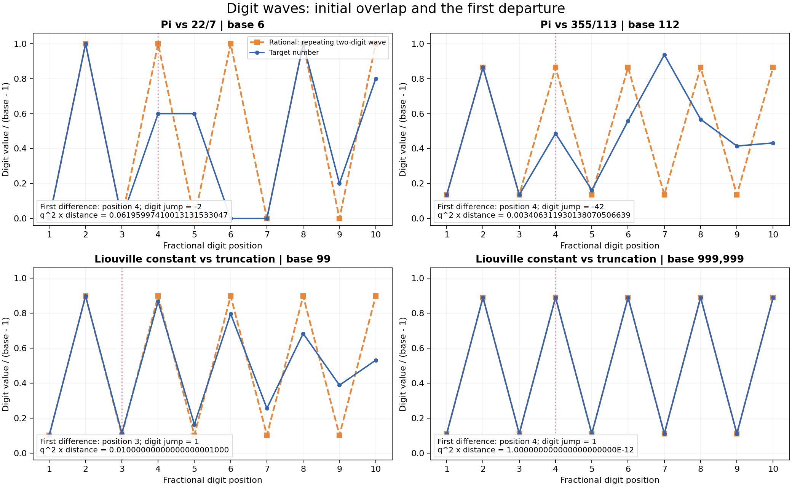

# π 有理逼近、数位波与根式保守下界

2026-10-27。lain 的研究方向，Mirai 协助推导与复现。这里保存本轮研究的证明、代码和数据，供继续研究与 Open Math 独立审查。没有证明 P2848，也没有证明 π 坏逼近；没有运行 Lean 或 Open Math。下列初等推导不主张文献新颖性。

**本轮进一步获得的结论：当前纯根式常数形成的包络必定满足 q²G_∞(q)→0。单纯增加参考数，不能用这份证书得到固定正数 C/q² 的全局下界。完整证明见 [ROOT_ENVELOPE_OBSTRUCTION.md](ROOT_ENVELOPE_OBSTRUCTION.md)。**

## 目标和已经完成的部分

研究目标来自正整数 n 上的命题

\[
\liminf_{n\to\infty}n|\sin n|=0,
\]

等价于

\[
\liminf_{q\to\infty}q\|q\pi\|=0,
\]

其中 ‖y‖ 是 y 到最近整数的距离。π 坏逼近指存在固定 C>0，对所有整数 a、正整数 q 均有 |π−a/q|≥C/q²；它与上述命题相反。这里的“尚未解决”指本研究没有给出答案，不作外部最新研究状态的断言。

| 内容 | 本轮结果 | 完整说明 |
|---|---|---|
| b=q+1，同数位循环 | 两位相等与第三位相对偏差刻画 q² 归一化误差 | [原始记录](P2848_Variable_Base_Research_20261027.md) |
| b=q−1，周期二波 | 保留 22/7 的六进制、355/113 的 112 进制例子；证明首次跳差与尾项关系 | [数位波](WAVE_RESULTS.md) |
| π 与刘维尔常数 | π 的全同初始前缀长度≤41，使用 Mahler 1953 定理；刘维尔数可有任意长初始全同前缀 | [记录末尾补充](P2848_Variable_Base_Research_20261027.md) |
| 一般二次无理数参考 | 连分数尾部替换提供很大的有限分母覆盖区间 | [二次参考数](QUADRATIC_BARRIER_RESULTS.md) |
| 纯根式函数 | 始终为非平方有理数的平方根，收敛到 π，具有显式保守距离函数 | [根式构造](PURE_ROOT_FUNCTIONS.md) |
| 纯根式包络限制 | 当前常数下 q²G_∞(q)→0；得到涵盖无限参考族的有限上界证书 | [限制定理](ROOT_ENVELOPE_OBSTRUCTION.md) |

同数位“重复”均指从小数点后第一位开始。不同进制的数位用一个整数表示，例如 [96] 是 112 进制的一个数位。连续重复长度有界不等于坏逼近；允许第三位相对偏差趋零仍可能产生很好的二次幂精度。

## 根式对象与保守范围函数

令 m≥2，T_m=⌊m²π²⌋。T_m 非平方时取 N_m=T_m，若 T_m 为平方则取 N_m=T_m−1。再设

\[
F_m=\frac{\sqrt{N_m}}m,
\quad A_m=\frac{m^2}{\gcd(N_m,m^2)},
\quad c_m=\frac1{A_m(4+F_m)},
\quad \eta_m=\pi-F_m.
\]

根式始终无理，3<F_m<π，且 F_m→π。对任意 a∈ℤ、q≥1，

\[
\left|\pi-\frac aq\right|
\ge H(m,q)=\max\left(0,\frac{c_m}{q^2}-\eta_m\right).
\]

简单实例 F_6684=√440933025/6684 满足 η<1.3×10⁻¹³、c>9×10⁻⁹，所以

\[
\left|\pi-\frac aq\right|
\ge\max\left(0,\frac{9\times10^{-9}}{q^2}-1.3\times10^{-13}\right).
\]

这对所有 q 定义，但大 q 时可能只给出零下界。后续证明甚至允许所有 m 的上确界 G_∞，也有 q²G_∞(q)→0。该结论说明此估计的限制，不判定 π 的真实距离。

## 实际验证

Python 3，标准库即可完成所有数学判定；matplotlib 仅用于可选绘图。所有取整、根式区间和误差不等式使用整数或 Fraction。JSON 的 `approx` 字段只用于显示。

```bash
cd research/pi-approximation-2026-10-27
python3 reproduce.py
```

| 程序 | 实际复跑的检查 |
|---|---|
| `verify.py` | 48,000 次精确恒等式检查；进制 4 到 1,000,000 共 999,997 个；两位相同 10 个，没有三位全同样本 |
| `wave_compare.py` | π 与刘维尔常数的周期二数位、首次分离和严格误差区间 |
| `quadratic_barriers.py` | 认证连分数至 a₅₀₀；有限分母下界，覆盖可达约 7.15×10²⁵² |
| `pure_root_barriers.py` | m=2,…,20000 共 19,999 个根式；非平方与本原系数检查、有限包络 |
| `envelope_audit.py` | 独立重新生成 π 区间；999 次平方调整分支检查；无限包络的有限高度证书 |

`envelope_audit.py` 得到：K=200 时，所有 q≥32 都满足 q²G_∞(q)≤1/1407。这里未遍历无限个 m：低高度根式全部枚举，高高度用解析上界控制。

数学计算代码在 2026-10-27 复跑通过。PNG 只是示意数位高度，画面不是证明。`MANIFEST.sha256` 记录提交前的文件摘要，重新生成图片时图像字节可能因绘图库版本改变。



## 交给 Open Math 的入口

先读 [OPEN_MATH_REVIEW.md](OPEN_MATH_REVIEW.md)，其中有独立、完整的英文审查任务。任务优先审计证明，再考虑改进界；没有把“证明 π 坏逼近”当成已成立的前提。

这份资料是数学任务包，不是声称已兼容某个未核验的提交 API，也没有代用户提交到 Open Math。平台权限开通后，可以将本目录作为上下文并使用该审查文本。

外部定理与依赖见 [SOURCES.md](SOURCES.md)。历史记录中有关其他预印本的讨论不被用作当前根式证明的输入。

## 后续：加权差与周期返回

[WEIGHTED_WAVE_RETURNS.md](WEIGHTED_WAVE_RETURNS.md) 给出精确恒等式 (p−1)x=d₁+Σ(dⱼ₊₁−dⱼ)/pʲ，并将接近整数、周期返回和归一化误差联系起来。`python3 weighted_wave.py` 可独立复现新实验；9000 次精确恒等式检查通过。

## 后续：前缀证书与振荡对照

[WAVE_CERTIFICATES_AND_CONTROL.md](WAVE_CERTIFICATES_AND_CONTROL.md) 给出最优的有限前缀区间、每一步数位高度差至少为 2 的刘维尔数，以及 π 的有限证书 q²×误差<1/20000。固定进制的强振荡不能单独保证坏逼近。运行 `python3 wave_certificates.py`，只用标准库；未得到 π 的无限尺度结论。

## 后续：实数进制与整数针

[REAL_BASE_NEEDLE_MODEL.md](REAL_BASE_NEEDLE_MODEL.md) 按研究构想建立实数底数横线与整数端点针的扇形面积，给出两者和归一化误差的等价关系。以 2+√2 为对照，证明其所有整数端点针的旋转面积大于 1/85；π 的 355/113 针具有小于此值的有限面积。该有限比较没有判定 π 的无限下极限。运行 `python3 real_base_needle.py` 可复现精确证书。

## 后续：无限射线与细管重叠

[INFINITE_RAYS_KAKEYA_BRIDGE.md](INFINITE_RAYS_KAKEYA_BRIDGE.md) 将共同起点的无限射线截断为长度随分母增长的窗口，并借鉴所给预印本第 9 节的细管重叠视角。射线扫过的三角形面积等于 q² 倍误差的一半；带厚度细管的重叠给出精确判据。还推导了多尺度重叠核和傅里叶平方表示。该模型没有应用或核验论文的 PDE 定理，也没有判定 π 的极限。运行 `python3 ray_tube_overlap.py` 可复现全部数值证书。

## 后续：实数进制空间与数位波

[BASE_SPACE_MODEL.md](BASE_SPACE_MODEL.md) 将实数进制、目标数值和数位波组合成一个可计算对象，推导横线曲线、有限前缀区域及其两种收缩尺度。还证明对固定目标、固定 K≥3，平移整数进制网格后几乎所有偏移只发生有限次全同前缀；特定整数网格是否命中不由此决定。`python3 base_space.py` 可复现证书；示意图可选用 `python3 base_space_plot.py` 生成。
