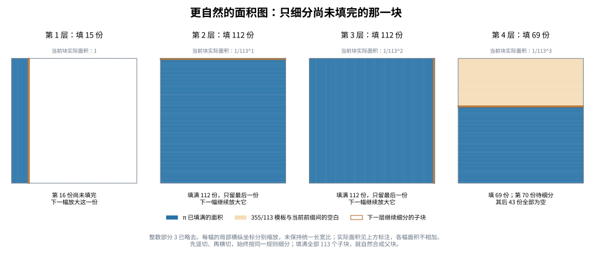

# 面积进制工具的修改：从数字柱改为嵌套填充

2026-11-03。回应用户给出的明确模型：第 \(k\) 位宽度为 \(b^{-k}\)，高度为数位，
矩形总面积表示对象；希望研究在合适进制下的简单几何拟合。

**推荐修改：保留每一位贡献的面积，将数位解释成填满的子块数量，
在尚未填完的子块内继续细分。**进位由局部填充规则自动实现。
这是表示工具的修正，没有构造新 π 逼近纪录。



## 1. 旧附加规则哪里不自然

之前补入的“把所有数字柱固定排成长条，再用不重叠面积衡量轮廓差异”，
在进位处不连续。令
\[
x_M=0.5-10^{-M},\qquad y=0.5,\qquad M\ge2.
\]
规范十进制数位分别为 `0.49...9`（到第M位）和 `0.500...`。
实际数值之差为 \(10^{-M}\)，但原数字柱的不重叠面积是
\[
\frac1{10}+9\sum_{k=2}^{M}10^{-k}
=\frac15-10^{-M}\longrightarrow0.2.
\tag{1}
\]
因此很接近的数会被画得相距很远。问题来自新增的固定条带距离，
并不否定用户的面积守恒直觉。

单纯把柱顶改成光滑曲线，不能保证消除这个表示依赖。
另一方面，若将所有同面积形状都免费视为相同，每个数又都可以选用
“宽为该数、高为1”的矩形代表，所有对象便都能被拉直。
所以应明确保留局部细分规则及层级，不允许无限制的免费重新塑形。

## 2. 建议固定的新规则

先固定整数底数 \(b\ge2\)。用户所称的 `1/113进制` 在这里对应面积尺度
每层缩小为上一层的 \(1/113\)，即每次分113个等面积子块。

本模型先处理非负对象。把单位面积根块按同一个固定全局顺序排列，
先填完整数部分所需的根块，再在紧接着的一个单位正方形内表示小数部分。
对其贪心数位 \(d_1,d_2,\ldots\)，逐层执行：

1. 把当前未完成的块分成 \(b\) 个等面积子块，并给出固定顺序。
2. 数位是 \(d_k\)，就完整填入前 \(d_k\) 个子块。
3. 在第 \(d_k+1\) 个子块内继续读下一位；其他后续子块保持空白。
4. 奇数层竖切、偶数层横切，每种对象都用相同方向及顺序。

第 \(k\) 层单个子块面积为 \(b^{-k}\)，本层新增面积恰为
\(d_kb^{-k}\)。所有新增区域互不重叠，前m层面积为原来的数位截断：
\[
\operatorname{area}(E_m)=\sum_{k=1}^m d_kb^{-k}.
\tag{2}
\]
面积因此守恒。交替横竖切使当前子块每两层回到相似的正方形，
不必把所有细块硬塞到一条越来越拥挤的横轴上。
图中各框采用当前子块的局部坐标，横纵分别缩放，没有保持统一长宽比；
实际面积以标注为准，它们不是四个可以相加的同尺度单位块。

数位原来作为高度时，一个高度d、面积为 \(db^{-k}\) 的矩形也可拆成d个
面积 \(b^{-k}\) 的单元。因此这个改法保留了原来的数位面积贡献，
改变的是这些单元的组织和显示方式。

## 3. 进位自动成为几何合并

本层的全部b个子块恰好组成父块，故
\[
b\times b^{-k}=b^{-(k-1)}.
\tag{3}
\]
这就是局部进位。并不需要在看到某个好逼近之后再额外允许任意移动。

终止展开和无限 \(b-1\) 尾的两种写法，也会得到相同的填充区域，
至多相差零面积边界。例如 `0.5000...` 与 `0.4999...`：
后一种写法在第5个十分之一块内部不断填满，剩余块面积趋于零，
极限上就是前一种写法已经完整填好的第5块。

## 4. 113例子的实际填充

用严格π区间认证得到
\[
\pi-3=\frac{15}{113}+\frac{112}{113^2}
+\frac{112}{113^3}+\frac{69}{113^4}+\cdots.
\]
而 \(355/113-3=16/113\) 直接填满第一层前16块。

- π 第一层填15块，在第16块内继续。
- 第16块再分113份，填满112份，只剩最后一份待细分。
- 下一层再次填112份，缺口又缩进唯一最后一份。
- 再下一位是69：填69份，在第70份继续，其后43份保持为空。

于是 π 的填充区域包含在355/113模板内；两者差异成为第16块内部
真实的微小空隙。无需让两处很大的柱形差异相互抵消。
前三层后，缺口小于 \(113^{-3}\)；前四层已经严格给出
\[
\boxed{\frac{43}{113^4}
<\frac{355}{113}-\pi<\frac{44}{113^4}.}
\tag{4}
\]
数值约为 \(2.63727\times10^{-7}\) 与 \(2.69860\times10^{-7}\) 之间。
独立计算的实际差为 \(2.6676418906\times10^{-7}\)。
由于355/113的实际分母为113，式(4)也认证其归一化质量小于
\(44/113^2\approx0.00344585\)。这里没有用图上看起来很小替代面积计算。

有限整数账本可记录缩放后的未填面积单位数：
\[
K_m=113^m\left(\frac{16}{113}-\sum_{k=1}^m d_k113^{-k}\right),
\qquad K_{m+1}=113K_m-d_{m+1}.
\]
本例前四项是 **1、1、1、44**。这是同一几何规则的整数检查方式，
不是把旧的逃逸深度等价关系重新宣称为新突破。

## 5. 更自然的画布仍需保留哪些信息

对同一分割树及上述单位根块顺序，当 \(0\le x<y\) 时，填充区域满足 \(E_x\subset E_y\)，
因为第一次不同的数位处，y会完整包含x仍在细分的那块。
所以这种固定有序填充的区域距离满足
\[
\operatorname{area}(E_x\triangle E_y)=|x-y|.
\tag{5}
\]
它修复了旧距离在进位处的不连续，但面积差本身没有提供新的数论信息。
因此后续研究至少应保留：

- 细分层数，以及未完成块在树中的位置；
- 简单填充模板是否能在多个层级重复使用；
- 模板有限描述的成本，以及候选面积约分后的实际分母。

若研究曲线拟合，也须独立规定允许的曲线族和描述成本。
一条曲线看起来简单，并不保证其下面积是有理数；若要生成有理候选，
可从有理顶点的分段直线等可核算面积的对象开始。
本轮推荐的主修改是上述嵌套填充，而非重新选择一条未经约束的最佳曲线。

## 6. 复现与检查

```bash
python3 verify_model.py
python3 -m pip install matplotlib
python3 draw_model.py
```

[verify_model.py](verify_model.py)只依赖标准库，使用精确 `Fraction` 和Machin反正切
交错级数上下界，认证π前12个113进制数位、每层块面积、所有新增区域互不重叠、
前缀面积守恒、区域落在355/113模板中，以及逐层缺口上下界。
还检查了式(1)在5种精度下的反例。输出见 [results.json](results.json)。
显示小数相同的上下端点不表示严格区间宽度为零。

[draw_model.py](draw_model.py)生成本文示意图；需要可显示中文的字体。
固定方向、固定顺序和整数面积账本使模型可复核；这些检查没有证明π存在
任意好的新逼近，也没有声称提出新的进位算法或新数论定理。


## 纪录尺度的迁移与邻域实验

后续已检验 233,325 位分母纪录的前三个数位和 73 个分块数，并推导公开巨型纪录的条件性面积比例。见 [record_migration/README.md](record_migration/README.md)。实际验算与依赖报告的结论分开记录。
