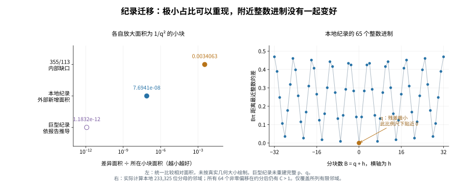

# 纪录分母及其附近进制的面积实验

2026-11-03。问题：113 的面积细分图能否迁移到纪录对应的尺度，附近是否存在一片同样有利的整数进制？

**表示可以迁移；本轮没有发现新的预测规律。**巨型纪录的差异占比约为 1.18317 × 10⁻¹²。实际计算的本地纪录，在所查加法邻域中是一个孤立的好点；小整数倍只是同一分数的重复表示。



## 证据范围

| 对象 | 本轮完成的工作 | 范围 |
|---|---|---|
| 355/113 | 用严格 π 有理区间计算面积与数位 | 实际验证 |
| 上传数据中的本地纪录 | 用完整 p、q，重新夹逼 π，提取前三个 q 进制数位，并扫描 73 点 | 实际验证；q 有 233,325 位十进制数字 |
| 部分商 845188380288 对应的巨型纪录 | 据公开系数与位置推导面积比例和数位关系 | 条件性结论；未重建巨型 p、q |

“1/q 进制”保留用户的几何含义：每层分成 q 份，每份面积缩到上一层的 1/q，即整数基数 q。填充次序与横竖细分方向固定。

## 共同观察尺度

设 p/q 既约，p = 3q + k，定义

\[
C=q^2\left|\pi-\frac pq\right|<1.
\]

把差异所在的第二层单元（面积 q⁻²）放大到共同大小后，差异面积占这个单元的比例就是 C。

| 分数 | 方向 | 单元内差异比例 C |
|---|---|---:|
| 355/113 | 模板内的缺口 | 0.00340631193013807… |
| 本地纪录 | 模板外的新增填充 | 7.69410765615515… × 10⁻⁸ |
| 巨型纪录，若公开报告正确 | 模板外的新增填充 | 1.18316818276… × 10⁻¹² |

巨型纪录的这一占比约比 355/113 小 **28.79 亿倍**。这是相对面积比较；各单元的实际面积也相差极大。

### 下侧分数：比例小，不一定零位多

若 p/q < π，则

\[
\pi=3+\frac{k}{q}+\frac{C}{q^2},\qquad
d_1=k,\quad d_2=0,\quad d_3=\lfloor qC\rfloor.
\]

其中 d₁、d₂、d₃ 是 q 进制的前三个小数数位，并有

\[
\frac{d_3}{q}<C<\frac{d_3+1}{q}.
\]

本地纪录实际认证了这三个数位。第三位非零，是一个有 **233,318 位十进制数字**的整数；但它占全部 q 份的比例只有约 7.69 × 10⁻⁸。因此，数位可以非常大，填充比例仍极小。

若 p/q > π，则相反方向的公式为

\[
d_1=k-1,\qquad d_2=q-1,\qquad d_3=q-\lceil qC\rceil.
\]

355/113 的 113C < 1，所以前几位为 15、112、112、69。不能把下侧纪录也画成同方向的内部缺口。

## 巨型纪录：依报告推导的部分

公开资料报告下一部分商 A = 845188380288，位于首项 3 计作第 1 项时的第 383059989914 项。标准编号为 a₃₈₃₀₅₉₉₈₉₉₁₃，对应好分数的标准收敛分数下标 N = 383059989912；N 为偶数，故该分数位于 π 下方。

连分数精确误差公式给出：**若上述系数与位置正确**，则

\[
\frac1{845188380290}<C<\frac1{845188380288}.
\]

两界约为 1.18316818276285 × 10⁻¹² 与 1.18316818276565 × 10⁻¹²。

此前“500 多亿位”是保守下界，不是已知实际位数：

\[
q_N\ge2^{191529994956}>10^{57458998485}.
\]

所以 q 至少有 57,458,998,486 位十进制数字。特别地 q > A+2，因而 qC > 1：第二位为零，第三位已非零。更优的相对面积并不自动变成更长的字面零段。

本轮未重建这项纪录的完整 p、q，未独立核验作者的世界规模计算；这里也不声称它是截至今天已独立确认的全球最优纪录。

## 实际扫描本地纪录周围 73 点

扫描 B = q+h，h = −32,…,32，共 65 点；以及 B = mq，m = 1,…,8，共 8 点。q 点重复一次。

对每个 B，严格认证最近整数 P = nearest(Bπ)，计算

\[
C_{\rm raw}=B|B\pi-P|,\qquad
g=\gcd(P,B),\qquad
C_{\rm reduced}=C_{\rm raw}/g^2.
\]

最后一项按真正约分后的分母计费。

| 分块数 | 结果 |
|---|---|
| q | C ≈ 7.6941 × 10⁻⁸ |
| 64 个非零偏移 | 原始与约分后的 C 全部严格大于 1 |
| 非零偏移中最小原始 C | h = ±7；log₁₀ C ≈ 233322.901656（显示精度相同） |
| 非零偏移中最小约分 C | h = −11，g = 1688；log₁₀ C ≈ 233318.145792 |
| mq，m = 1,…,8 | 最近分子均为 mp；约分均回到 p/q |

这里的“孤立”只覆盖明确列出的有限邻域；不能据此宣称更远处没有好分母。

### 邻域形状的原因

对下侧纪录，qπ = p + C/q，故

\[
(q+h)\pi=p+h\pi+C/q.
\]

记 ‖t‖ 为 t 到最近整数的距离，则距离函数的 Lipschitz 性给出

\[
\big|\|(q+h)\pi\|-\|h\pi\|\big|\le C/q.
\]

因此邻域形状基本由小整数 h 的相位 hπ 决定。1 ≤ |h| ≤ 32 时最小距离出现在 |h| = 7，约为 0.00885142487，而非与纪录同阶的极小数。

这个公式只控制原始网格质量。约分能否大幅改善还需要实际 gcd；本地扫描计算了它们，巨型纪录没有这部分计算证据。

若 B=mq 且 mC/q < 1/2，则最近整数是 mp，原始质量为 m²C；约分后仍为 C。不能把这一结论扩展到不受限制的所有 m。

## 对工具的实际修改结论

面积图保留三项：细分树、单元内占比、模板既约分母。同时增加进制邻域扫描和约分检查，才能识别一个形状是否只是已知好分母的重现。

本轮成功迁移的是已知逼近的几何特征。q 本身由纪录反选，已提供了关键尺度；这些结果尚未给出独立于已知 q 的选底规则，也未找到新纪录。

## 重现

在仓库根目录安装 gmpy2、matplotlib 后运行（不要使用 python -O，认证使用 assert）：

```bash
python research/pi-area-refinement-2026-11-03/record_migration/verify_local_record.py
python research/pi-area-refinement-2026-11-03/record_migration/verify_neighborhood.py
python research/pi-area-refinement-2026-11-03/record_migration/compare_records.py
python research/pi-area-refinement-2026-11-03/record_migration/draw_comparison.py
```

前两份程序自动寻找仓库中的既有快照，也支持 --record。π 由 Machin 公式、向外舍入的 MPFR atan 夹逼；提取数位用精确整数除法。精度为 3,100,868 bits。结果保存长度、哈希和短前后缀，避免打印巨整数。显示的小数与对数为近似值，认证由精确端点与断言完成；显示的区间端点可能相同。

来源：

- [上传的本地纪录](../../pi-search-2026-11-03/snapshots/terms-000010184980-0dfca99fac67/records/convergent_000000453292.json)
- [OEIS 部分商纪录 A033089](https://oeis.org/A033089)
- [OEIS 位置及编号说明 A033090](https://oeis.org/A033090)
- [Max Frank 原始 README](https://drive.google.com/file/d/1Dw6pzvn_mouWut7T2NtGsp0VskT-wTFN/view)
- [Max Frank 原始日志](https://drive.google.com/file/d/1rf5VjABLlb4rRd3aI6LbZQ23vhU7TnhB/view)
- [此前的来源审查](../../root-angle-record-2026-11-02/record-review/FRACTION_AND_VERIFICATION.md)
