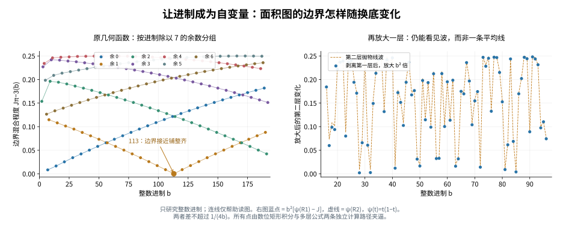
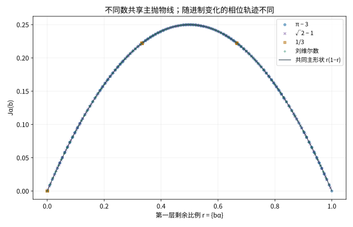

# 直接从面积图定义整数进制函数

2026-11-03。沿用固定的“先竖切、再横切”细分图。本轮把进制作为自变量，推导整个几何函数的层级关系；不以预先选择纪录分母为研究入口。

## 定义：只读边界，消除自动缩放

略去整数部分，令 α = π−3。在整数进制 b ≥ 2 下，填充图 E_b(α) 位于单位正方形内。它向左下封闭，可用每一列的填充高度 h_b(x) 描述：

\[
E_b(\alpha)=\{(x,y):0\le y\le h_b(x)\},\qquad
\int_0^1h_b(x)\,dx=\alpha.
\]

总面积不随进制改变；形状会变。选取如下几何读数：

\[
\boxed{J_\alpha(b)=b\int_0^1h_b(x)(1-h_b(x))\,dx.}
\]

满列 h=1 和空列 h=0 都贡献零；部分填充的边界列有贡献。只有一个宽 1/b 的边界列可能部分填充，因此乘以 b 消除其宽度自动缩小的影响。J 不是逼近误差或总面积，是这套固定几何规则下的一种边界读数；不宣称它是唯一的自然选择。



所有横坐标均为整数。图中连线仅帮助阅读，没有把它当作非整数底数上的几何函数。

## 精确函数方程

令

\[
R_n=\{b^n\alpha\},\qquad \psi(t)=t(1-t),
\]

花括号表示小数部分。R_n 是第 n 层活动小块里最终会填满的面积比例。

则有精确关系：

\[
\boxed{J_\alpha(b)=\psi(R_1)-b^{-2}\psi(R_2)+b^{-3}J_{R_2}(b).}
\]

这不是回归拟合。它表示：剥离前两层，再把剩余量放大 b³ 倍，得到同一种几何函数，只是输入面积变成 R₂。

展开 K 轮：

\[
J_\alpha(b)=\sum_{j=0}^{K-1}b^{-3j}
\left[\psi(R_{2j+1})-b^{-2}\psi(R_{2j+2})\right]
+b^{-3K}J_{R_{2K}}(b).
\]

因为 0 ≤ J_u(b) ≤ 1/4，尾项有严格界：

\[
0\le\text{尾项}\le\frac1{4b^{3K}}.
\]

因此当前进制函数是可认证的多尺度抛物线波叠加。这里是本轮从模型推得的关系，不主张文献首创。

## 两步几何证明

记 a = floor(bα)、r = R₁、c = floor(br)、s = R₂。唯一未满竖条内的高度为

\[
h_\alpha(x)=\frac{c+h_s(bx-a)}b,
\qquad \frac ab\le x\le\frac{a+1}b.
\]

它之外都是满列或空列。使用 ∫h_s=s，代入 J 的定义：

\[
J_\alpha=\frac cb+\frac sb-
\frac{c^2+2cs+\int h_s^2}{b^2}.
\]

而 r=(c+s)/b，且 J_s=b(s−∫h_s²)。整理即得上述函数方程。整数 b 保证嵌套的小数部分满足 {bⁿ{b²α}}={bⁿ⁺²α}，因而可逐轮展开。

## 哪些波是普适的，哪些信息值得继续看

边界列中高度的平均数是 r。由凹函数 t(1−t) 的 Jensen 不等式，J ≤ r(1−r)。结合递推，可得

\[
\boxed{0\le\psi(R_1)-J_\alpha(b)\le\frac1{4b^2}.}
\]

第一层的主抛物线对每个 α 都相同。换进制时不同对象沿这条曲线经过的相位不同；深层修正也不同。

定义第二层放大读数

\[
\Delta_\alpha(b)=b^2[\psi(R_1)-J_\alpha(b)],
\]

则精确地

\[
\Delta_\alpha(b)=\psi(R_2)-J_{R_2}(b)/b,
\qquad 0\le\psi(R_2)-\Delta_\alpha(b)\le\frac1{4b}.
\]

所以可以逐层剥离共同主项，检查某一段进制范围的异常究竟在第几层形成。共同抛物线不能当作 π 独有的规律，也不能据此推出新的逼近纪录。



## 实际实验

### 已能解释的一簇进制曲线

上图左侧按 b 除以 7 的余数分组，得到简单分支。设 ε=22/7−π>0，则 α=1/7−ε。对于 b=7m+r，r=0,…,6，有精确相位公式

\[
R_1=\{r/7-b\varepsilon\}.
\]

因此这七簇的主曲线由 ψ({r/7−bε}) 给出，每条在不跨越进位处都是二次曲线。特别是 **b=7,14,21,…,189** 这一簇，0<bε<1，从而

\[
\boxed{0\le b\varepsilon(1-b\varepsilon)-J_{\pi-3}(b)\le\frac1{4b^2}.}
\]

这里的系数来自对象与 1/7 的差；没有拟合参数。这个结果给出一整个进制族上的曲线，而不只描述某一项纪录。它解释了已绘图形，不额外构成关于下一个好分母的预测。

四个对象为 π−3、1/3、√2−1，以及经典刘维尔数 L=Σ10^(−k!)。每个对象扫描整数底 b=2,…,192，提取 24 位，共 764 份前缀。未使用连分数或纪录分母作为输入。

每个点以两条路径独立夹逼 J：

1. 直接对已填矩形求纵向一阶矩，剩余尾面积限制在活动矩形内。
2. 使用 12 轮层波公式和严格尾项界。

所有数位认证和区间计算采用精确有理数。764 个点全部通过两种夹逼的一致性检查；一、二层误差界也全部相容。结果中的浮点数仅用于显示与作图。

| 对象 | 扫描范围内最小 J 所在进制 | J 约值 |
|---|---:|---:|
| π−3 | 113 | 0.0000300416587455 |
| 1/3 | 3，且每个 3 的倍数均为零 | 0 |
| √2−1 | 169 | 0.00207970087532 |
| L | 100 | 0.000099 |

这里只是本次有限扫描中的几何函数最小值，不等于在全部有理数中寻找最优逼近。J 小也不能替代约分后的分母平方误差标准。

768 位二进制有理区间用于常数认证。π 使用交错 Machin 级数；√2 使用整数平方根；L 使用前五项和第六项起的严格尾界。较低精度会使 L 在十进制的第 24 位跨越进位边界，因此这里保留足够精度，不以普通浮点数判定数位。

## 保留几何约定

不同进制的形状依赖固定的轴安排。比如面积 α=1/4，在二进制 `.01` 下得到边长 1/2 的正方形、J=1/4；在四进制 `.1` 下得到宽 1/4、高 1 的竖条、J=0。面积相同而几何不同是本函数刻意研究的内容。

原面积图已有“交替竖、横”约定，因此本轮没有修改它。若将来用非整数底数连续连接整数点，需要另作定义，不能称作分成非整数个等块。

## 重现与后续问题

在本目录运行（不要使用 python -O）：

```bash
python compute.py
python draw.py
```

compute.py 仅依赖 Python 标准库；draw.py 使用 matplotlib。

下一步对象已经具体化：研究 b ↦ J_α(b) 的多层相位如何共同形成局部低谷，以及连续多个层级都偏低时，其底数集合怎样分布。固定的层波函数方程作为工具保留，实际约分成本在需要评价逼近时另行计算。
