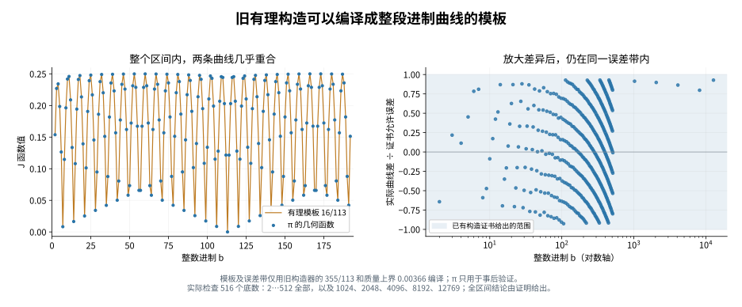

# 仓库结合：有理模板、进制函数与真正约分质量

2026-11-03。读取基线提交 `ce9ee54ef02e430d29b84e1dbb1b95c5be23041b` 的研究索引、当前方向及相关旧笔记。本轮只审查与当前进制函数有关的接口，没有独立重审全仓库及论文语料。

**得到三处严格结合：旧循环余数可以编译成完整有理函数分支；好分数可以跟踪整段进制曲线；加上真实约分因子后，几何读数与实际逼近质量可乘法比较。**没有新 π 逼近纪录，也没有证明质量沿无限子序列趋零。

## 1. 原有模块怎样接上

| 旧模块 | 已有内容 | 本轮新增接口 |
|---|---|---|
| [分母进制信号](../DENOMINATOR_BASE_SIGNAL_2026-10-29.md) | 最近网格误差、数位缺口与分母平方质量 | 几何 J 的乘法型质量界 |
| [循环与相位审查](../PERIOD_ALIGNMENT_AUDIT_2026-10-29.md) | 有限余数轨道、最小循环、重复表示 | 完整 J 的精确有理函数分支 |
| [有理进位逃逸](../base-transport-2026-10-31/RATIONAL_CARRY_ESCAPE.md) | 额外存活深度 H 的有限整数证书 | H 控制整段进制曲线可稳定跟踪的长度 |
| [整数周期链的 gcd](../wave-chain-2026-11-02/arithmetic/NOTE.md) | 真分母为标签分母除以实际 gcd | 几何读数同步除去 gcd² 的成本接口 |
| [周期比证书构造器](../period-content-design-2026-11-03/README.md) | 纯有理输出 p/q 及严格质量上界 U | 不读取 π 即可编译曲线模板及认证误差带 |

沿用小数面积 α∈[0,1]、整数进制 b≥2、固定交替横竖细分。J 的定义和层波方程见 [上一轮](../pi-base-function-2026-11-03/README.md)：

\[
J_\alpha(b)=b\int_0^1h_b(x)(1-h_b(x))\,dx,
\quad \psi(t)=t(1-t),\quad R_n=\{b^n\alpha\},
\]

\[
J_\alpha(b)=\psi(R_1)-b^{-2}\psi(R_2)+b^{-3}J_{R_2}(b).
\]

## 2. 好分数控制整段曲线，而不只一个底数

有序填充图随面积参数嵌套，且

\[
J_\alpha(b)=b\int_{E_b(\alpha)}(1-2y)\,dA.
\]

由于 |1−2y|≤1，得到跨进位也成立的全局界：

\[
\boxed{|J_\alpha(b)-J_\beta(b)|\le b|\alpha-\beta|.}
\]

它不要求两边规范数位前缀相同。取既约 p/q∈[3,4]，设 u=p/q−3、C=q²|π−p/q|，便有

\[
\boxed{\sup_{2\le b\le q^2,\ b\in\mathbb Z}
|J_{\pi-3}(b)-J_u(b)|\le C.}
\]

因此 355/113 的模板在**全部整数 b≤12769**上，函数值误差不超过约 0.00340631193。保持的是整条曲线的模板形状；各点产生的有理逼近仍按各自的既约分母计算。

例如 b=113 时，π 与 355/113 的第一小数位已分别为 15、16，规范前缀立即不同；但

\[
J_{\pi-3}(113)\approx3.00416587455\times10^{-5},\quad
J_{16/113}(113)=0,
\]

差仍小于 113|π−355/113|≈3.01443533641×10⁻⁵。新函数的稳定性可以跨越这个进位。

旧逃逸时钟给 t=p/q、H=E−N₀ 时的误差界 |t−π|<56/(q²tᴴ)，所以直接得到

\[
\sup_{2\le b\le B}|J_{t-3}(b)-J_{\pi-3}(b)|
<\frac{56B}{q^2t^H}.
\]

在固定允许误差下，H 每增加 1，可跟踪的底数范围按因子 t 扩大。旧整数存活证书由此成为整函数图形的稳定长度证书；这里没有把“有符号余量存活”误称为规范前缀相同。

## 3. 有理模板的全部深层波可以精确求和

取既约有理面积 u=a/q，0≤u<1。设

\[
s_0=a,\quad s_{j+1}=b^2s_j\bmod q,
\quad A_j=\psi((bs_j\bmod q)/q),
\quad B_j=\psi(s_{j+1}/q).
\]

有限状态机至多经过 q 个状态后重复。若前周期长 v、循环长 ℓ，则

\[
J_u(b)=\sum_{j<v}b^{-3j}(A_j-b^{-2}B_j)
+\frac{b^{-3v}\sum_{j<\ell}b^{-3j}
(A_{v+j}-b^{-2}B_{v+j})}{1-b^{-3\ell}}.
\]

固定 b mod q 后，全部状态与 A、B 系数固定。因此**每个同余类给出一条精确有理函数分支**，不是只保留第一层抛物线。

这里需要输入有理模板；至多 q 个状态的界不等于对巨型 q 的快速算法，状态数和系数位数仍有计算成本。

例如 u=1/7：

\[
J_{1/7}(b)=0\quad(b\equiv0\pmod7),
\]

\[
\boxed{J_{1/7}(b)=\frac{6b(b+1)}{49(b^2+b+1)}
\quad(b\equiv\pm1\pmod7).}
\]

这将上一轮“模7主曲线”接到了旧的循环余数工具，并保留全部层级。

余量自身的分母也同步变化：

\[
\operatorname{den}(\{b^nu\})=q/\gcd(q,b^n).
\]

下节将证明 J_{R_{m−1}}(b)=0 当且仅当 q|bᵐ。因此某层几何完全变整齐，恰对应模板分母的素因子已被该进制幂清除。

## 4. 几何读数与真实约分质量的乘法型桥梁

加法 O(b⁻²) 误差在极小谷底不够灵敏。这里可以给出相对界：

\[
\boxed{(1-1/b)\psi(R_1)\le J_\alpha(b)\le\psi(R_1).}
\]

证明：上界是边界列上的 Jensen 不等式。写 u=(k+s)/b、0≤k≤b−1，直接检查关于 k 的凹二次函数的两端，可得 ψ({bu})≤bψ(u)。代入 J 方程并使用 J≥0，即得下界。此界也证明 J_α(b)=0 当且仅当 bα 是整数。

现在令 x=3+α，m≥1，取最近整数 P=nearest(bᵐx)，实际公因子 g=gcd(P,bᵐ)，t=‖bᵐx‖。完全约分的分母为 bᵐ/g，其真实质量为

\[
C=\frac{b^m}{g^2}t.
\]

定义带约分成本的几何读数

\[
\boxed{Z_m(b)=\frac{b^m}{g^2}J_{R_{m-1}}(b).}
\]

由 ψ(R_m)=t(1−t)，严格得到

\[
(1-1/b)(1-t)C\le Z_m(b)\le(1-t)C,
\]

\[
\boxed{Z_m(b)\le C\le\frac{2b}{b-1}Z_m(b)\le4Z_m(b).}
\]

所以沿任何这类候选序列，Z→0 当且仅当真实质量 C→0。若同时 b→∞、t→0，则 Z/C→1。这是接口定理，不是已证明存在这样的 π 候选序列。

实际例子：

| b,m | gcd | 约分后分母 | Z，约 | C，约 |
|---|---:|---:|---:|---:|
| 7,1 | 1 | 7 | 0.0581175 | 0.0619600 |
| 14,1 | 2 | 7 | 0.0578504 | 0.0619600 |
| 113,1 | 1 | 113 | 0.003394707 | 0.003406312 |
| 226,1 | 2 | 113 | 0.003391597 | 0.003406312 |
| 12769,1 | 113 | 113 | 0.003394707 | 0.003406312 |

重复表示没有成为新的逼近机会。旧仿射链的指定分子必须先认证是最近整数，才能把其 gcd 原样代入这里；否则不能无条件套用本节定理。

## 5. 实际接入已有构造器

复用旧 `period-content-design-2026-11-03/global_summary.json` 中 m=2、未强制版本的输出：p/q=355/113、严格质量上界 U=183/50000=0.00366。

仅从这组**有理数据**，就能生成精确模板 J₁₆/₁₁₃(b) 及误差带

\[
J_{\pi-3}(b)\in
[J_{16/113}(b)-bU/113^2,\ J_{16/113}(b)+bU/113^2].
\]

编译模板这一步不读取 π 数值。对全部 b≤12769，统一严格误差上界为 U=0.00366。随后才用独立 Machin π 区间核验。

本轮复用已有积分证书，未重建其 Gram 大矩阵；独立核验确认保存的质量上界确实覆盖该输出。候选仍是既有基准，没有得到新的更好分数。

## 6. 实际验证范围

- 516 个明确底数：全部 b=2,…,512，另加 1024、2048、4096、8192、12769。
- 三个模板 22/7、333/106、355/113，共 1548 次有限状态闭式与独立矩形积分区间核对，以及 1548 次跨进位稳定界检查。
- b=2,…,64、m=1,…,4，加六个展示例，共 258 次真正约分质量的乘法界认证。
- 模7闭式、有理余量分母恒等式和 63 个底数下的反射对称核对。

所有认证计算使用标准库 Fraction。π、J 的区间来自上一轮的独立矩形积分与层波夹逼；显示数值与绘图用浮点数。**没有逐一扫描全部 12768 个底数**；全区间结论来自证明。

## 7. 哪些旧结果不能直接搬来

旧 [CF_RESIDUE_LAWS](../base-transport-2026-10-31/CF_RESIDUE_LAWS.md) 冻结 π 原生数位后换位权底数，数值本身会移动。当前 J 固定 α，每换整数底数重新展开。旧模3、模6部分商定理不能直接称作新 J 的规律。

J 也不是对象的完整编码：J_α(b)=J_{1−α}(b)，例如 1/3 与 2/3 的整条 J 曲线相同。层波证明很直接：{bⁿ(1−α)} 与 {bⁿα} 互补（整数情形均为零），ψ 的值相同，故每项层波相同。它们的相位、面积和方向应继续保存，不能从 J 曲线相近单独反推两个数接近。

## 重现

从本目录运行 `python verify.py`；画图另运行 `python draw.py`，后者需要 matplotlib。不要使用 python -O。验证器会寻找相邻的 `pi-base-function-2026-11-03/compute.py`。输入副本及哈希固定在本目录，来源为上述基线提交。

下一步可以让既有构造器输出的每个候选同时生成：有限状态曲线、稳定范围、以及带真实 gcd 的层级读数。构造端仍需产生质量趋零的候选；本轮结合提供的是可以逐项认证的几何接口。
