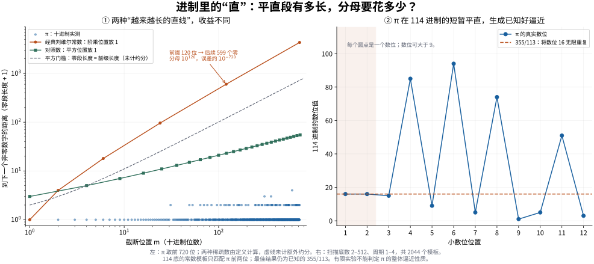

# 进制空间中的“直线”：数字模式、实际成本与 π 实验

2026-11-03。研究问题是：在某种进制里，数字波形的长平直或短周期能否产生
极好有理逼近，以及能否据此找到解释 π 的更好曲线。

**本轮结果：**经典阶乘刘维尔数的长零段机制得到直接验证；
对 π 完成了跨底数截断和短周期候选生成实验。没有找到统一最优曲线，
没有产生新的 π 逼近纪录。完整理论与边界见 [THEORY.md](THEORY.md)。



## 一个可直接验证的几何机制

在固定整数底数中，截断后很长一段全为零，意味着这个有限小数暂时不需要修正。
但零段增长必须与已经写下的前缀长度比较，而非只看曲线是否越来越平。

十进制经典刘维尔常数 \(L=\sum_{k\ge1}10^{-k!}\) 在第120位后有599个零。
截断的实际分母为 \(10^{120}\)，误差约 \(10^{-720}\)，因此
归一化质量 \(C=q^2|L-p/q|\) 约为 \(10^{-480}\)。
换成平方位置放1的对照数 \(S=\sum10^{-k^2}\)，零段也越来越长，
但在第 \(k^2\) 位截断后的零段仅为 \(2k\)，这些截断的质量反而趋于无穷。
这项对照只涉及该截断族，没有证明 \(S\) 的全部有理逼近都差。

左图的横轴是前缀长度，纵轴是到下个非零位的距离。它直接读取数位间距，
并非把旧的归一化误差重新命名为“直线”。虚线给出不计额外约分时的平方尺度。
真正评分仍用约分后的分母；低于虚线的点也可能通过约分获益。

## π 的两组有限实验

### A. 普通截断：整数底2–64，每底2000位

对 π、√2、上述刘维尔常数分别取前2000位，另算64位检查零段。
所有数位判断、既约分母与候选排名均使用精确有理区间。

- π 在这126,000个位置中，排除整数截断后，最佳是25/8，\(C\approx1.06192983\)。
  这只覆盖分母整除底数幂的截断族，不能否定 π 的其他好逼近。
- 刘维尔常数在底数10、20、30、40、50、60下，第720位都取得同一个分数
  \(S_6=\sum_{k=1}^6 10^{-k!}\)，实际分母都是 \(10^{720}\)，并严格满足
  \(10^{-3600}<C<2\cdot10^{-3600}\)。原始分母不同，约分后的好逼近相同。
- √2 的该有限截断族最佳为239/169，\(C\approx0.35355\)。

完整摘要和目标严格端点在 [truncations/base_scan_results.json](truncations/base_scan_results.json)。
相同位数预算并非相同分母预算；跨底数最小值是描述性结果，不能据此选出一个普适最好底数。

### B. 用短周期数位真正生成候选

固定底数2–512、周期长度1–4。每次只读最初一个短词，把它无限重复，
生成普通有理数；随后检查后续数位与实际误差。没有输入连分数。

共生成 **2044个模板、1748个不同分数**，最佳仍为 **355/113**。
它的最短扫描内模板是114底中的单个数位16：
\[
355/113=3+16/(114-1)=3.\overline{[16]}_{114}.
\]
π 的真实数位开头是 \([16],[16],[15],[85],[9],[94],\ldots\)，
只有前两位字面相同；右图如实展示了第三位开始的分离。
二进制中的短词 `001` 则生成22/7，并与 π 的前8个二进制小数位匹配。

这是一个有限候选生成实验；扫描后选出114底不能算未经选择的独立预测。
每个有理数 \(a+k/q\) 都能在 \(q+1\) 底写成常数循环数位，因此不限制底数
时，“选择最直的底”可能只是将未知分母藏入底数。
完整排名与严格证书见 [periodic/results.json](periodic/results.json)。

## 非整数底与一个重要边界

本轮也保留非整数进制的理论情况。任取 \(0<\alpha<1\)，
底数 \(\beta=1+1/\alpha\) 就会使它变成 \(0.11111\ldots_\beta\)。
所以 π 确实能被精确“拉直”，但这件事对所有数都成立。
把该底数再用有理数逼近时，理论文件式(8)精确核算了回到普通分母的成本。

此外，Bugeaud2002年定理2证明存在所有整数底都正规的刘维尔数。
Amou–Bugeaud2010年定理2说明，即使固定底数中的长零段和周期词指标都不强，
整体无理指数仍可以无穷大。因此“长直段”解释经典刘维尔构造，却不能概括全部刘维尔数。
来源与准确条件均列在理论文件，未把任何关于几乎所有实数的结论套用到 π。

## 验证与复现

π 扫描使用有方向舍入的 Machin 反正切公式；√2 使用整数平方根界。
随后用更高精度的 MPFR `const_pi` 和 `sqrt`，独立检查126个完整2064位前缀，
并精确复核567个保存候选，全部通过，见 [truncations/verification.json](truncations/verification.json)。
周期扫描独立使用标准库 `Fraction` 与100项交错反正切级数的严格余项界。
程序中的所有巨大有理数取整均使用整数除法，避免浮点取整制造伪零段。
对数仅用于显示，排名不依赖对数或浮点数。

```bash
python3 -m pip install gmpy2 numpy matplotlib
python3 truncations/scan_bases.py
python3 truncations/verify_results.py
python3 periodic/scan.py
python3 plot.py
```

`plot.py` 使用本目录附带的紧凑绘图输入；完整选定底数曲线由扫描程序生成，
本次未重复保存15.5MB的可重建中间结果。制图时若无Noto CJK字体，请安装一个可显示中文的字体。

旧仓库已经建立过“逃逸深度—最小分母平台”与逼近质量的等价关系。
本轮新增的是数字模式候选实验、对照与文献边界，没有把旧等价式重新计作突破。
