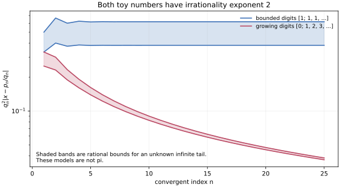

# π 构造原理：从论文到可检验的模型

2026-11-01。按新的研究优先级，暂停全库逐篇轮转，集中研究π的有理逼近、无理性构造及相关Flint–Hills级数。目标是解释构造为什么有效，并检查删去某个部件后哪里失效。

固定的OpenAI语料版本仍为`4eaee87548250b2682affda7d05d947c05554bae`。在721篇目录元数据和30个目录外文件夹名称中，直接以实数π的逼近为主题的稿件是017《The irrationality exponent of pi is 2》；这是主题范围核对，不是声称逐篇检索了751篇全文。017全部数学源码已读；本次另外回读其经典构造来源与相关级数论文。取得的全文、只读到部分的文章及访问受阻项见[范围与级数记录](scope_and_series.md)、[经典文献覆盖](classical_coverage.json)和[积分文献覆盖](integral_mechanism.md#sources-and-actual-reading-coverage)。

这次已经重建了三条机制：**用周期闭合制造算术离散性；用精确消去制造解析小量；让这两者作用于同一个非零对象。** 最后的全局结论仍取决于各篇的秩定理、整除定理、渐近估计及其准确假设。有限模型不替代这些定理，也没有解决π的坏逼近或非坏逼近。

## 1. 构造的四项任务

| 要完成的事 | 真正需要的证据 | 少了它会发生什么 |
|---|---|---|
| 算术离散性 | 同一表达式清分母后属于整数或高斯整数 | 一个很小的实数或复数没有矛盾 |
| 非零性 | 正性、满秩子式、非零配对，或准确的指标选择论证 | 零本来就可以任意小 |
| 解析小量 | 对同一对象证明大小压过清分母成本 | 原始积分小，归一化后仍可能增长 |
| 对全部有理数的控制 | 从构造序列到任意输入p/q的整数比较 | 找到一串好近似不自动给出无理测度上界 |

[Niven型模型](core_models.md#1-为什么niven型积分同时需要端点零阶乘和三角周期)先把这四项中的前三项压到一个积分里。反设π=a/b后，端点n重零配合n!让端点导数为整数；交替偶数导数制造一个可积分的微分恒等式；sinπ=0、cosπ=−1关闭边界；正性排除零；阶乘压过固定指数增长。把上限换成22/7，端点导数仍为整数，但三角周期没有闭合，积分就不再是整数。这个删除实验显示，“很接近周期”还要支付边界导数的放大成本。

## 2. 017为何引入这么多变量

先固定实数ν>2，反设有无界分母q和整数p满足|π−p/q|≤q⁻ν。这里的反设是“有无限多次固定指数的超好近似”，不是只说某些小数看起来接近π。

从反设族中依次选m个近似p_i/q_i，指标i遍历1,…,m。设虚数单位为\(\mathrm i\)，定义\(w_i=\lceil\ln q_i\rceil\)、\(r_i=2\mathrm i p_i/q_i\)。这些近似的分母可以极度分离；不要求它们处在相邻数量级。

列由单项式

\[
P(Y,X)=Y^hX_1^{\alpha_1}\cdots X_m^{\alpha_m},\qquad
w_0h+\sum_iw_i\alpha_i\le H
\]

组成。所有指数是非负整数，w_0和各w_i是正权重，H是最后才增大的多项式预算。列共享一个总预算，因此指数填满的是单纯形，不能随意改成各坐标独立截断的盒子。

行由(j,s,β)标记：j=0,…,K−1标记中心，s是t的阶数，β=(β_1,…,β_m)是横向阶数，保留

\[
v_0s+\sum_i w_i\beta_i/\theta<H,
\qquad v_0>0,\quad0<\theta<1.
\]

矩阵元是下面展开式中t^s u^β的系数：

\[
P\bigl(1+t,jr_1+G_1(t)+u_1,\ldots,jr_m+G_m(t)+u_m\bigr).
\]

G_i是ln(1+t)在0处的有限Taylor多项式。足够晚才出现的尾项只会修改更高权重，因而是有限系数包上的可逆三角变换，保留秩；同时它把矩阵元变成可清分母的高斯有理数。这一截断同时服务于局部几何与算术，不只是数值近似。

### 条件数少于未知数，为什么还不够

模型取三个中心(1,0)、(1,1)、(1,2)，用总次数≤3的二元多项式拟合每点的值和两个一阶系数：10列、9行，但秩只有7。

原因可以直接看见：沿直线Y=1，一阶数据只取决于

\[
P(Y,X)=f(X)+(Y-1)g(X)\pmod{(Y-1)^2},
\quad\deg f\le3,\quad\deg g\le2.
\]

所以只有4+3个有效方向。未知数数量没有消除中心所在直线带来的依赖。

论文的分离权重在处理更隐蔽的同类障碍。其证明先把“过多接触”变成某个代数子簇上大量导数同时消失，再比较坐标方向和对数曲线方向的法向基。权重相差足够大时，某些不同的法向基不能同时存在，被迫得到

\[
dX_i=dY/Y.
\]

在完整代数曲线上，右边在Y的零、极点有非零留数；左边是一个亚纯函数的全微分，留数恒为零。这个冲突排除了Y非恒定的障碍。然后还要处理Y=1内的障碍，再用曲线正性、blowup和消失定理得到所有局部系数包的满射。

这解释了“为什么是对数曲线、为什么要逐个分离权重”。从曲线不等式到全局满射仍使用实质性的代数几何输入；小矩阵实验没有证明这一步。具体推导、两个体积条件仍不足的反例，以及真正分离后仍须H足够大的实例，见[插值机制](interpolation_mechanism.md)。

## 3. 同一行列式怎样获得相反的大小要求

插值定理若成立，允许选一个包含全部行的非零方形子式Δ_H。将每列乘上相应的分母幂、每行除去已被取系数消耗的分母幂，再清除G_i的系数分母，可得到非零高斯整数。其模至少1，给出Δ_H的算术下界。

解析一侧不另选一个更漂亮的子式。令ω=2π\(\mathrm i\)，对每个横向指标a和同一选中列P定义

\[
f_{a,P}(z)=[u^a]P(e^z,z+u_1,\ldots,z+u_m).
\]

对列Y^hX^α，它等于\(\binom\alpha a e^{hz}z^{|\alpha|-|a|}\)。精确周期e^{jω}=1把原来的Y=1+t保持住；原中心jr_i与jω的差额放进横向位移。完整行恒等式展开后，仍然是原来Δ_H的多行线性展开。

**注意中心的类型：**原矩阵的中心是(1,jr_1,…,jr_m)，不是(e^{jr},jr,…,jr)。在指数里用“近周期”替换精确周期，会偷偷引入原矩阵没有的相位。

### 重复次数为什么产生二次节省

固定a，将所有f_{a,P}在一个大圆盘内展开为Taylor系数向量。若展开项中的两行用了同一个Taylor次数d，它们的系数向量完全相同，那个行列式项严格为零。

因此，同组n_a行若要存活，必须使用至少n_a个不同的非负次数，总次数至少

\[
0+1+\cdots+(n_a-1)=\frac{n_a(n_a-1)}2.
\]

各次幂都有几何衰减；把所有组相加就得到与∑n_a²成正比的解析节省。这是反对称行列式把线性行数放大成二次代价的具体原因。

这个节省是大圆盘Taylor展开中的几何衰减，不能自动解释成“对周期变量Z有同样高的消失阶”。模型中一个五行同组行列式为−6Z⁵，尽管不同Taylor次数的最小总和是10。

### 横向变量既恢复秩，也提供逃离碰撞的通道

新的六行模型用列(1,Y,X₂,X₂²,X₂³,X₁)，行取j=0,1及s=0,1,2，横向初始阶数均为0。精确计算得到

\[
\det A=-3r_2^2(r_1-r_2).
\]

当r₂≠0且r₁≠r₂时，原矩阵秩为6；移到全部精确周期、只保留零横向位移后，秩变成5。带位移的项恢复秩。125种完整选择中，16项单独非零，全部相加恢复原式；当两个位移相等时，这些非零项还能彼此相消。

所以不能把“一个展开项非零”说成“总行列式非零”，也不能把纯周期矩阵的秩当成原矩阵的秩。代码核验的是同一子式的完整恒等式，见[行列式机制](determinant_mechanism.md)。

## 4. 为什么无论展开项怎样选都要付费

每个展开项的行有一个横向指标a。固定阈值AH，其中0<A<1：

| 行选择的情况 | 被迫出现的节省 |
|---|---|
| 许多行的a都很小 | 小指标类别有限，许多行挤在同组，∑n_a²变大 |
| 不够多行的a很小 | 许多行必须取大a，精确位移系数支付高次近似误差 |

这两种情况覆盖每个展开项，再统一取绝对值求和，不靠挑一个有利项。完整单纯形使行数按H^(m+1)增长，而横向小指标的类别数按H^m增长；两种维数的体积比正是碰撞收益的来源。

将ln|Δ_H|除以“行数M×预算H”，得到无量纲成本。若b是原行横向预算的平均值除以H、E是全部次要成本之和，则足够条件可写为净余量

\[
\Phi(b)=\min\{cL,\nu(A(1-\eta)-b)\}-(1-b)-E>0.
\]

c=ln2/4，L量化小类别中的拥挤程度，η∈(0,1)是所需的行比例。原稿协调三个指数比：一个降低整函数增长成本，一个降低截断与清分母成本，一个提高碰撞收益。不能只让L变大而忘记另一分支。

我们给出精确有理参数和向外舍入区间的可运行证书：ν=3、2.5、2.1的一套保守选法分别用m=2967、9519、230289使预算通过。这不是最小维数，也没有生成这些维数上的真实异常好π近似；没有计算最终H或有效分母阈值。见[参数模型、消融与量词顺序](parameter_mechanism.md)。

正确顺序是：固定ν和有限维数，再选中心无关的逐级权重阈值，从反设中取足够大的分母以满足阈值，最后固定所有中心，才令H趋于无穷。逆转顺序会造成循环依赖。

## 5. 积分路线：为何对称极点能留下π

ZZ论文的一种符号归一化为

\[
R_n(t)=\frac{5t^{2n}(t^4+6t^2+25)^{2n}}{(25-t^2)^{3n+1}},
\qquad J_n=\mathrm i\int_{-1-2\mathrm i}^{-1+2\mathrm i}R_n(t)\,dt.
\]

分母只有±5两个有理极点，偶对称性迫使两个极点的主部系数成对相同。高阶极点积分后给有理函数端点值；仅简单极点留下对数。端点是共轭高斯有理数，成对对数的总角度恰为π/2。因此J_n∈Q+Qπ。

第一非平凡实例精确为

\[
J_1=-\frac{11272}{3}+1196\pi,
\qquad12J_1=-45088+14352\pi.
\]

原始残差约0.01148036只是数值显示；有理系数、分解和清分母是精确核验。删除偶对称性，即在n=0时给被积函数多乘一个t，同样的极点却留下5 arctan(1/7)。这说明对称性确实在选择目标常数。

四次多项式的零点包括积分两端及其反射点。高重零既帮助复积分的指数衰减，也帮助证明积分分母可被额外的2幂及素数整除。后者不能从“小积分”推断出来。

下面固定原论文的解析指数估计，只删除部分算术节省：

| 归一化所保留的算术信息 | 归一化后的衰减指数τ | 由这些估计能得到什么 |
|---|---:|---|
| 仅最小公倍数 | −0.475227… | 整数线性形式不保证变小 |
| 再除去已证明的2幂 | 1.257640… | 较弱的有限无理测度上界 |
| 再除去已证明的素数乘积 | 1.902916… | 原论文的7.103205…上界 |

这些渐近率依赖原文的全指标整除与复分析估计，不由n≤4的实验认证。我们另外推导了一个正系数提取式，证明π系数不会在某个指标意外变零；并把任意p/q的整数比较及所需指标选择写清楚。完整机制、Hata与Bai的变体及访问边界见[积分笔记](integral_mechanism.md)。

## 6. 这些构造目前解释到哪里

定义κ=q²|π−p/q|。原稿反设ν>2给出κ≤q^(−(ν−2))，即一个固定正的额外指数；而κ→0可能慢到1/ln q。后一种情况下，折成q的指数仅有ln(1/κ)/ln q→0。

同一选参架构在ν=2处还存在一个精确障碍。它要求A²<θ，同时想要2(A−θ)>1−θ，但

\[
2(A-\theta)-(1-\theta)<2A-A^2-1=-(1-A)^2<0.
\]

即使先把次要误差全部删除也过不去。因此本次模型解释了原稿为何只覆盖每个固定ν>2，不能据此把“指数2”升级成统一正q⁻²屏障，也不能排除另一种端点构造。



图中两个数都不是π。[1;1,1,…]有正q⁻²屏障；[0;1,2,3,…]的收敛分数上κ趋于0，但无理指数仍为2。阴影是未知无限尾数的精确有理界，图只是界的显示。证明和Legendre判别的使用见[两个模型](core_models.md)。

Flint–Hills级数还需要另一个机制：小分母的出现频率。逐项下界可能只给发散的上界；对分母差使用同一个逼近下界，则圆周点必须彼此分离，最坏尖峰不能同时挤在一个小区间。用连分数分块可把级数收敛化为∑a_(k+1)²/q_k<∞；这里a_k、q_k属于1/π的连分数。这解释了5/2临界指数，并可构造临界指数相同但收敛性相反的模型，详见[间距与失败证明审查](scope_and_series.md)。

## 7. 阅读与验证的实际边界

本次完整回读了017的正文和参考文献，以及Mahler、Mignotte、Zudilin综述、Hata、ZZ、Alekseyev和Meiburg的相应全文。Bai、Dan、López Zapata和Carella按构造或声称证明的相关节回读，未冒称全篇审计。Salikhov2010全文访问受阻，2008公告只取得第一页的提取；Chudnovsky1982只取得两页预览。没有把这些缺口补写成“已读完”。Mahler的部分初始引理仍引用另一篇未回读的论文，ZZ的外部递推证书也没有重跑。

所给模型已经独立检查了所显示的代数恒等式、矩阵秩、完整平移、端点对称、参数预算和删减实验；复积分的全部轮廓估计及一般代数几何输入没有因此被重新证明。017存在实际Lean解答源码；挑战目标文件中的sorry是目标占位，不能据此误判实际解答没有证明。本次没有编译它的传递导入闭包、执行kernel导出或运行comparator。

可访问的声称证明也不一律可靠：Carella的一个路线把应为负的sin C当作正下界，并忽略两项相消；已撤回的Flint论文使用了不满足Hölder条件的取整函数。具体式子、页码和反例都保存在范围笔记中。这些错误的定位不意味着已审完相关论文的每个陈述。

## 8. 运行模型

依赖Python、SymPy、mpmath；绘图额外用Matplotlib。入口：

```bash
python3 research/pi-construction-mechanisms-2026-11-01/run_labs.py
python3 research/pi-construction-mechanisms-2026-11-01/plot_models.py
```

六个实验的结果文件和退出状态见[verification.json](verification.json)。源码字节身份由[pinned_source_manifest.json](pinned_source_manifest.json)固定；核对工具可使用本次缓存，也可使用初始化后的`external/openai-math`子模块。若原文不在本地，只跳过字节核对并明确报告不可用，有限数学实验仍可运行；版本不符则报错。字节核对不等于证明核验。

| 模型入口 | 独立核对的主要内容 |
|---|---|
| [interpolation_lab.py](interpolation_lab.py) | 直接Taylor展开与微分方向恒等式、秩不足与分离实例 |
| [period_lab.py](period_lab.py) | 同一六行子式、125种完整展开、真正截断尾项及重复次数消去 |
| [parameter_lab.py](parameter_lab.py) | 精确有理选参、向外区间大次幂、保守预算与失败消融 |
| [integral_lab.py](integral_lab.py) | 成对极点分解、整数形式、正系数留数式、算术成本消融 |
| [check_classical_models.py](check_classical_models.py) | 小型Hermite–Padé、同时对数近似、非零行列式与分母成本 |
| [core_models.py](core_models.py) | Niven型端点模型、两个无限连分数的有理误差区间、端点障碍 |

这一阶段的推进是把构造机制具体化。π的坏逼近或非坏逼近仍未解决；后续可直接在这些带有失效实验的模型上研究改造，而不必重新开始全库轮转。
