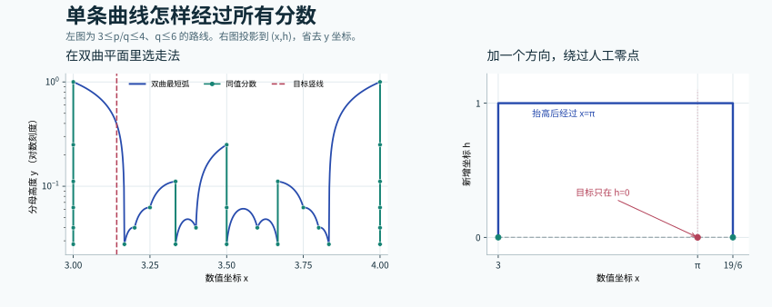

# 单条全覆盖曲线的走势、空间和长度

设 $\alpha$ 是实数，应用中取 $\alpha=\pi$。我们要一条连续曲线经过每个整数对 $(p,q)$ 的标记点，包含 $p<0$、$p=0$、$q>0$ 以及可约分数。空间应当允许从曲线到一个固定目标的距离读出 $q^2|\alpha-p/q|$，也应当有明确的长度概念来选择路线。

## 空间的选择由距离公式决定

在双曲上半平面 $\mathbb H=\{(x,y):y>0\}$ 中使用线元 $ds=\sqrt{dx^2+dy^2}/y$，把整数对放在
$$
Z_{p,q}=(p/q,q^{-2}),
$$
把目标放在竖直测地线 $G_\alpha=\{(\alpha,y):y>0\}$。这个标记是单射。同值分数对应同一个 $x$，每个实际分母有自己的高度。

上半平面距离满足 $\cosh d_{\mathbb H}((x,y),(u,v))=((x-u)^2+y^2+v^2)/(2yv)$。固定 $u=\alpha$，对 $v>0$ 取最小值，最小点为 $v=\sqrt{y^2+(x-\alpha)^2}$。因此
$$
d_{\mathbb H}((x,y),G_\alpha)
=\operatorname{arsinh}(|x-\alpha|/y),\qquad
\sinh d_{\mathbb H}(Z_{p,q},G_\alpha)=q^2|\alpha-p/q|.
\tag{1}
$$
在这套固定的实部和目标竖线下，若要求距离的双曲正弦恰好给出平方归一化误差，标记高度就必须是 $q^{-2}$。原始距离另可从 $x=p/q$ 直接读出。$q^{-2}$ 也使既约分数落在相应 Ford 圆的顶端。[上半平面距离与测地线讲义](https://webspace.maths.qmul.ac.uk/s.r.bullett/LDSGmini2.pdf) · [Farey 图与 Ford 圆](https://doi.org/10.1007/s10711-025-00997-5)

## 实际走法是竖直段接双曲最短弧

先限制 $m\le p/q\le m+1$ 和 $q\le Q$，其中 $m$ 是整数。按 $x=p/q$ 从左到右排列既约分数，也就是平移后的 Farey 序列。对每个既约值 $a/b$，同一位置的全部标记点的高度是
$$
\frac1{b^2},\ \frac1{(2b)^2},\ \ldots,\ \frac1{(\lfloor Q/b\rfloor b)^2}.
$$
它们在同一条竖直段上。可以从上端往下走，也可以从下端往上走。邻近的两个竖直段，用指定两端之间的双曲最短弧连接。双曲最短弧与实轴正交，沿弧的 $x$ 单调。竖直段的 $x$ 恒定。这条路的每一个拐向都有可计算的坐标。

在**所有横坐标非递减的覆盖曲线**中，哪种上下顺序最短，可以精确求出。记第 $i$ 条竖段两个可选方向的起点、终点为 $S_i^\sigma,E_i^\sigma$，$\sigma\in\{0,1\}$，纵向长度为 $w_i=2\log\lfloor Q/b_i\rfloor$。定义走完第 $i$ 段、以方向 $\sigma$ 退出的最短长度为 $C_i^\sigma$。有
$$
C_i^\sigma=w_i+\min_{\tau\in\{0,1\}}
  \big(C_{i-1}^\tau+d_{\mathbb H}(E_{i-1}^\tau,S_i^\sigma)\big),
\qquad C_1^\sigma=w_1.
$$
证明是任何 $x$ 非递减的路都必须按此顺序通过各列。一旦离开该 $x$ 就不能回来，所以每列的最高最低标记必在同一次经过里访问。记录第一次碰到某个极端和随后碰到另一个极端，其间至少需要 $w_i$。两个相邻列之间至少需要所选两端的双曲距离。逐项把这些下界取到，就是上述曲线。这里首尾允许在任一对应的极端点起止。此结论没有假设整个平面中最短的覆盖线一定横坐标单调。

在**所有曲线**中，长度量级仍可精确判定为 $\Theta(Q^2)$。对两个不同的既约点，有
$$
\cosh d_{\mathbb H}(Z_{p,q},Z_{p',q'})
=1+\frac{(p q'-p'q)^2+(q'/q-q/q')^2}{2}
\ge\frac32 .
$$
所以任何覆盖路线，按第一次到达的时刻列出既约点，连续两次到达之间至少相隔 $\operatorname{arcosh}(3/2)$ 的长度。单个单位区间内既约点数为 $1+\sum_{q\le Q}\varphi(q)=\Theta(Q^2)$。上界可先构造一条稍长的比较路线。按 Farey 顺序连接各列的顶端，且每一列都从顶到底再返回。相邻顶端的行列式绝对值为 1。令 $r=\max(q/q',q'/q)$，上式给出相邻顶端距离至多 $\log 4+2\log r$。于是所有弧长加上竖向往返，总长至多为 $O(Q^2)+O(\sum_{q\le Q}\varphi(q)\log(Q/q))=O(Q^2)$。最后一步用 $\varphi(q)\le q$、$\log(Q/q)\le Q/q$ 即可。优化后的路线只会更短。[Farey 顺序与相邻行列式](https://doi.org/10.1007/s10711-025-00997-5)

## 额外一个方向让整条连续曲线保留算术下界

如果只用 $\mathbb H$，任何连续曲线从 $x<\alpha$ 走到 $x>\alpha$ 都会碰到 $G_\alpha$。碰到的点可以来自中间连线，未必对应整数对。因此 (1) 关于标记点的结论不能直接用于连续路线的全部时间。

使用直积空间 $\mathbb H\times\mathbb R$，附加坐标记为 $h$，长度由 $ds^2=ds_{\mathbb H}^2+dh^2$ 给出。目标为 $L_\alpha=G_\alpha\times\{0\}$。所有整数对的标记位于 $h=0$。相同分数的竖直段仍在 $h=0$ 内完成。每次连接不同分数的两列，就从一个标记点升到 $h=1$，在该层走原双曲最短弧，再于下一处标记下降到 $h=0$。附加长度恰为每根连接 2，故保持 $\Theta(Q^2)$ 的有限几何代价。在这类抬高规则下，动态规划所选方向仍然最短，因为每个方向序列增加同一个常数。原投影会越过 $x=\alpha$，越过时第三坐标保持 1。

整个无限曲线可用尺度 $Q=1,2,4,\ldots$ 连续拼成。每阶段覆盖 $|p/q|\le Q$ 且 $q\le Q$ 的所有标记。相邻阶段末首标记也用上述升起、平移、落下的方式连接。于是每个整数对都在有限弧长时刻经过，曲线可用同一个弧长参数 $t\ge0$ 描述。构造不依赖目标 $\alpha$，取 $\pi$ 或其他实数都使用同一条曲线 $\Gamma$。

直积距离到目标是 $\sqrt{d_{\mathbb H}(z,G_\alpha)^2+h^2}$。在升降段，保持基点为某个分数标记，距离至少是该点的距离。在同值分数的竖直段，式 (1) 随 $y$ 递减，最小值正是较高端标记的距离。在 $h=1$ 连接处，距离至少是 1。全体标记中分母 $1$ 的最近整数给出距离至多 $\operatorname{arsinh}(1/2)<1$。两边取下确界，得到对**同一条连续曲线的全部时间**成立的恒等式
$$
\boxed{\inf_{t\ge0}\sinh d_{\mathbb H\times\mathbb R}(\Gamma(t),L_\alpha)
=\inf_{p\in\mathbb Z,q\ge1} q^2|\alpha-p/q|.}
\tag{2}
$$
对单个单位区间的有限分母路线，只要目标 $\alpha$ 落在区间内，同样得到最小值相等的版本，因为其两个整数端点已经访问。三维空间的作用在这里是防止连接弧引入更小的人工距离，同时每个分数依然有各自的读数。由 (2)，证明 $\pi$ 坏逼近等价于证明这条固定曲线始终和 $L_\pi$ 保持统一正距离。

## 核验与边界

复算脚本对 $Q=4,6,16,64,128$ 检查所有整数对标记、Farey 行列式和重建路径。在 $Q=4,6$ 另枚举全部竖段方向，对照动态规划。$Q=64$ 的双曲最短单调长度约为 $2780.464554$，逐列竖直往返的路线约为 $3436.956899$，这些小数使用浮点展示。两种最优性结论由上面的精确证明保证。图使用 $[3,4]$、$Q=6$，省去了无穷扩展和高度层的完整三维视图。[复算脚本](verify_hyperbolic_route.py)

这套空间选择使问题可表述为整条曲线的统一距离，并给出实际长度的下界。它仍需额外的数学估计来判定 $L_\pi$ 的距离是否能趋于零。[此前的变速和压缩](ADAPTIVE_LATTICE_SWEEP.zh.md)
