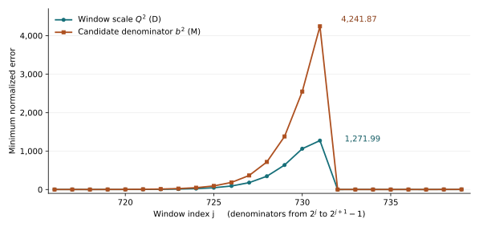

# 一条线怎样找到整个分母窗的最佳分数

给定无理数 $\alpha\in(0,1)$ 和正整数 $Q$，把所有分母 $Q\le b<2Q$ 的既约分数 $u/b$ 放在数轴上。若知道 $\alpha$ 的连分数走到这个窗口的位置，就能沿两条整数直线找出全窗最佳分数。每窗只需比较至多四个点。这个结论同时给出了研究包未检查的另一侧格点，以及判断何时可以安全剪掉它的条件。

## 两种问题要分开计算

设 $D(Q)=Q^2\min|\alpha-u/b|$，$M(Q)=\min b^2|\alpha-u/b|$。两个最小值都在上述整个分母窗取，$u\in\mathbb Z$，$\gcd(u,b)=1$。$D$ 问谁离目标最近，$M$ 问谁在付出自己分母的平方代价后最好。由 $Q\le b<2Q$ 得 $D\le M<4D$。一致有界性等价，最佳分数和有限最优常数却可以不同。

正向任务要证 $\alpha=1/\pi$ 的 $D(2^j)$ 在所有充分大的 $j$ 上有同一上界。坏逼近性在取倒数时保持，检查 $1/\pi$ 即可。一个很大的有限峰能限制覆盖这个峰的常数。若命题允许任意推迟起始尺度，这个有限峰对其常数没有约束。

## 两条整数直线上的端点定理

取分母小于 $2Q$ 的最后一个普通收敛分数 $a/r$，前一项为 $a'/r'$，后一项分母为 $R\ge2Q$。在首项取形式前驱 $(a',r')=(1,0)$，若初始分母 1 重复则按连分数顺序选最后一项。写 $d=|\alpha-a/r|$，$t=rd$，$e=r^2d$。普通连分数的标准界给出 $t<1/R$。相邻收敛分数行列式为 $\pm1$，故整数向量都有唯一表示

$$ (u,b)=k(a,r)+m(a',r'),\qquad k,m\in\mathbb Z. $$

既约性等价于 $\gcd(k,m)=1$。行列式绝对值 $|m|$ 给出到锚点的水平距离 $|u/b-a/r|=|m|/(rb)$。前驱与 $\alpha$ 位于锚点同侧，因此 $m>0$ 指向目标所在的一侧。由于 $bt<1$，两条 $m=\pm1$ 格线的误差和质量分别为

| 格线 | 绝对误差 | 乘 $b^2$ 后的质量 |
| --- | --- | --- |
| $m=+1$ | $(1/b-t)/r$ | $b(1-bt)/r$ |
| $m=-1$ | $(1/b+t)/r$ | $b(1+bt)/r$ |

**定理。** 两个问题的全部最优点都在 $m=0,\pm1$ 中。$m=0$ 只可取锚点且须满足 $Q\le r$。求 $D$ 时选两线各自最大的可用分母，再比较锚点，至多三个点。求 $M$ 时选 $+1$ 线上最小和最大的可用分母、$-1$ 线上最小的可用分母，再比较锚点，至多四个点。格线为空时跳过。上述次数只计获得收敛分数后比较的候选数。

**证明。** 若 $r<Q$，在 $+1$ 线上取首个 $c\ge Q$，由步长 $r$ 得 $Q\le c<Q+r<2Q$。对任意 $|m|\ge2$ 的候选，其误差至少为 $(2/b-t)/r$；由于 $b<2Q\le2c$，这个数严格大于 $c$ 处的误差。对于 $M$，该候选的质量至少为 $b(2-bt)/r\ge Q(2-Qt)/r$，这里在 $bt<1$ 上使用了单调性。与 $c$ 的质量之差乘以 $r$ 后至少为

$$ 2Q-c+t(c^2-Q^2)>0. $$

若 $Q\le r<2Q$，锚点在窗内，质量 $e=rt<1$。对 $D$，$|m|\ge2$ 给出 $(2/b-t)/r>t/r=d$。对 $M$，有 $b/r>1/2$。当 $|m|\ge3$，质量至少为 $(b/r)(|m|-bt)>1$。当 $m\le-2$，质量至少为 $2b/r>1$。当 $m=2$ 且 $b\ge r$，质量 $(b/r)(2-bt)>1$。余下 $m=2,\ b<r$，由 $b=kr+2r'$、$0<b<r$、$0\le r'\le r$ 以及 $k$ 为奇数得到 $k=-1$ 与 $r'>r/2$。因 $R\ge r+r'>3r/2$，有 $e<2/3$。此时质量严格大于 $(2-e)/2>e$。最后，表中两种绝对误差都随 $b$ 递减，$+1$ 线的质量是凹二次函数，$-1$ 线的质量严格递增，故取所述端点即可。证毕。

## 对 $1/\pi$ 的 4,993 窗逐项复算

在 $Q=2^j,\ 0\le j\le4992$ 的范围，两指标各自的最大值都在 $j=731$，但该窗的两个最优分数不同。表中用严格的有理数开区间包住真值。

| $j$ | $D(2^j)$ | $M(2^j)$ |
| --- | --- | --- |
| 730 | $(1060.446603225205,\ 1060.446603225206)$ | $(2545.588585977767,\ 2545.588585977768)$ |
| 731 | $(1271.992476268743,\ 1271.992476268744)$ | $(4241.866549663565,\ 4241.866549663566)$ |

两个指标在 1,686 个窗的最佳分数不同。原包 `m5` 的表列出 $j=1,\ldots,4992$ 的候选，其中 142 行可改善 $M$。141 行由另一侧的格点取胜，这些点均落在普通和中间收敛分数之外。最后一窗的普通收敛分数被原表截断。142 行原有的 `semi_min_certified` 标记只在生成的候选族内有效；原包标成未确定的 356 行反而全都选中了真最优点。独立统计，$D$ 有 91 个窗的赢家落在普通和中间收敛分数之外。

首例为 $j=36$。原分数 $24842629429/78045422110$ 的质量介于 $3.5455591862$ 与 $3.5455591863$ 之间。另一侧的 $22067781384/69327979877$ 把它降到 $3.4203832624$ 与 $3.4203832625$ 之间。原包关于 $j=730$ 的 $7\cdot20776/128$ 推断若用于任务中的 $D$，与表中严格区间冲突。$j=731$ 则确实给出更高的有限区间常数下界。



## 巨型部分商后面，分数会怎样走

以下 $A\ge8$ 为紧跟某个收敛分数 $a/r$ 的部分商。有 $R=Ar+r'$ 和 $1/(A+2)<e<1/A$。可从经典精确式 $1/e=\alpha_{n+1}+r'/r$ 得到这个界，$\alpha_{n+1}\in(A,A+1)$ 为完全商。

**窗口的形状。** 在 $r<Q,\ 2Q\le R$ 上令 $s=Q/r$，$f(u)=u-eu^2$。则

$$ \min\{f(s),f(2s)\}\ \le\ M(Q)\ \le\ \min\{f(s),f(2s)\}+1. $$

每个格点的质量至少为 $f(b/r)$，因为它与锚点不同且交叉行列式绝对值至少 1。凹性给出下界。在 $+1$ 线上，最左和最右可用分母与各自窗口边缘相距至多 $r$，且质量恰等于 $f(b/r)$。由 $2se<1$，在这个区间有 $|f'|\le1$，上界随即成立。连续模型两支在 $s=1/(3e)$ 相交，峰值为 $2/(9e)$。这解释了单个中间收敛分数的抛物线顶点 $1/(4e)$ 与整个窗口观察到的峰之间的差距。

**一个整窗内所有分数都差的界。** 选二次幂 $Q_0\le Ar/3<2Q_0$，记 $z=Q_0/(Ar)\in(1/6,1/3]$。若 $z\ge1/5$ 取 $Q=Q_0$，否则取 $Q=2Q_0$。于是对窗内每个 $b$ 均有 $b/(Ar)\in[1/5,4/5]$，且 $r<Q$。由 $e<1/A$ 及前段的行列式界，

$$ b^2|\alpha-u/b|\ >\ (b/r)\big(1-b/(Ar)\big)\ \ge\ 4A/25. $$

同样，选取二次幂使 $w=Q/(Ar)\in[1/6,1/3]$，便得 $D(Q)>A(w/2-w^2)\ge A/18$。这样的二次幂存在，因为区间两端相差一倍。两种下界可在不同窗口达到。与原包的中间收敛分数覆盖上界结合，这也说明若部分商无界，$D(2^j)$、$M(2^j)$ 必在一列趋于无穷的窗口上无界。

**何时可以只走一侧。** 若 $r<Q,\ 2Q\le Ar$ 且 $Q^2 d\ge1/2$，两个目标的最优点都在 $+1$ 线上。对 $D$，比较两侧各自最大的分母 $c,b$，其中 $c$ 在 $+1$ 侧。若 $c<b$，则 $b-c<r$，故 $(1/c-1/b)/r<1/Q^2\le2d$；据表 $+1$ 的误差更小。若 $c\ge b$ 结论也成立。对 $M$，每个 $-1$ 分母 $b$ 的窗内都有距离小于 $r$ 的 $+1$ 分母 $c$，因为两线均以 $r$ 为步长且窗宽大于 $r$。若 $c\le b$，其质量更小；若 $c>b$，质量差为 $(c-b)/r-d(c^2+b^2)<1-2Q^2d\le0$。其余格线已由端点定理排除。

取原始计算公布的 $A=845188380288$。紧接这次巨大纪录，至少有一个二进窗让全窗质量 $M>135230140846.08$，另有一窗保证 $D>46954910016$。对所有 $r\sqrt{(A+2)/2}\le Q\le Ar/2$，前段单侧判据成立。这个区间上下端之比 $A/\sqrt{2(A+2)}>2^{19}$，故至少有 **19 个连续二进分母窗** 可只沿目标一侧的格线走。该应用把巨型部分商作为公开输入，本轮独立计算只到较早的部分商 $20776$ 所在区间及其以后至 $j=4992$，未重算产生巨型部分商的数千亿项。[原始计算及索引说明](PI_RECORD_PEAK_AND_GAP.zh.md) · [OEIS 纪录](https://oeis.org/A033089)

## 把几何窗口接到可移动的峰

第二包给每个既约节点放一个非负核，问观察点略微移动能否读到半高峰。将 $Q$ 固定，核分辨率为 $1/L$，$L=HQ^2$。我们把“存在某个移动点”的判据收紧为整个半高集合的内外界。当 $H\ge20$ 时，半高集合包含每个节点周围半径 $c_*/L$ 的圆弧，并且包含在同样的圆弧扩大到 $(c_*+31/H^2)/L$ 后的并集中。常数 $c_*=0.4429464706894523\ldots$ 是第一瓣的半高位置。这套界能用左边算出的真 $D(Q)$ 直接夹住为了看见峰所必须移动的距离。[定理、证明和常数](MOVING_HALF_PEAK_ARCS.zh.md)

在上述纪录的锚定窗 $Q=r$，我们选定允许移动最多 $1/(50Hr^2)$。能看见半高峰的最后一个整数档位恰为 **391276977722**。这个选定的移动量使公开的单个部分商就足够区分相邻整数。固定观察点的最后档位仍是此前的两个候选之一。原包从可移动峰提取异常逼近的论证本身适用于所有无理中心；要用于判定 $\pi$，仍须证明 $1/\pi$ 在无穷多个窗中确实出现这类峰，或者证明所有充分大尺度上都排除了任意高的峰。[阈值认证程序](verify_moving_record_threshold.py)

## 复现及边界

两份输入为 `dyadic_window_approximation.zip`（SHA-256 `c27e7fe92ddb6d16fc40ec03da6e85ae4e07f4a03ed5d5709e246d28d4ee227d`）与 `moving_phase_peaks.zip`（`9a8b797a90c6af103ff4b49118f0c284277b8eeef7732f1305cb2a2cd7f791b8`）。前者的 13 个 Python 入口复跑成功，十份留存日志的数学输出一致。后者的八项清单哈希逐项匹配。

```bash
python3 verify_primitive_window_extrema.py
python3 verify_primitive_window_extrema.py dyadic_window_approximation.zip --csv extrema.csv
python3 verify_window_extrema_independent.py
python3 verify_moving_record_threshold.py
```

主程序用 Machin 公式、交错反正切级数和整数向外舍入，在 $2^{10300}$ 的尺度上夹住 $1/\pi$。它只接受区间两端给出相同部分商的步骤，并在每个窗严格分开最优值的上界与其余候选的下界。第二程序使用十进制整数尺度，直接取 Farey 邻点求 $D$，并按相邻收敛分母分段求 $M$。两程序得出的所有 9,986 个最优分数相同。逐窗按 `M`、`D` 顺序，对 ASCII 文本 `指标 j 分子 分母` 每行追加换行，其 SHA-256 为 `c7bbc3ec609e2e834486a155ff07c62023342a44ef789b496e58dbc9e63502a1`。主程序还用小窗直接枚举交叉检验。档位验证器依赖同目录已有的 `verify_two_window_profiles.py`。三者均只需 Python 标准库。

已有 $\mu(\pi)=2$ 给出的是带任意正指数损失的界。它允许部分商缓慢而无界地增长。这里的选择引理解决了“在给定一窗中，哪些数必须检查”。正向证明仍需要 $\pi$ 的独立性质迫使**所有足够晚的窗口**有一个固定上界；反向证明须推出**无穷多个窗口**的最小值任意大。任一有限纪录都满足不了后一个量词。[指数 2 的形式化结果](https://github.com/openai/math/blob/main/lean/docs/017.md)
