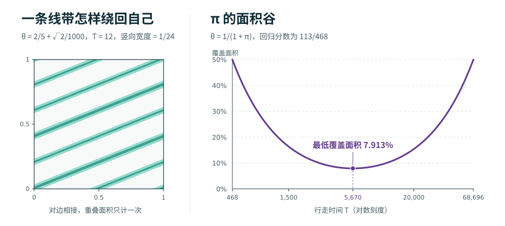

# 一条线扫过多少面积？从对角线铺法读出整数周期

研究路线是从原铺线抽出交点，再给交点的连续轨迹一支有宽度的笔。第一个问题是一个分数能在多长的时间内改变覆盖面积，第二个问题是两个分数的波能否同时出现，第三个问题是全体斜率的共同统计。前三者在下面有精确答案。对圆周率，已知的无理性指数可限制凹槽的深度速度，其全体凹槽是否有共同的正下界仍待判定。

## 从原线得到一个连续观测量

原笔记沿正整数平面的对角线 $P+Q=n$ 左右折返。与目标射线 $P=\alpha Q$ 相交处的第二坐标为 $Q=n/(1+\alpha)$。对固定 $\alpha>0$，记 $\theta=1/(1+\alpha)$。相邻行交点相差 $\theta$，把连续行号记作 $t$，把横纵两坐标都按整数平移认同，就得到单位环面上的单条轨迹
$$
\gamma_\theta(t)=(t,\theta t)\pmod{\mathbb Z^2}.
$$
它保留了每一行交点相对整数格的位置。原平面折线和这条记录交点的线具有不同的几何像。把每个相位同时平移会移动整条轨迹，覆盖面积保持相同。[原铺法和交点证明](https://github.com/epsilon-lain/yohaku/blob/eeead9a62cc3865fdefe0fe2a690ab71713d4d77/research/pi-equivalence-native-2026-11-18/PI-CONTINUOUS-WAVE.zh.md) · [原双侧选择器](FINITE_TRANSFER_MATRIX_TWO_SIDED_SELECTOR.md)

固定笔触参数 $\lambda>0$。走到任意实数时间 $T\ge1$，给整段轨迹统一的竖向总宽度 $w=\lambda/T$。定义
$$
A_\theta(T,\lambda)=
\operatorname{area}_{\mathbb T^2}
\{(t,\theta t+s)\bmod\mathbb Z^2:0\le t\le T,\ |s|\le w/2\}.
$$
计重面积恒为 $Tw=\lambda$。实际覆盖面积 $A$ 把涂过多次的地方计一次。每个 $T$ 对应一次用同样墨量的观察。这个定义只有一个行进参数，允许非整数的观测时间，无需依次生成分数。随 $T$ 改变，参数矩形的对称差面积趋零，所以投影面积也连续。

## 一个分数决定一整段波

假设 $0<\lambda\le1/2$，$\theta$ 无理。对于互素的整数 $a,b$（$b>0$），写 $\delta=|b\theta-a|$。当 $b\delta<\lambda$ 时，它产生一个开区间
$$
b<T<\lambda/\delta .
$$
这些开区间两两不交。区间以外 $A=\lambda$，区间之内严格有
$$
A_\theta(T,\lambda)=\frac{\lambda b}{T}+(T-b)\delta.
\tag{1}
$$

**证明。** 参数平面中的矩形 $R=[0,T]\times[-w/2,w/2]$ 经映射 $(t,s)\mapsto(t,\theta t+s)\bmod\mathbb Z^2$ 投影到环面。映射的核是面积为 1 的格 $\Lambda=\{(b,a-b\theta):a,b\in\mathbb Z\}$。一个格向量能使矩形内部与自身相交，当且仅当 $|b|<T$ 且 $|a-b\theta|<w$。竖直非零格向量长度至少为 1。将其余向量定向为 $b>0$。若有两个线性独立的重叠方向，那么它们的行列式是非零整数，绝对值却严格小于 $2Tw=2\lambda\le1$。于是所有重叠都沿同一个原始方向 $v=(b,a-b\theta)$。

同一环面点在矩形内的原像沿 $v$ 排成等距的一列。矩形的凸性保证这列没有缺项。一列若有 $m$ 个原像，就有 $m-1$ 个相邻对。将相邻对积分，重复计算的面积恰好为 $|R\cap(R+v)|=(T-b)(w-\delta)$。从 $\lambda$ 减去它就得到 (1)。边界相切的交集面积为零。这个论证适用于每个实数 $T$。

记 $\eta=b\delta$。谷底时刻是 $T_* =\sqrt{\lambda b/\delta}$，此时的覆盖面积为 $2\sqrt{\lambda\eta}-\eta$。在对数时间 $s=\log(T/T_*)$ 上，整段正好为 $2\sqrt{\lambda\eta}\cosh s-\eta$。反过来，在凹槽内部只观测面积曲线便得到
$$
\boxed{b=\frac{T^3}{2\lambda}\,\partial_T^2 A_\theta(T,\lambda)},\qquad
\delta=\partial_T A_\theta(T,\lambda)+\frac{T}{2}\partial_T^2 A_\theta(T,\lambda).
\tag{2}
$$
两个读数分别是回归所跨的整数行数和每次回归的漂移。曲率读数本身不含漂移的正负。已知斜率时，取 $b\theta$ 的最近整数可恢复 $a$，因为该窗口内 $\delta<1/2$。换时钟会改变普通二阶导数，式 (2) 使用原铺线的行号时间。

## 把笔加宽，两个整数方向可以同时产生波

到 $0<\lambda\le1$，存在一条仍然精确的叠加公式。用 $x_+=\max(x,0)$，则
$$
A_\theta(T,\lambda)=\lambda-
\sum_{\substack{b\ge1,\ a\in\mathbb Z\\ \gcd(a,b)=1}}
(T-b)_+\,(\lambda/T-|b\theta-a|)_+ .
\tag{3}
$$
每个固定 $T$ 只有有限项贡献，$\theta$ 可以是有理数。

**证明。** 取一个环面点，考察它在矩形内部的原像。如果三个原像不共线，它们构成的格三角形面积至少为 $1/2$。矩形内的三角形面积至多为矩形面积的一半，这是因为逐个移动顶点到矩形角点即可极大化行列式的绝对值。三个顶点都在开矩形内时严格小于 $\lambda/2\le1/2$。因此几乎每个点的全部原像都共线。和上面一样，$m$ 个原像有 $m-1$ 个相邻原始格步。不同环面点可以有不同方向，按所有原始方向积分，就得到 (3)。边界在积分中为零测集。

当 $\lambda\le1$，(3) 同时至多有两项。两个不同方向若有同号漂移，行列式绝对值是两个小于 $\lambda$ 的非负数之差的绝对值，严格小于 1。若有活跃的零漂移方向也不能再有独立方向。故两个活跃方向必在斜率两侧，其非零整数行列式绝对值严格小于 $2\lambda\le2$，只能为 1。甚至无需对所有 $a,b$ 搜索。若 $a/b$ 与 $\theta$ 之间还夹着分母 $s<T$ 的不同分数 $r/s$，则 $|b\theta-a|>b|r/s-a/b|\ge1/s>1/T$，矛盾。因此对无理 $\theta$，仅需检查分母严格小于 $T$ 的左右最近分数。这给出只比较两个方向的求值法。

$1/2$ 确实是保证**全图只出现一个方向**的最优通用阈值。给定 $\lambda>1/2$，取大整数 $k$ 使 $k+1<\lambda(2k+1)$，选 $k+1<T<\lambda(2k+1)$。当 $\theta=2/(2k+1)$ 时，$(b,a)=(k,1),(k+1,1)$ 的漂移绝对值都是 $1/(2k+1)$。它们都有正的重叠面积，且行列式绝对值为 1。对斜率作足够小的无理扰动仍成立。$1$ 也是保证**一个环面点的全部原像都共线**的最优通用阈值。取 $\theta=1/(k+1)$，则参数格中的 $(0,0),(k,1/(k+1)),(k+1,0)$ 形成非共线三角形，其包围矩形的面积等于 1。任何 $\lambda>1$ 都允许选 $T>k+1$、$\lambda/T>1/(k+1)$，把这个三角形平移到开矩形内部。小范围内的无理扰动同样可行。

在活跃方向集合固定的时间区间，(2) 的曲率读数现在等于各活跃 $b$ 的和。还可以固定 $T$，连续改笔宽，从一条宽度曲线把它们分别读出。对无理 $\theta$，不同原始方向的误差绝对值互异。在 $0<\lambda_i=T|b\theta-a|<1$ 且 $b<T$ 时，(3) 对 $\lambda$ 的导数有一次向下跳跃，跳幅绝对值为 $1-b/T$。因而由折点横坐标与跳幅分别读出 $\delta=\lambda_i/T$ 和 $b$。两种读法都使用整条线的面积。

同样的“相邻原像对”证明也适用于换形状的笔触。如果有界凸集 $K$ 的内部差集中的非零格向量都沿同一个原始步 $v$，其投影面积就是 $|K|-|K\cap(K+v)|$。例如把矩形换成椭圆，缺去的面积变成两椭圆的透镜交叠面积。改变笔触形状会实质改变波形。

## 笔再加宽，三角形进入公式

对 $1<\lambda\le2$，还有一次可以严格完成的推广。仍在参数矩形 $R$ 与参数格 $\Lambda$ 中计算。对于有限格点形状 $F$，令 $J(F)=|\bigcap_{v\in F}(R-v)|$。每个形状按格平移只取一次，可把字典序最小的顶点移到零，其他顶点不加排序权重。令 $S_2$ 为全部**原始格点对**的 $J$ 之和（此处包含竖直格步），$S_3,S_4$ 分别为所有**非共线**三点集、四点集的 $J$ 之和。每项直接等于 $(T-\operatorname{span}_x F)_+(w-\operatorname{span}_y F)_+$，其中 span 表示最大坐标减最小坐标。对给定 $T,w$，只有有限项非零。实际面积为
$$
A=\lambda-S_2+S_3-S_4. \tag{5}
$$
证明仍按一个环面点看全部原像。非共线原像中，每个非共线三角形的非零整数行列式严格小于 $\lambda\le2$，故绝对值正好为 1。此时任意两点之差都是原始向量，否则找一个与之不共线的第三点，行列式便至少为 2。参数格模 $2\Lambda$ 只有四类，同一类内的两个不同点之差不能是原始向量，所以非共线原像至多有四个。也不能有三点共线，否则其中最远的两点之差非原始。三点时逐项贡献 $3-3+1=1$，四点时贡献 $4-6+4-1=1$。共线时回到一串 $m$ 个点、$m-1$ 个原始邻边，贡献同样为 1。对环面积分即得 (5)。这说明同一条线只需改变笔宽，就可从单个整数周期走到真正的二维格三角形。

还有一个覆盖整个环面的充分条件。在 $1<\lambda\le2$ 时，如果某个内部点有四个非共线原像，那么 $A=1$。用前三个原像建立格坐标，使它们成为 $0,e_1,e_2$。第四个点 $(x,y)$ 由三角形行列式必须满足 $|x|=|y|=|1-x-y|=1$，故它为 $(1,1),(1,-1),(-1,1)$ 三者之一。四个顶点的凸包都是一个格的基本平行四边形。整个凸包都在笔触内，其投影已覆盖全环面。例子取 $\theta=1/3,T=25/6,\lambda=3/2$，参数格中由 $(a,b)=(0,0),(0,1),(1,3),(1,4)$ 生成的四点形状的四重交叠面积为 $1/225$，故覆盖率严格等于 1。水平与竖直跨度均未用尽，因而小的无理斜率扰动仍给出全覆盖。

## 三重相遇何时意味着铺满整个平面

事实上，可以去掉笔宽上限，并把矩形改成任意具有非空内部的紧致中心对称平面凸集 $K$。对任意满秩平面格 $L$，以下两件事等价。

1. 笔触的所有格平移铺满平面，即 $K+L=\mathbb R^2$。
2. 有三个不共线的格向量 $a,b,c\in L$，使 $K+a,K+b,K+c$ 有公共点，允许只接触边界。

**从局部到全局。** 平移 $K$ 使其中心为零。设公共点为 $z$。由 $z-a,z-b\in K$、中心对称及凸性，有 $(b-a)/2\in K$，故边 $[a,b]$ 的前一半在 $K+a$ 内，后一半在 $K+b$ 内。其余两边同理。这三个凸集的并以 $z$ 为星形中心，已包含三角形的全部边界，因此包含整个三角形 $abc$（从 $z$ 朝三角形内点延长可碰到其边界）。绕 $(b+c)/2$ 作中心反射，把它送到相邻的互补三角形。格平移的总并在这个反射下不变。两个三角形拼成由 $b-a,c-a$ 张成的平行四边形。它的两个边向量都是格向量，反复平移便铺满平面。

**反向。** 若 $K+L$ 铺满，对任意 $\epsilon>0$，以 $K$ 的开 $\epsilon$ 邻域 $U$ 作开覆盖。对各格点 $v$ 以 $x$ 到 $(U+v)^c$ 的距离为权重，归一化后对 $v$ 求加权平均 $F(x)$。这是局部有限的连续函数，$|F(x)-x|$ 一致有界。为证满射，给定 $y$，函数 $x\mapsto y+x-F(x)$ 将以 $y$ 为中心的一个充分大的闭圆盘映入自身，由 Brouwer 不动点定理得到 $F(x)=y$。如果每个 $x$ 的正权重格点均共线，$F$ 的像就包含在可数条直线的并内，与满射矛盾。因此膨胀后的笔触必有非共线三重交点。让 $\epsilon\downarrow0$，可将第一格点平移到原点，其他两格点仅有有限种可能（$K$ 有界）。取子列与公共点的极限，得到闭笔触的三重相遇。

对矩形带，这给出任意宽度下的面积算法。有这样的三角形就直接得到 $A=1$。否则各点的原像都共线，按原始步相邻对扣除重叠，仍然精确。在 $w>1$ 时还要包括原始竖直步 $(0,1)$。固定 $T$ 若仍要区分已经铺满后的不同轨迹，可以测量重复覆盖次数。令 $m(x)$ 是环面点 $x$ 的原像数，则
$$
H_2=\int_{\mathbb T^2}\binom{m(x)}2\,dx
=\sum_{v\in(\Lambda\setminus\{0\})/\{\pm1\}} |R\cap(R+v)|.
$$
这里每个正负方向取一个代表，包含非原始倍数。这来自对所有无序原像对计数。固定 $T$ 改变 $\lambda$，非竖直向量仍然在 $\lambda=T|b\theta-a|$ 留下折点，现在导数向上跳 $1-b/T$。无理斜率使不同的正 $b$ 格步具有不同误差，竖直方向只在 $\lambda/T$ 为正整数时开启。由此得到可在人造的粗分辨率下继续观测整数周期的量。

**三维反例。** 在 $\mathbb R^3$ 用半径 $5/6$ 的球，以每个整数点为球心。$0,e_1,e_2,e_3$ 是四个不共面的球心，对应四球有公共点 $(1/3,1/3,1/3)$，因为最大的距离平方是 $2/3<25/36$。可是在 $(1/2,1/2,1/2)$，到任何整数点的距离平方至少是 $3/4>25/36$，所以没有铺满。局部交会能推出全覆盖这一充分性确实用到了二维。此反例针对球形笔触。

## 原铺线的圆周率样本

取 $\theta=1/(1+\pi)$。原格点 $(P,Q)=(355,113)$ 对应行号 $b=P+Q=468$，行上整数坐标 $a=113$，故
$$
\delta=468\theta-113=\frac{355-113\pi}{1+\pi}.
$$
在 $\lambda=1/2$ 时，(1) 对整个区间 $468<T<68695.994297\ldots$ 成立。最低点在 $T=5670.072780\ldots$，实际覆盖的环面比例是 $0.079132310925\ldots$。未折叠时扫过的面积总是 $1/2$。因此这个分数对应一段能精确预测的重复扫掠过程。

保持**同一条**圆周率轨迹，在固定时间 $T=140000.5$ 把 $\lambda$ 从 $1/2$ 调大到 $3/4$。这时出现一处双方向重叠。

| 原平面的 $P/Q$ | 行坐标的 $a/b$ | 开始贡献的笔宽参数 $T\lvert b\theta-a\rvert$ |
| --- | --- | ---: |
| $104348/33215$ | $33215/137563$ | $0.3723466063\ldots$ |
| $103993/33102$ | $33102/137095$ | $0.6466392998\ldots$ |

表中两方向行列式绝对值为 1。细笔只报告第一项，加宽后两项同时改变面积，$A_\theta(140000.5,3/4)\approx0.74127971213421$（近似，按 14 位小数舍入）。在旧欧氏选择器中跳过的 $103993/33102$，这次成为能测到的第二个方向。

独立验证把 $T=m+r$ 写成整数与小数部分。竖直截面分别有 $m$ 或 $m+1$ 个中心，相应截面占比是 $1-r$ 和 $r$。对每种截面，排序 $j\theta\bmod 1$（$0\le j<n$），将每个环形间距 $g$ 计作 $\min(g,w)$ 后相加，即得覆盖长度。这个算法直接测量面积，与行列式的证明独立。脚本在 $0<\lambda\le1$ 上核对 240 组有理参数，在 $1<\lambda\le2$ 上另核对 330 组，含三重、四重交叠，并用 Machin 恒等式及交错级数夹住 $\pi$。[复算脚本](verify_ribbon_area.py)

## 怎样区分发散速度

对无理 $\theta$，坏逼近等价于 $\inf_{T\ge1}A_\theta(T,\lambda)>0$，其中固定任一 $0<\lambda\le1/2$。因为每个谷底是 $2\sqrt{\lambda\eta}-\eta$，它在 $0\le\eta\le\lambda$ 上严格递增，从零开始。非既约分数的归一化误差是约分后误差的公因数平方倍，故判定只需检查原始方向。原铺线的变换也保留坏逼近性。事实上 $b=P+Q$、$a=Q$ 给出 $b|b\theta-a|=[b/((1+\alpha)Q)]Q|P-Q\alpha|$，对逼近 $\alpha$ 的序列，方括号趋于 1。反向取 $Q=a$、$P=b-a$ 得到相同关系。

甚至可以确定谷底能以怎样的幂次下降。记 $\mu(\theta)$ 为无理性指数，即有无穷多既约分数满足 $|\theta-a/b|<b^{-\nu}$ 的指数 $\nu$ 的上确界。对同一支细笔有
$$
\limsup_{T\to\infty}\frac{-\log(A_\theta(T,\lambda)/\lambda)}{\log T}
=1-\frac{2}{\mu(\theta)},\qquad 2/\infty=0 .
\tag{4}
$$
若在无穷多时刻 $A/\lambda<T^{-s}$，$0<s<1$，(1) 给 $b<T^{1-s}$，且最终 $T-b>T/2$，故 $\delta\le 2\lambda T^{-1-s}$。因此 $\mu(\theta)\ge2/(1-s)$，常数可由任意小的指数损失吸收。固定 $b$ 的窗口都有有限右端，故这里出现的 $b$ 趋于无穷。又有 $A\ge\lambda/T$，从而左端至多为 1。反向对任意 $2<\nu<\mu$，取无穷多 $\delta<b^{1-\nu}$，在对应 $T_*$ 有 $A/\lambda\le2b/T_*$ 且 $T_*\ge\sqrt{\lambda}\, b^{\nu/2}$。这给出左端至少 $1-2/\nu$，令 $\nu\uparrow\mu$ 即可。$\mu=2$ 时用左端非负补足。

分式线性变换 $\theta=1/(1+\pi)$ 也保留无理性指数，因为相应分母同比例增长，而两边的分数误差之比趋于非零常数。使用 OpenAI 关于 $\mu(\pi)=2$ 的结果，(4) 给出对于每个 $\varepsilon>0$，从某个时刻起，$A_\theta(T,\lambda)/\lambda\ge T^{-\varepsilon}$。这给出了圆周率轨迹的定量限制。任意慢的趋零仍符合这个不等式，因此共同正下界依然开放。[OpenAI 原文](https://github.com/openai/math/blob/main/preprints/The-irrationality-exponent-of-pi-is-2-September-24-2026/build/main.tex)

## 同时看所有斜率

固定 $0<\lambda\le1/2$，让 $\theta$ 在单位圆周上均匀变化。在给定 $T$，每个 $b<T$ 有 $\varphi(b)$ 个既约中心（$\varphi(1)=1$），各自管辖半径 $\lambda/(bT)$ 的角区间。其内部面积曲线关于斜率是一个 V 字，最低值为 $\lambda b/T$，边缘为 $\lambda$。不同中心的开区间互不相交，由此得出
$$
\lim_{T\to\infty}\operatorname{Leb}\{\theta:A_\theta(T,\lambda)=\lambda\}
=1-\frac{12\lambda}{\pi^2}.
$$
更完整地，对 $0\le z<\lambda$，
$$
\lim_{T\to\infty}\operatorname{Leb}\{\theta:A_\theta(T,\lambda)\le z\}
=\frac{12}{\pi^2}\left[z+(\lambda-z)\log(1-z/\lambda)\right].
$$
第一式来自总窗口宽度 $2\lambda T^{-1}\sum_{b<T}\varphi(b)/b$。对第二式，在每个窗口内求 $A\le z$ 对应的宽度，然后相加，得到 $2\sum_{b\le zT/\lambda}(\varphi(b)/b)(z-\lambda b/T)/(T-b)$。用 $\sum_{b\le x}\varphi(b)/b=(6/\pi^2)x+O(\log(2x))$ 做分部求和，极限即 $12/\pi^2$ 乘以 $\int_0^{z/\lambda}(z-\lambda u)/(1-u)\,du$。这里的平均数也可由 $\varphi(b)/b=\sum_{d\mid b}\mu_{\rm M}(d)/d$ 得到，其中 $\mu_{\rm M}$ 是莫比乌斯函数。这个统计的变量是斜率，固定圆周率斜率沿时间的各段可以有不同的统计。[欧拉函数平均值讲义](https://www.math.tugraz.at/~lapkova/teaching/ANT2020/Number_Theory_lecturenotes.pdf)

## 文献位置与待解问题

环面直线、旋转截面的三间隙定理及其格解释都有经典文献。Goda 证明一维 Kronecker 序列的准均匀性等价于斜率坏逼近。Golse 的讲义讨论了环面上避开狭缝的轨迹及三种可能的长度。这里从原对角线抽出相位，对固定笔触证明了 (1)–(5)、整数反演以及两种重叠阈值。本文没有做足以判定这些公式之文献首创性的检索。[Marklof 与 Strömbergsson](https://arxiv.org/abs/1612.04906) · [Goda](https://doi.org/10.1007/s00013-024-02039-0) · [Golse 讲义](https://www.cmls.polytechnique.fr/perso/golse/Surveys/FGLorentzGran08.pdf)

一个可实验的下一问是，在三维把上面的球形笔触换成沿轨迹拉伸的椭球，哪些格方向还必须控制，才能从局部相遇推出全覆盖？平面定理和三维反例给这项实验提供了正负对照。另一个问题专属于圆周率，即其固定细笔的所有谷底是否有共同正下界。这是上述全斜率平均与有限凹槽尚未决定的量。
