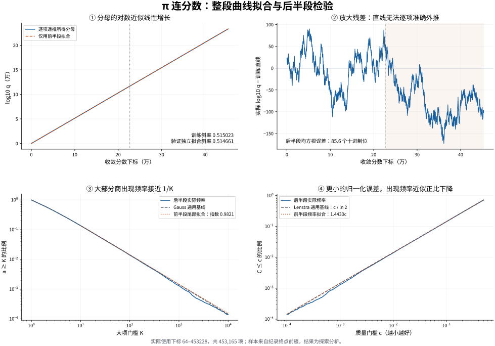

# π 搜索：连续数据的曲线拟合

2026-11-03。使用同一上传快照精确还原的 **453,294 个连分数系数**，分析每个普通位置。
本次不以九个纪录点拟合下降曲线。可评分的范围删去前64个与末尾64个位置，
实际使用收敛分数下标 **64–453228，共453,165项**。
前半段64–226645用于拟合，后半段226646–453228用于时间顺序检验。
此前已经查看过这个前缀，因此后半段不是完全未见过的正式盲测数据。



## 1. 分母的增长曲线

用每个系数递推分母的对数，无需将每个巨大分母转成十进制：

\[
\beta_n=\frac{q_{n-1}}{q_n}=\frac1{a_n+\beta_{n-1}},\qquad
\log_{10}q_n=\log_{10}q_{n-1}+\log_{10}(a_n+\beta_{n-1}).
\]

前半段最小二乘直线为

\[
\log_{10}q_n\approx0.515022852n-21.206477.
\]

单独拟合后半段，斜率为 **0.514660860**；全段描述性斜率为 **0.514734545**。
作为参照，几乎所有实数的 Lévy 极限斜率为
\(\pi^2/(12\ln2\ln10)=0.515320417\)。这不是关于 π 满足该极限的证明。

图上两条累计曲线几乎重合，但放大残差后，训练直线在后半段的均方根误差
达到 **85.6 个十进制位**。训练段二次曲线外推更差，误差 **378.4 位**。
因此“累计曲线非常直”可以描述平均增长，不能据此精准外推分母或下一次突破。
这里的“位”指 `log10(q)` 的误差，不是分母有效数字的精度。

## 2. 每一项的误差曲线

设

\[
C_n=q_n^2\left|\pi-\frac{p_n}{q_n}\right|.
\]

记 \(u_{n+1}=[0;a_{n+1},a_{n+2},\ldots]\)，则
\(C_n=u_{n+1}/(1+\beta_nu_{n+1})\)。本次用向前递推的 \(\beta_n\)
及向后递推的 \(u_{n+1}\) 计算连续位置的 \(C_n\)。

由定义精确得到

\[
-\log_{10}\left|\pi-\frac{p_n}{q_n}\right|
=2\log_{10}q_n-\log_{10}C_n.
\]

因此误差对数与分母对数之间约为2的斜率，主要来自这个恒等式。
值得研究的波动是 **\(-\log_{10}C_n\)**，以及这些波动有无预测能力；
不能将它与分母的巨大累计趋势混在一起，得到一个很高的拟合分数就算找到规律。
\(-\log_{10}C_n\) 没有对所有连分数都成立的统一上界。

在自然线性区间 \(0<c\le1/2\)，以预先固定的50个等距阈值
\(c=0.01,0.02,\ldots,0.50\) 拟合经验累计频率，得到

\[
\widehat F_{\mathrm{train}}(c)=1.442984569c.
\]

普通连分数的 Doeblin–Lenstra 参照曲线为
\(F(c)=c/\ln2=1.442695041c\)。前半段拟合和这个通用模型非常接近。
在后半段1000个等距阈值0.001–0.5上，累计频率均方根偏差分别为
**0.00074294** 和 **0.00075457**；这点描述性改善不能解释为可靠的预测优势。

| 质量门槛 | 后半段实际次数 | 实际比例 | 通用模型参照 |
|---:|---:|---:|---:|
| C≤0.1 | 32,466 | 14.3285% | 14.4270% |
| C≤0.01 | 3,186 | 1.4061% | 1.4427% |
| C≤0.001 | 297 | 0.1311% | 0.1443% |
| C≤0.0001 | 32 | 0.0141% | 0.0144% |

模型表达的趋势是：在**已经由连分数筛出的候选**上，把归一化质量门槛压小10倍，
相应出现频率大致也缩小10倍。它不是下一项命中的精确条件概率，
也不能把频率倒数直接当成确定的等待时间。

## 3. 大部分商的频率曲线

对固定门槛 \(a\ge10\)，拟合离散 Pareto 尾部：

\[
P(a\ge K\mid a\ge10)=\left(\frac{10}{K}\right)^\alpha,
\qquad K\in\{10,11,\ldots\}.
\]

训练段最大边际似然指数为 **0.982051**，后半段单独拟合为 **0.985303**。
两段均接近反比例尾部。这里使用准确的离散质量函数
\((10/k)^\alpha-(10/(k+1))^\alpha\)，没有对经验双对数曲线做独立误差回归。
相邻系数有关联；未据此给出独立同分布的标准误或显著性结论。

高斯参照尾部为 \(P(a\ge K)=\ln(1+1/K)/\ln2\)。
后半段 \(a\ge10\) 的30,952个观测值上，条件负对数似然如下，越小越好：

| 模型 | 后半段负对数似然 |
|---|---:|
| Gauss 通用模型 | 134108.485 |
| 训练段拟合的离散 Pareto | 134110.345 |
| 指数固定为1的离散 Pareto | 134113.585 |

有限门槛10处，高斯曲线并非准确的纯幂律，所以指数略偏离1本身不代表新现象。
拟合模型在这段检验中也没有超过高斯基线。

## 4. 范围、数值复核与复现

这个前缀的终点由一次纪录选中；删除巨大终点并不能消除整个样本的选择偏差。
当前结果与普通连分数的统计模型相近，既没有证明 π 随机，也没有排除其他结构。
后续973万项没有逐点数据，不能把当前拟合说成覆盖全部1018万项。

本次曲线计算使用双精度浮点数。尾部未知量取0与1的两种极端时，保留区间
的计算结果完全一致；最少65个已知后续系数使数学上的截断影响小于约
\(3.4\times10^{-27}\)，浮点舍入误差另计。这是稳定性检查；
严格有理误差证书仍见上一级的独立复核。
另一个独立计算核对了这里的质量门槛计数，结果一致。

输出数字在 [`fit_results.json`](fit_results.json)，计算及制图程序在
[`fit_curves.py`](fit_curves.py)。从上一级分析目录运行：

```bash
python -m pip install gmpy2 numpy scipy matplotlib
python windows/analyze_windows.py --records-dir ../snapshots/terms-000010184980-0dfca99fac67/records
python curves/fit_curves.py
```

程序核对重建系数流的SHA-256，与第一轮精确重建一致：
`ce0fd0c028276918ac51d04e122486dc628d283c0c6d2972cf27e2d4eae21739`。
制图程序在存在 Noto CJK 字体时自动使用它；其他环境需要可显示中文的字体。

理论参照：

- [Bosma、Jager、Wiedijk，1983原论文](https://www.math.ru.nl/~bosma/pubs/IndagMath1983.pdf)：定理1给出质量分布，式(3.1)回顾分母增长，第三节给出 Gauss 分布。
- [Berthé等，2023](https://research-portal.uu.nl/ws/files/225638316/2303.07777v1.pdf)：式(4.4)和(4.5)并列说明 Lévy 与 Doeblin–Lenstra 定律及“几乎所有”条件。
