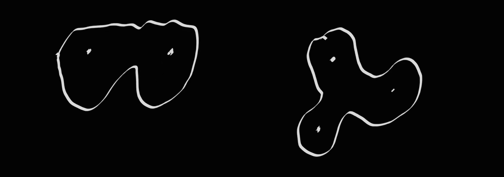
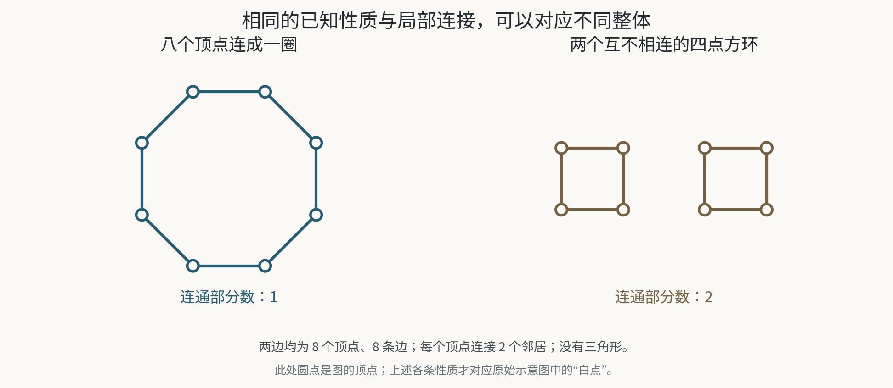

# 已知性质怎样约束整体：一个可复核的数学研究起点

日期：2026-11-16。状态：**研究问题的形式化、已知理论的定位与初等例子的精确复现**。本文不声称发现新定理、解决公开问题，或证明某种 AI 工作流更有效。

**English abstract.** We study how established properties constrain an object without necessarily determining its whole structure. A candidate-set and closure formulation separates logical consequences, additional information, inconsistency, and identification up to a specified equivalence. An exact finite example compares an eight-cycle with two disjoint four-cycles: identical listed properties and radius-one neighborhoods do not determine the global graph. Exhaustive labeled enumeration and homomorphism counts are reproducible with the Python standard library. These are elementary illustrations and connections to existing theory, not claims of mathematical novelty.

## 研究直觉与范围



原始示意中的白点表示**已经有依据确定对象具有的性质**；它们不一定是数值，也不是随机采样的空间位置。轮廓表示对象整体，尚未画出的性质表示未知。白点的坐标、距离和轮廓形状暂未被赋予严格数学意义。性质之间拟议的关系也需要单独论证。

问题包括：哪些对象能够同时满足这些性质？哪些性质可由已有性质推出？增加什么信息能区分候选？两种描述能否通过保留指定结构的对应联系起来？研究目标应说明是对象相等、同构，还是在指定观察下不可区分。

这里的数学研究与 [Yohaku 免疫式／自主组织工作流观察](https://github.com/epsilon-lain/yohaku/tree/codex/initial-release/research/immune-autonomous-2026-11-16) 分别记录。本目录的证明与精确计算由外部整理和复核完成，不能记为该实验两组模型已经产生的发现。

## 最小形式化

固定对象集合 $U$，以及允许使用的性质集合 $P$。每个 $p\in P$ 是关于 $U$ 中对象的一个确定命题；$x\models p$ 表示对象 $x$ 满足性质 $p$。设 $S\subseteq P$ 是目前已确立的性质。

定义与已知性质相容的候选集合

$$
C(S)=\{x\in U:\ \text{对每个 }p\in S,\ x\models p\}.
$$

再定义相对于 $U,P$ 的逻辑闭包

$$
\operatorname{Cl}(S)=\{p\in P:\ \text{对每个 }x\in C(S),\ x\models p\}.
$$

因此，某条尚未列入清单的性质 $q\in P$ 是否带来新约束，有一个精确判据：

$$
C(S\cup\{q\})=C(S)\quad\Longleftrightarrow\quad q\in\operatorname{Cl}(S).
$$

证明：左边成立时，每个满足 $S$ 的对象都满足 $q$；反过来，若每个候选都满足 $q$，加入 $q$ 就不会排除候选。两方向都只用了定义。

由定义也得到：增加性质只能缩小候选集合；$S\subseteq\operatorname{Cl}(S)$；闭包具有单调性与幂等性。这些是标准的闭包性质，不是本项目的新定理。

这里有三个必要区分：

- $p\notin S$ 表示尚未列为已知，不能据此推出 $x\not\models p$。已证实的否定可以在语言允许时作为性质 $\neg p$ 单独记录。
- $C(S)=\varnothing$ 表示性质组合在选定对象范围 $U$ 内不相容。此时全称命题真空成立，$\operatorname{Cl}(S)=P$；这不表示我们知道某个实际存在对象的全部性质。
- 若要“确定到同构”，须事先指定对象上的同构概念，并要求 $C(S)$ 非空且其中所有对象属于同一同构类。即使已经列出某对象在 $P$ 中的全部真性质，过弱的性质语言仍可能无法完成识别。

也可以把每个对象映到其完整性质轮廓 $\pi_P(x):P\to\{0,1\}$，其中 $\pi_P(x)(p)=1$ 当且仅当 $x\models p$。轮廓相同的对象形成同一个观察纤维。忘掉部分性质会合并观察类，增加能区分对象的性质会细分观察类。这里的“投影”指忘掉观察坐标，不自动具有线性代数中正交投影的结构。

## 精确例子：相同局部，不同整体

以下对象是有限无向简单图：没有自环、重边。$C_n$ 表示 $n$ 个顶点组成的单个环；$C_4\sqcup C_4$ 表示两个互不连接的四环。



**图中的小圆点是图的顶点；下面各条性质才对应原始示意中的“白点”。**

| 性质或观察 | $C_8$ | $C_4\sqcup C_4$ |
|---|---:|---:|
| 顶点数 | 8 | 8 |
| 边数 | 8 | 8 |
| 每个顶点的度数 | 2 | 2 |
| 三角形数 | 0 | 0 |
| 每个顶点及其邻居诱导的带根图 | 中点为根的三点路径 | 中点为根的三点路径 |
| 连通分量数 | 1 | 2 |
| $\operatorname{hom}(C_4,G)$ | 48 | 64 |

前五项都相同，但两图不同构：图同构保持连通分量数。度数为 2 且没有三角形时，每个顶点的两个邻居彼此不相连，故半径 1 的诱导邻域都是以中点为根的三点路径。这给出“所有这些局部观察相同，却不能确定整体”的具体例子。

### 在明确范围内完整找出候选

现在把 $U$ 限定为顶点集 $\{0,1,\ldots,7\}$ 上的所有无向简单图。考察性质“每个顶点度数为 2”。任何有限简单 2 正则图都是长度至少为 3 的环的无交并：从某顶点沿边前进，每一步不沿来边立即返回；度数为 2 使这一步总能继续，有限性迫使出现重复顶点。首次重复形成长度至少为 3 的环；度数恰为 2 又使环上的顶点不能再连接外部顶点，因此该连通分量就是整个环。

把 8 分拆为不小于 3 的环长，仅有 $8$、$3+5$、$4+4$ 三种可能。

| 环长类型 | 带标签的图数 | 是否无三角形 |
|---|---:|---|
| $8$ | $8!/(2\cdot8)=2520$ | 是 |
| $3+5$ | $8!/((2\cdot3)(2\cdot5))=672$ | 否 |
| $4+4$ | $8!/((2\cdot4)^2\,2!)=315$ | 是 |
| 合计 | **3507** | 无三角形者 **2835** |

计数中每个环除以选起点的环长及反向的 2；两个等长四环还需除以交换两环的 $2!$。代码枚举全部顶点排列并对边集去重，得到同样计数。

因此，“8 个顶点、各顶点度数为 2、没有三角形”把候选缩小到**两个同构类**。加入“连通”后只剩 $C_8$ 的同构类。反之，“8 条边”不再缩小候选：握手恒等式 $2|E|=\sum_v\deg(v)$ 已经由前两项推出 $|E|=8$。这是新增信息与重复信息的直接对照。

这些带标签计数记录不同标号的表示数量；没有指定随机抽样机制时，不把它们解释为对象的先验概率。

### 用另一种观察区分对象

$\operatorname{hom}(C_4,G)$ 表示从四环到 $G$ 的保边顶点映射数；允许不同顶点映到同一个目标顶点，因此它**不是四边形子图个数**。固定四环的顶点顺序，每个映射等价于 $G$ 中一条带指定起点的长度 4 闭游走。

在 $C_8$ 上，每一步选择顺环或逆环走。走 4 步闭合要求恰好两步顺、两步逆，每个起点有 $\binom42=6$ 种，故总数 $8\cdot6=48$。在四环上，除这六种外，四步始终顺行或始终逆行也会闭合；两个四环共有八个起点，故为 $8\cdot8=64$。验证程序另外枚举全部 $8^4$ 个顶点映射，逐一检查保边条件。

## 与已有理论的关系

- **形式概念分析（FCA）**研究对象、属性及满足关系产生的 Galois 对应与闭包。上面的 $C$ 和 $\operatorname{Cl}$ 是这一标准结构的直接实例；可参见 [FCA 教学材料](https://math.hawaii.edu/~jb/math618/appendix3.pdf)。
- **模型论**把语句的模型集合与模型共有的理论联系起来。固定对象范围和语言后，本文的候选／共同性质写法与 $\operatorname{Mod}$／$\operatorname{Th}$ 的关系相通。参见 [Model Theory Notes，§6.1](https://math.berkeley.edu/~scanlon/225af13lectures/ModelTheoryNotes.pdf)。不能由共享部分性质直接跳到同构。
- **属性探索**研究提出属性蕴涵、接受有效蕴涵或用反例修订知识的过程，与“下一条该问什么、反例怎样减少候选”接近。参见 [Ryssel、Distel、Borchmann 的属性探索研究](https://iccl.inf.tu-dresden.de/w/images/d/dd/RyDiBo-AMAI13.pdf)。本文尚未实现完整属性探索算法。
- **图同态计数**提供一族结构观察。这里仅计算一个测试图 $C_4$；关于有限图、有限数量的同态计数所能区分的范围，可参见 [MFCS 2022 论文](https://drops.dagstuhl.de/entities/document/10.4230/LIPIcs.MFCS.2022.32)。本文不由一个例子推断任意有限观察都能恢复任意结构。

这些联系为研究提供既有工具，也说明单纯重新命名“性质集合”不构成原创成果。需要进一步寻找具体、可复核的新问题或方法。

## 复现

要求 Python 3.10 或更新版本。默认精确核验只使用标准库，不调用模型或网络：

```sh
python verify_graph_example.py
```

程序重建全部 3507 个带标签候选、2835 个无三角形候选、两个代表图的性质及同态计数，核对理论计数后写入 [exact_results.json](exact_results.json)。没有浮点运算参与这些计数。

仓库附带已生成的 PNG。若需重新绘图，另安装 Matplotlib 并使用系统已安装的中文字体，或显式提供字体文件：

```sh
python verify_graph_example.py --plot
python verify_graph_example.py --plot --font /path/to/cjk-font.ttf
```

绘图用到的浮点坐标仅影响示意图布局。图像不是数学证明，像素也不是枚举输入。

## 待研究问题

下一步可以在固定有限对象库与允许性质库后，研究新增性质怎样排除候选，以及哪些性质可由已有性质推出。若研究“最少白点”或“最短描述”，必须预先规定允许的性质、等价目标及查询／描述成本：把任意复杂条件打包成一条性质，不能自动视为更短或更便宜；允许“就是目标对象”这样的性质也会使问题退化。

目前尚未比较不同选性质策略的效率，未证明某种语言学类比能产生新数学结果，也没有将此例外推为关于所有对象的识别定理。

## 来源与贡献边界

原始问题、性质白点的语义及原始示意图来自用户；本目录由 AI 助手协助形式化、定位已有理论、编写验证程序并整理。原始版本与本次标准库核验的 JSON 逐项一致；可选绘图入口经过本次实际运行检查。所有数学结论按上文明确范围陈述，计算复现与研究设想分开记录。
