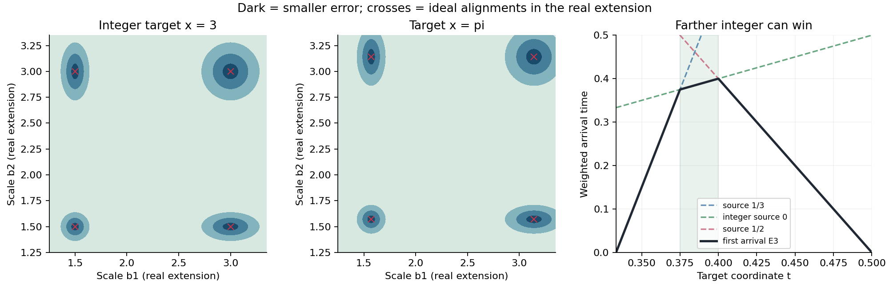
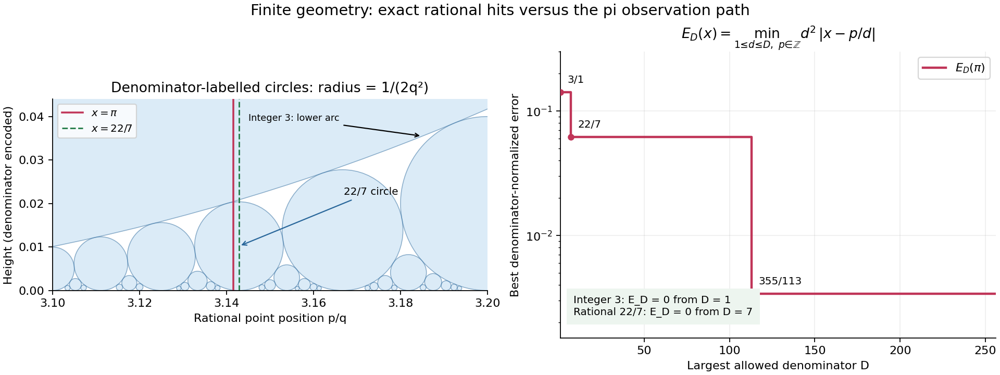

# 分母层级、观测刻度与有理波前

2026-11-01。接续用户提出的模型：分母不是单个 q，而是 q 所代表的一族；在不同有理刻度中观察目标，邻点既可以来自整数，也可以来自有理数；总邻域未必圆对称，局部凹陷可能对应好逼近。本轮建立几个明确区分的候选模型，并分别测试整数 3、有理数 22/7 与 π。用户尚未唯一规定“有理底 m/n 的低位 n 坐标”，因此没有将下面任何一种解释冒充为唯一原意。

**得到的主要结果：** 分母标记确实能产生非对称包络与多盆地；而且存在精确的波前传播解释。局部非凸形状对整数也会出现，区分目标的关键还包括凹陷深度与分母增长的关系。本轮没有证明 π 的坏逼近或非坏逼近。

## 1. 先保留分母族，不把不同表示算作不同位置

可把一层定义为 `Q≤d≤Q^Q`。在固定有界观察区间内，候选点只有有限个，但数量可以极大。必须保留 `(位置 p/d, 标签 d)`，并区分：标签数量、约分后的不同位置数量，以及真正新增的逼近。

同一个位置可能反复出现。例如 π 的窗口 `2≤d≤4` 中，若标签允许未约分表示，归一化误差最好的标签是 `6/2`；若要求真实既约分母也在窗口内，最好的则是 `7/2`。二者不是同一个查询。对 `Q=3,4,5` 的窗口，有限程序分别得到 `22/7,355/113,355/113`。检查只做到 `d≤3125`，未外推无限尾部。

## 2. 整数邻点与有理邻点可以由同一个观测得到

先放大目标为 `dx`，找最近整数 p；再缩回原坐标，就得到 `p/d`。定义

\[
 \delta_d(x)=\min_{p\in\mathbb Z}|x-p/d|=\frac{\|dx\|}{d},
 \quad \kappa_d(x)=d^2\delta_d(x)=d\|dx\|,
\]

其中 `||u||` 是 u 到最近整数的距离。普通距离对每个实数都满足 `δ_d≤1/(2d)`；这部分收缩不能区分 π 与其他实数。

有理目标 `a/b` 既约时，网格距离恰为零当且仅当 `b|d`。非精确邻点 `p/d≠a/b` 则满足 `|a/b−p/d|≥1/(bd)`。因此“最终精确对齐”与“不同邻点以普通距离靠近”是两种不同现象。

在 N 维中，若目标各坐标为既约有理数 `a_i/b_i`，共同刻度 `1/d` 的精确对齐条件是 `lcm(b_1,…,b_N)|d`。独立选择各坐标刻度会改变问题，不能静默增加独立自由度。详见 [integer_geometry.md](integer_geometry.md)。

## 3. 直接得到非球、多盆地的刻度空间

一种自然的“有理底”解释，是取比例晶格 `bZ`，其中 `b=m/n>1`。最近点为 `kb=km/n`，真实既约分母是 `n/gcd(k,n)`。给 N 个刻度定义平方误差

\[
 V_x(b_1,\ldots,b_N)=\frac12\sum_j\min_{k_j\in\mathbb Z}|x-k_jb_j|^2.
\]

固定整数选择时，低误差区域为椭球；跨选择后是多个盆地的并，可以非凸。整数目标 3 已有精确对照：刻度 3 与 3/2 都零误差，中点刻度 9/4 的误差却为 3/4。π 在实刻度延拓里也有理想对齐中心，但这些中心是无理数，不能当作有理刻度的精确命中。

图前两幅是实参数域中的连续延拓，深色表示较小误差；真正有理刻度模型需限制回有理采样点。红叉不是全部可用的有理点。右图的非对称性将在下一节解释。

另一种解释是真正的有理底数位前缀。若底为 `m/n`，L 位前缀的既约分母整除 `m^L`，通常不能当成 `n^L`。这与比例晶格的分母规则不同。详见 [rational_lenses.md](rational_lenses.md)。

## 4. “像流体”可以先变成精确的波前模型

对允许分母 `1≤d≤D`，给每个有理点 `p/d` 一个向两侧扩张的波前，速度定义为 `1/d²`。点 t 的首次到达时间是

\[
 E_D(t)=\min_{1\le d\le D,\ p\in\mathbb Z}d^2|t-p/d|.
\]

等价地，时间 c 时被覆盖的区域恰是

\[
 \bigcup_{d\le D,p}[p/d-c/d^2,\ p/d+c/d^2].
\]

这个模型保留了用户关心的“分母级别、距离、不同近邻共同收束”。局部波前都对称，但全局获胜分支切换后，包络可以不对称。它是传播与首次到达模型，不是已经给出速度场、黏性或质量守恒的流体方程。

一个意外但精确的例子：`D=3`、目标在 `1/3` 与 `1/2` 之间时，

\[
 E_3(t)=\min\{9t-3,\ t,\ 2-4t\}.
\]

当 `3/8≤t≤2/5` 时，获胜者竟是空间上较远的整数 **0**，因为其分母成本最低。只看最近两个有理端点，会把完整包络的峰值 `2/5` 高估成 `6/13`。这说明跨层级的整数、有理近邻确实会改变形状。

在相邻有理零点之间，E_D 是凹的分段仿射函数；但这项凹性属于整个有限网格，对任意目标都存在。详证见 [denominator_envelope.md](denominator_envelope.md)。

## 5. 让分母平方直接成为几何尺度

Ford 在 1938 年《Fractions》中使用了如下几何表示：给每个既约 `p/q` 配一个上半平面的切圆，其中心和半径为

\[
 (p/q,1/(2q^2)),\qquad r=1/(2q^2).
\]

整数是 q=1 的大圆。有理数的分母越大，圆越小。两个不同圆内部不相交；是否相切由整数 `|ps-rq|` 是否为 1 决定。这是已有的几何工具，不作为本轮发明。

左图包括整数 3 的圆的下侧边界，以及附近 q≤32 的有理圆；红线是 π，绿虚线是 22/7。右图只显示 D≤256 的有限最优深度，未绘制或推断无限尾部。图形使用浮点显示，获胜者比较使用严格有理区间。

目标竖线 x 穿过 `p/q` 的圆内部，当且仅当 `q²|x−p/q|<1/2`。更一般地半径取 `c/q²`，令 `κ=q²|x−p/q|<c`，竖线进入圆时的最低高度 y_- 满足

\[
 q^2 y_-=c-\sqrt{c^2-\kappa^2}
 =\frac{\kappa^2}{c+\sqrt{c^2-\kappa^2}}.
\]

因此“相对于当前分母尺度，贴近圆底多深”可以准确计算。原始高度趋零不够；需要保留 `q²y_-`。单个圆仍凸，圆族整体边界与空隙可以复杂；不能将每个圆随 q 增大的曲率当成 π 特殊的凹陷性质。证明在 [integer_geometry.md](integer_geometry.md)。

来源：L. R. Ford, *Fractions*, American Mathematical Monthly 45(9), 1938, pp.586–601，[原文扫描件](https://www.maths.ed.ac.uk/~v1ranick/papers/ford.pdf)。本轮定向阅读其中 pp.587–592 的圆构造、分离、邻接与逼近部分，未声称全文审阅；本目录不再分发扫描件。相关公式也在本轮笔记中独立证明。

## 6. 与 π017 论文的精确连接

对无理目标，E_D 每个有限 D 都严格为正，且随 D 非增。π 是否坏逼近，等价于 `inf_D E_D(π)>0`。

**若采用论文所声称的 μ(π)=2 结论**，则它在这个模型中等价地给出：对每个 ε>0，充分大的 D 都有

\[
 E_D(\pi)\ge D^{-\varepsilon}.
\]

所以用户关于“凹陷深度受到限制”的方向有一个准确版本：论文排除最优谷底以固定负幂规模持续降低，却没有提供统一正底线。它仍不能排除类似 `1/ln D` 的慢速趋零。这里的慢速曲线是逻辑上未被排除的尺度示例，不是在报告 π 的实际尾部。

## 核验、限制与下一项工作

运行 `python3 research/rational-scale-geometry-2026-11-01/run_labs.py`。四组实验检查整数观测、有理刻度/数位、有限分母包络，以及 π 有理区间与两种窗口查询；图由 `plot_models.py` 生成。

π 区间来自 Machin 恒等式与反正切交错级数的有理余项；有限胜出者的比较没有用浮点数作判定。有限实验不替代各笔记中的一般证明，也不判定 π 的全部分母。

下一步的数学目标是分析这种分母标记波前跨层级合并后，是否有 **π 特有**的深度控制，能够从“没有固定幂次的下降”进一步提升到正底线，或反向构造任意小的归一化深度。只看到非凸、局部凹或普通距离缩小，还没有完成这一点。
