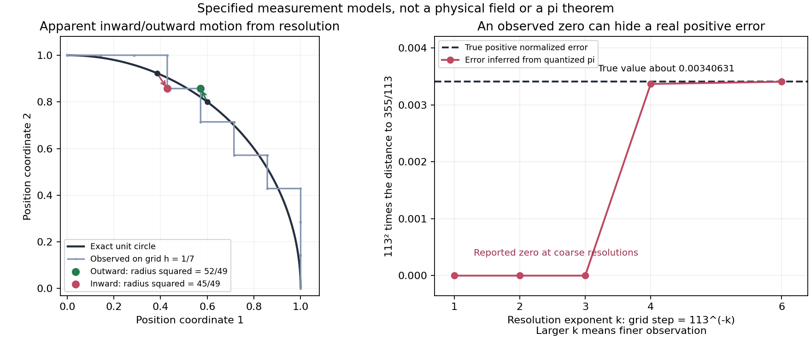

# 分辨率能否解释“内凹”：精确结构与观测误差的对照

2026-11-01。用户提出：连续空间的运动经过有限分辨率观察后，可能表现为突然接近、内凹或速度增大；希望把这个机制与 OpenAI π017 的反证构造联系。本轮实际建立了可分辨两类机制的对照，不预设这一解释成立。

**结论：有限分辨率确实能制造内外摆动、表观速度尖峰和假零误差；但论文中的精确消去不能统称为这种观测误差。** 论文先反设存在异常好逼近，再从假设族选择数据，没有实际构造一个已经发生的 π 反例，也没有定义物理力场。

## 0. “分辨率”有两个不同含义

用户原来的描述更接近**允许哪些候选点**：目标 x 仍精确，只允许整数分子除以 n 的点。另一种是**仪器如何读出位置**：把目标或轨迹的坐标舍入到网格。本轮两种都保留，不能把前一种直接改称数值舍入误差。

第一种模型中，π 到 22/7 的差是精确存在的。改变 n 会改变候选集合，而不一定包含原来的点：分母 7 的最近点是 22/7；改用分母 8 后，22/7 被排除，最近点变成 25/8，普通误差反而更大。即使网格间距更小，也出现了“先靠近又退回”的现象。这是候选集合不嵌套产生的真实选择切换，不需要目标移动，也没有测量错误。

若改用嵌套细化，如分母 7、14、28，原候选一直保留，最小普通误差就不会变大；这几个具体尺度恰好仍选中同一位置 22/7。程序用 π 的有理区间认证了这些比较。

若把全部实数都允许为候选，目标本身也被允许，最近距离直接为零。这确实消除了原来的候选限制，但同时改变了问题，不能据此说有理逼近的真实小差值只是观测幻觉。下面第1—2节另行检验仪器量化，第3—4节检验精确辅助结构。

## 1. 先用没有真实径向变化的轨迹做控制

为隔离分辨率，不引入行星动力学：真实轨迹取半径恒为 1 的圆。把每个坐标就近映到步长为 1/7 的网格。

| 精确圆上点 | 网格观测 | 观测半径平方 | 现象 |
|---|---|---|---|
| `(3/5,4/5)` | `(4/7,6/7)` | `52/49>1` | 看起来向外移 |
| `(5/13,12/13)` | `(3/7,6/7)` | `45/49<1` | 看起来向内缩 |

原始两点半径平方都精确为 1。这给出了用户“分辨率制造内凹/外凸”的一个真实成立的模型。这里的圆是用于排除真实径向变化的控制，不是为原研究点云拟合的曲线。

左图黑线是精确圆，阶梯线是指定网格的观测。右图在同一有理候选 355/113 上提高观测精度：粗网格报告误差为零，细网格恢复了真实的正误差。绘图用浮点显示，表格与获胜/量化判定用精确有理数或严格有理区间。

对于 a 个坐标的最近网格量化，位置误差最多 `√a h/2`，但除以很小的观测时间间隔后，差分速度误差最多变成 `√a h/Δt`。因此位置误差趋零，并不自动保证速度估计也正确。

在一个完全精确的匀速直线模型中，真实速度恒为 1；令空间分辨率逐渐提高，但时间间隔更快缩小，观测速度仍可沿所选序列趋于无穷。这说明“同时提高精度”必须说明空间精度与时间精度的相对速度；不能仅由 h→0 推出没有伪速度。详证与纯有理数序列在 [quantization_mechanism.md](quantization_mechanism.md)。

## 2. π 的逼近质量要求与分母平方相配的分辨率

固定一个候选 p/q。若只把目标 x 量化成观测值，网格步长为 h，那么归一化逼近质量 `κ=q²|x−p/q|` 的观测误差不超过

\[
 \frac{q^2h}{2}.
\]

因此只说观测更精细还不够：要使归一化误差绝对可靠，需要 `q²h→0`；若还要求相对误差可靠，则需 `q²h/κ→0`。这不是 π 特有的规律，而是三角不等式给出的观测预算。

尤其当 `h=1/q²` 时，p/q 本身就在观测网格上。如果真实 `0<κ<1/2`，最近网格量化会把 x 直接读成 p/q，报告 `κ_obs=0`。这对固定无理目标同样适用；它没有使真实数值变成有理数。

本轮用 Machin 恒等式及交错级数余项建立严格有理区间，认证了两个实例：

| 候选 | 真实 κ，约值 | 步长 `h=1/q²` 的观测 κ |
|---|---:|---:|
| 22/7 | 0.0619599741 | 精确为 0 |
| 355/113 | 0.0034063119 | 精确为 0 |

它们的真实误差都有严格正下界；零只出现在指定观测规则中。分母固定时提高分辨率，会使这种假零消失。有限范围验证不支持“所有异常好逼近都是分辨率假象”。

## 3. 与 OAI 辅助构造的直接对照

论文的有限 H 是保留有限组**精确 Taylor 系数**，不是把数值舍入成像素。相同系数行造成的消去，在精确实数或复数计算中仍成立。其余关键输入是 π 的精确指数周期、一个非零子式，以及清分母后的整数约束。

此前[六列模型](../pi-construction-mechanisms-2026-11-01/determinant_mechanism.md)可以直接做分辨率对照。固定同一组选列，令中心差为 `iδ`，δ 为正有理数，另一个中心为 6i。该子式精确满足

\[
 \Delta=108i\delta.
\]

| 中心差 δ | 精确秩 | 以 0.01 步长观测中心后的秩 |
|---|---:|---:|
| 0.1 | 6 | 6 |
| 0.01 | 6 | 6 |
| 0.001 | 6 | 5 |
| 0.000001 | 6 | 5 |

这里有两种现象，必须分开：

- **真实结构：** δ 缩小时，子式的精确绝对值真的变小；两列的差真的变短。δ 非零时六个方向仍独立，δ=0 时这组选列精确降为五个方向。
- **观测假象：** 粗网格提前把不同中心读成同一点，错误地报告已经降为五个方向。

取真实的两个有理近似 22/7、355/113 作为中心输入，也得到同样对照：精确子式非零，步长 0.02 的中心观测把它报告成零；步长 0.01 已能区分这两个中心。本轮没有用这个有限模型代替论文的插值定理。

“难以分辨”并非全部由舍入制造。在固定标准坐标和列规范下，两列差的精确大小还给出条件数下界 `cond₂≥2/|r₁−r₂|`。因此结构越接近重合，对观测误差越敏感；有限分辨率会加剧和提前呈现这种敏感性。这个结论针对该固定子式与规范，不把任意小行列式都等同于几何曲率或大条件数。

## 4. 放大观察能恢复方向，但不是免费收益

在 δ=1/Q 的精确例子里，将两列相减，再放大 Q 倍并作固定相位旋转，可以恢复一个固定的非零方向，归一化后的行列式为 108。放大同时会把误差也放大 Q 倍。

算术侧同样要计算这个放大成本：适当地对列乘 2Q，并对两个半整数系数行乘 2 后，所有元素成为高斯整数，行列式恒为 `864i`。所以原始子式虽然任意小，清分母后的对象并没有小于 1，也没有矛盾。

这正是与论文联系最紧的机制：**同一个对象的接近程度、可分辨方向与整数化成本必须一起计算。** 仅看到一个方向很薄、一个观测值很小或一个轨迹出现凹口，还不足以产生反证。论文试图让结构性的解析节省压过全部算术成本。

## 5. 对用户假说的准确修订

可以保留：“有限分辨率使不同位置被合并，轨迹落在网格单元边界的不同侧，造成表观内缩、外移和速度尖峰。”本轮已经给出精确例子。

目前不能采用：“OAI 已构造一个实际异常位置或物理场，其异常完全由分辨率造成，实数精度下就会消失。”异常逼近在原稿中是反设，解析消去在精确计算中存在，并且数学上的连续空间本身不禁止真实靠近或真实速度变化。

更准确的联系是：**真实的结构接近，会使有限分辨率下更容易出现观测误判；两者能同时发生，但不能互相替代。**

本轮也区分了第三类现象：即使精确计算，若观察的是“距离最近候选的距离”，候选身份切换仍可产生尖点。这是所选统计量的非光滑性，既不必是轨迹本身的尖点，也不必是测量误差。

## 来源与复现

原文仍固定在 `openai/math@4eaee87548250b2682affda7d05d947c05554bae`。关于反设、有限 jet、重复 Taylor 次数与选取参数的准确行号、原文链接和范围，见 [source_mechanism.md](source_mechanism.md)。来源字节审计在 `mechanism_results.json` 中；没有重新证明上游插值满射，没有运行 Lean，没有给出 π 好坏逼近结论。

运行 `python3 research/resolution-and-pi-2026-11-01/run_labs.py`。依赖 Python、SymPy、NumPy、Matplotlib；复用此前已保存的矩阵系数生成器与 π 有理区间工具。两个精确实验组分别检查观测误差规律和同一六列模型；绘图另行生成，不用浮点图形代替证明。
