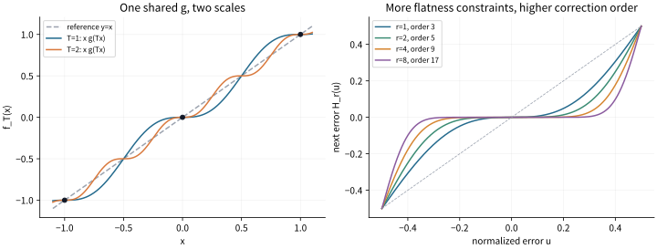

# 同一个 g、多种缩放：独立约束、剩余自由度与高阶纠偏

2026-11-02。研究用户提出的乘积模型

\[
F_T(x)=f(x)g(Tx),
\]

其中同一个 g 用于多个非零缩放 T。固定正整数 q，希望 F_T(nq)=nq 对全部整数 n 成立。这里先选 f(x)=x，构造和验证共享 g；它是用户模型中的明确子类，而不是对所有 f、g 的完整分类。T首先按实缩放理解；若用角度参数 T=cos θ，还需将以下允许的尺度转换为具体角度。

本轮落实了两件事：固定有限频率模型时，“条件增加、自由度减少”有精确秩公式；在另一个非周期共享 g 子类中，独立平坦条件能建设性地给出三次、五次、七次等任意奇数阶纠偏。基础工具为标准插值、有限Fourier代数与正核，不主张这些数学原理首创性。

## 1. 原点必须保留的自由度

非零格点要求 g(Tnq)=1；但 x=0 处，外因子 x 已经为0，只需 g(0)有限。原始条件没有要求 g(0)=1。

若希望原点也有三次或更高阶纠偏，应允许 g(0)=0，因为 F_T'(0)=g(0)。一个实际共享整函数是

\[
\boxed{g(y)=1-\frac{\sin(2\pi y)}{2\pi y},\quad g(0)=0.}
\]

若 Tq 为整数，则全部非零 T 都使用同一个 g，且

\[
F_T(x)=x-\frac{\sin(2\pi Tx)}{2\pi T},\qquad F_T(nq)=nq.
\]

在每个指定格点，F_T的一阶、二阶导数都为0。取q=1、T=1和2，得到两条不同形状却共用同一g的函数。对每步加q的演化，|e_0|<1/(2T_max)是共同的误差捕获区间，误差三次趋零。缩放可在有限集合内任意切换，也允许每次选不同整数跳数；归一化误差控制仍保留。

需要保留一个范围区别：Tq>1时也会出现额外细格点。证明保护的是指定q骨架附近的共同管，不是说全实轴都只吸引到nq。

## 2. 更多独立条件如何提高纠偏阶数

选用R个谐波系数：

\[
\Phi(y)=\sum_{j=1}^R c_j\frac{\sin(2\pi j y)}{2\pi j},
\quad H(y)=y-\Phi(y),\quad g(y)=H(y)/y.
\]

要求H在整数处到2r阶的误差导数都消失（r≤R），等价于r个独立线性条件

\[
\sum_jc_j=1,\qquad \sum_jc_jj^{2k}=0\quad(1\le k<r).
\]

节点j²互异，Vandermonde矩阵满秩，所以剩余自由度为R−r。固定最少频率R=r时，唯一解为

\[
c_{r,j}=\frac{2(-1)^{j+1}(r!)^2}{(r-j)!(r+j)!}.
\]

这是真正的“r个独立条件确定r个系数”；同一条件重复改写不增加秩，也不能把这个有限子模型的唯一性推广到所有函数。

更强的是，所得函数有正核恒等式

\[
\boxed{H_r'(y)=\frac{4^r}{\binom{2r}{r}}\sin^{2r}(\pi y).}
\]

它保证对整个0<|y|<1/2都有0<|H_r(y)|<|y|，而不仅是形式Taylor消去。共享调制器 g_r=H_r/y 可同时用于全部 Tq∈Z 的尺度，并有

\[
e_{k+1}=H_r(T_ke_k)/T_k=O(e_k^{2r+1}).
\]

|T_ke_0|保持在统一严格半格管内时，全部切换轨道都纠偏。阶数r=1、2、3分别对应三次、五次、七次。更多独立平坦条件确实减少有限自由度，同时得到更高阶功能；并不是单纯把合法函数排空。

当r增长，H_r在远离半整数的每个闭子区间上趋向最近整数读数。频率、系数分母及复平面增长也随r增加，不能把该极限当作免费整数化。格点是预先规定的输入，这不是整数物理起源的证明。

完整全阶证明、成本与精确验证见 [hermite/NOTE.md](hermite/NOTE.md)。另有独立的arcsin截断高阶构造，并保留一段可调形状自由度，见 [dynamics/NOTE.md](dynamics/NOTE.md)。



图只用于展示形状，未参与证明或PASS判定。左图两条曲线使用同一g；右图在同一误差区间比较不同纠偏阶数。

## 3. 同时满足多种缩放，究竟增加多少约束

这部分另选“g本身L周期、有限Fourier带宽”的模型。它不同于上一节非周期的g_r；上一节周期的是F_T(x)−x。两个子类不能混同。

若qT_i/L=a_i/r_i已约分，令w=exp(2πiy/L)，则一个正频多项式缺陷P(w)满足该方向的全部格点条件，当且仅当

\[
w^{r_i}-1\mid P(w).
\]

全部方向的共同生成元为

\[
A(w)=\operatorname{lcm}_i(w^{r_i}-1),\qquad D=\deg A.
\]

对真正实值的三角多项式g−1，若带宽为M，原有2M+1个实系数，剩余维数恰为

\[
\boxed{\max(0,2M+1-D)}.
\]

例如沿用用户的q=133，L=1，固定M=3：

| 同一个g必须满足的累计缩放 | D | 剩余实系数 |
|---|---:|---:|
| T=1/2 | 2 | 5 |
| 再加T=1/3 | 4 | 3 |
| 再加T=1/6 | 6 | 1 |
| 再加T=1 | 6 | 1 |

最后一条条件已被旧条件包含，不能重复扣除自由度。这里用133只是遵循用户举例，与先前π基准分母113不同，不作混用。

这个模型在有理周期方向下自动要求g(0)=1，因为非零整数n也会使相位回到原点。因此它可以构造共享保值和幅度控制，但不能直接套用上一节g(0)=0的原点三次吸引结论。

具体非平凡正调制器、完整整数Fourier基与系数高度见 [rank/NOTE.md](rank/NOTE.md)。全部结果计量的是固定有限模型里的自由系数，并非任意无限函数集合的基数。

### 非有理尺度的附加说明

若g本身是固定L周期的有限Fourier函数，且qT/L无理，那么e^(2πikqT/L)在不同整数频率k上互异。把g(Tnq)−1=0写成有限指数和，取足够多个n，Vandermonde满秩迫使所有缺陷系数为0，即g=1。

这结论依赖固定周期/有限频谱。一般整函数同时在两条无理比格点链上取1，仍可非平凡：例如1+sin(πy/h₁)sin(πy/h₂)在h₁Z与h₂Z上都为1。有限条离散格点链本身并不因无理比就变成稠密集。

## 4. 已把共享约束实际接入π积分

取同一个

\[
g_\lambda(y)=1-\lambda[\sin(6\pi y)+\sin(4\pi y)]^2.
\]

它同时满足g(n/2)=g(n/5)=1，且λ仍是形变参数。Cayley代换后，括号内波形精确变为

\[
\frac{2x(x^4-10x^2+5)}{(1+x^2)^3}.
\]

因此可以将完整g乘入已有只留下π和有理边界的积分核；新增的六次分母幂必须保留。也可只抽出核心零点多项式S₅(t)=t²−10t+5，作为整数核的两个独立线性条件。

对m=1,…,4，核心约束使整数核维数从m+2下降到m；但m≥2时，周期像仍秩2。因此不限制系数高度时，所有有理周期比例仍可实现：减少形状自由度不自动等于减少可出现的有理标签，可能主要改变标签的最低实现费用。

已经实际比较无附加约束、核心因子和四组完整g参数，共24组发生器试验，47个候选被独立认证。本次没有改善π逼近；完整g的六次分母和系数成本很大，保守Gram度量还可能丢失额外解析衰减。它不是这个子族的失败定理。见 [constructive/NOTE.md](constructive/NOTE.md)。

## 5. 下一步与结论范围

本轮已经把“共享调制器、多种T、独立相容条件”推进为可计算的秩和明确的稳定构造。下一步可利用剩余系数自由度设计相消，同时把接触阶、频率、系数高度和既约分母放入同一评分。单纯减少自由度或提高纠偏阶数，尚不能代替实际q²|π−p/q|的收益证明。

## 6. 复现

在本目录运行：

```sh
python3 rank/verify_rank.py
python3 dynamics/verify_shared_dynamics.py
python3 hermite/verify_harmonics.py
python3 constructive/shared_integral_search.py
python3 constructive/verify_shared_integral.py
```

hermite验证与constructive发生器使用SymPy 1.14；其余只需标准库。最后一项读取constructive/results.json，输入改变后应先重跑发生器。全部一般性结论依赖正文证明，有限测试核对实现。

可选图示：`python3 hermite/plot_shared.py`，另需NumPy、Matplotlib，不参与验证。

Vandermonde插值的标准背景见 [Stanford Math 114](https://web.stanford.edu/class/math114/decks/interpolation/interpolation.html)。本记录中的具体共享g、有限核和收费接口均自足推导，不将标准原理包装成新的基础理论。
