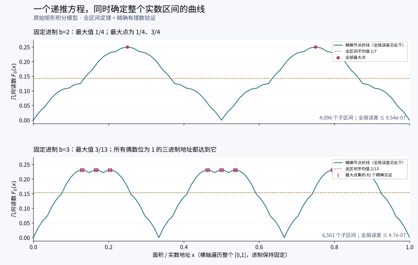

# 整个实数区间的进制面积函数：统一递推、极值与误差证书

日期：2026-11-03。延续 [实数地址映射](../real-address-space-2026-11-03/) 与 [进制面积函数](../pi-base-function-2026-11-03/)。

本轮固定整数进制 \(b\ge2\)，让面积/地址 \(x\) 遍历整个 \([0,1]\)。这与此前固定 \(x=\pi-3\)、改变进制 \(b\) 的横轴不同。我们没有更换矩形填充规则。

**结果：一条仿射递推唯一确定整个区间上的函数；它同时给出所有点的误差界，以及完整的零点、最大点和区间平均值。** 最大点在奇数进制下仍保留无限多个自由数位。

## 1. 保持原来的几何定义

将单位正方形按 \(x\) 的 \(b\) 进制小数位递归填充：第一步沿横向分成 \(b\) 个竖条，填满数位指定的条数，并在下一条继续；第二步在活动条内沿纵向分成 \(b\) 份；此后交替。每步都从活动矩形左侧或底部填起。令所得区域为 \(E_b(x)\)，其面积为 \(x\)；竖向填充高度为 \(h_{b,x}(t)\)。

本轮研究的函数是

\[
F_b(x):=J_x(b)=b\int_0^1 h_{b,x}(t)\bigl(1-h_{b,x}(t)\bigr)\,dt.
\]

等价地，\(F_b(x)=b\int_{E_b(x)}(1-2y)\,dA\)。端点取 \(F_b(0)=F_b(1)=0\)。终止展开采用尾部全零的约定；以下递推保证相邻子区间端点相容。

这是一个**几何读数**。完整实数地址仍是 \(x\)，或携带同样面积信息的区域 \(E_b(x)\)。不能单独用 \(F_b(x)\) 还原地址，见第 7 节。

非负性来自第一种积分。首个竖条步骤以后，只有一个宽 \(1/b\) 的活动条有部分填充，其平均高度为 \(r=\{bx\}\)。由 \(t(1-t)\) 的凹性，

\[
0\le F_b(x)\le r(1-r)\le\tfrac14.
\]

## 2. 一个方程覆盖全部子区间

对任意 \(k,\ell\in\{0,\ldots,b-1\}\) 和 \(u\in[0,1]\)，写

\[
x=\frac{kb+\ell+u}{b^2}.
\]

两个数位后，余下活动矩形的宽、高都缩为 \(1/b\)。原有逐层积分公式给出

\[
F_b(x)=\psi\!\left(\frac{\ell+u}{b}\right)
-b^{-2}\psi(u)+b^{-3}F_b(u),\qquad\psi(t)=t(1-t).
\]

展开后，两个二次项完全相消：

\[
\boxed{
F_b\!\left(\frac{kb+\ell+u}{b^2}\right)
=\frac{\ell(b-\ell)+(b-2\ell-1)u}{b^2}
+\frac{F_b(u)}{b^3}.
}\tag{1}
\]

因此每个两位子区间都包含同一条完整曲线：横向缩为 \(b^{-2}\)；剥去相应的仿射主项以后，纵向余项缩为 \(b^{-3}\)。整个图形映射还带有仿射剪切，不能仅描述为无剪切缩放。

这是一条适用于**所有实数地址**的恒等式，不是由有限散点拟合出的关系。

## 3. 唯一性与整个区间的统一计算

在 \(\mathcal C=\{f\in C([0,1]):f(0)=f(1)=0\}\) 上，用式 (1) 的右侧定义算子 \(T_bf\)。

各段左右端点分别为 \(\ell(b-\ell)/b^2\) 与 \((\ell+1)(b-\ell-1)/b^2\)，所以相邻段吻合，且首尾为零。因此 \(T_b\) 将 \(\mathcal C\) 映到自身，并有

\[
\|T_bf-T_bg\|_\infty\le b^{-3}\|f-g\|_\infty.
\]

于是存在唯一连续不动点，就是上述几何函数 \(F_b\)。从零函数出发，令 \(S_K=T_b^K0\)，则：

\[
\boxed{0\le F_b(x)-S_K(x)\le\frac1{4b^{3K}}
\quad\text{对全部 }x\in[0,1].}\tag{2}
\]

更精确地，在每个深度 \(K\) 的子区间内，误差恰为 \(b^{-3K}F_b(u)\)。\(S_K\) 是覆盖 \(b^{2K}\) 个子区间的分段仿射函数，在所有节点 \(x=j/b^{2K}\) 处与 \(F_b\) **精确相等**，所以它也是精确节点的折线插值。

这回答了“研究整个区间”的计算含义：有限文件保存一条有限折线及全局误差，而该误差同时覆盖区间里没有逐一列出的每个点。

程序保存的两个例子：

| 固定进制 | 两位递推轮数 | 覆盖子区间数 | 所有点的误差上界 |
|---|---:|---:|---:|
| \(b=2\) | 6 | 4096 | \(1/1048576\) |
| \(b=3\) | 4 | 6561 | \(1/2125764\) |

节点横坐标分母为 \(b^{2K}\)，纵坐标统一分母为 \(b^{3K}\)；`results.json` 保存整数分子，显示用的小数不充当证书。



## 4. 完整零点、对称性和连续性强度

由式 (1)、非负性及端点相容性可得：

\[
\begin{aligned}
F_b(x)=0&\iff x=j/b,\quad j=0,\ldots,b,\\
F_b(x+k/b)&=F_b(x)\quad\text{只要两点均位于 }[0,1],\\
F_b(1-x)&=F_b(x).
\end{aligned}
\]

零点分类可直接看仿射主项：其非负，且只有 \(\ell=0,u=0\) 或 \(\ell=b-1,u=1\) 时可为零。周期性来自式 (1) 中 \(k\) 不出现在右侧。反射关系则由 \((k,\ell,u)\mapsto(b-1-k,b-1-\ell,1-u)\) 和不动点唯一性得到。

\(S_K\) 的最大绝对斜率为 \(b(1-b^{-K})\)：由 \(L_K=(b-1)+L_{K-1}/b\) 得出，上界在首段取到。取一致极限，

\[
\boxed{|F_b(x)-F_b(y)|\le b|x-y|.}\tag{3}
\]

这个常数不能缩小：在节点 \(x=b^{-2K}\) 上，\(F_b(x)/x=b(1-b^{-K})\to b\)。这里研究的是连续曲线；没有据有限折线声称最终曲线光滑。

## 5. 全局最大值与全部最大点

### 偶数进制

\[
\boxed{\max F_b=\frac14,\qquad
\operatorname{argmax}F_b=
\left\{\frac{2k+1}{2b}:k=0,\ldots,b-1\right\}.}\tag{4}
\]

由 \(F_b\le\psi(\{bx\})\le1/4\)，等号必须满足 \(\{bx\}=1/2\)。\(b\) 为偶数时，这些点满足 \(\{b^2x\}=0\)，代入递推确实取得 \(1/4\)。

### 奇数进制：固定一半数位，另一半无限自由

令 \(b=2h+1\)。式 (1) 的仿射主项是相邻两个值

\[
\frac{\ell(b-\ell)}{b^2},\qquad
\frac{(\ell+1)(b-\ell-1)}{b^2}
\]

的凸组合。因此它不超过 \(C=h(h+1)/b^2\)，且当 \(\ell=h\) 时对所有 \(u\) 恒等于 \(C\)。若 \(M=\max F_b\)，则 \(M\le C+b^{-3}M\)。地址 \(x=1/2\) 的每一位都是 \(h\)，故能递归取得等号，得到

\[
\boxed{\max F_b=\frac{b(b+1)}{4(b^2+b+1)}.}\tag{5}
\]

要达到最大值，仿射主项与尾部都必须达到各自最大值。尾部不可能为端点 0 或 1，所以仿射主项取等号要求 \(\ell=h\)。逐层重复这一条件，得到完整分类：

\[
\boxed{x=0.d_1\,h\,d_3\,h\,d_5\,h\cdots\quad\text{（}\,b\text{进制）},
\qquad d_{2j-1}\in\{0,\ldots,b-1\}\text{任意}.}\tag{6}
\]

这些地址不存在尾部全零/全 \(b-1\) 的歧义。最大点集由 \(b\) 个比例 \(b^{-2}\) 的相似分支构成，含有不可数多个地址。

尤其在三进制下，

\[
\boxed{F_3(0.d_1\,1\,d_3\,1\,d_5\,1\cdots)=\frac3{13}.}
\]

比如 \(1/8=0.010101\ldots_3\)、\(1/2=0.111111\ldots_3\)、\(7/8=0.212121\ldots_3\) 都取得同一个最大读数。任意挑选无限多个奇数位，结论仍然成立。

这具体实现了“无限地址族共享一个确定的几何性质”。共同读数不会保存那些自由位；自由信息存在于完整地址中。这里没有判定 π 的地址属于这一集合。

## 6. 整区间的精确平均值

对所有 \(b^2\) 个分支积分。仿射主项的平均值为 \((b^2-1)/(6b^2)\)，余项仍按 \(b^{-3}\) 缩小。记 \(\mu_b=\int_0^1F_b(x)\,dx\)，则

\[
\mu_b=\frac{b^2-1}{6b^2}+b^{-3}\mu_b,
\qquad
\boxed{\mu_b=\frac{b(b+1)}{6(b^2+b+1)}.}\tag{7}
\]

例如 \(\mu_2=1/7\)、\(\mu_3=2/13\)。并且

\[
\int_0^1S_K(x)\,dx=(1-b^{-3K})\mu_b.
\]

这些是整体积分恒等式，无需抽样估计。

## 7. 接上覆盖整个实数轴的地址映射

前一轮的有符号地址变换为

\[
\Phi(u)=\frac{u}{1-|u|},\quad -1<u<1;
\qquad \Phi^{-1}(X)=\frac{X}{1+|X|}.
\]

将本轮单位面积地址规范化为 \(u=2x-1\)，则

\[
\Theta(x)=\Phi(2x-1),\quad 0<x<1
\]

是开单位区间到整个实数轴的连续严格递增双射。于是在实数轴上得到完整曲线

\[
\boxed{G_b(X)=F_b\!\left(\frac{1+X/(1+|X|)}2\right),\qquad X\in\mathbb R.}\tag{8}
\]

把 \(F_b\) 替换为 \(S_K\) 后，式 (2) 的同一个误差上界覆盖**所有 \(X\in\mathbb R\)**，包括两端无界区域。任意子区间也整体映为 \(\Theta([l,r])=[\Theta(l),\Theta(r)]\)；遇到端点 0 或 1 时，改取相应开端点与无穷边界。

这里控制的是同一个精确地址处的**纵向函数读数误差**。它不表示先把地址量化到有限网格后，实数坐标 \(X=\Theta(x)\) 的绝对误差也能在全实轴统一有界；靠近地址端点，坐标变换会放大输入误差。

任意有限开区间 \((A,B)\) 只需先令 \(x=(t-A)/(B-A)\)，就得到同样的全实轴地址映射。闭区间上的连续有限值函数不能覆盖无界实数轴，因此这里使用开区间。

此前 π 的正侧地址 \(\pi/(1+\pi)\) 直接适用于 \(\Phi\) 的正半侧；在本节对称规范化中，π 对应的面积地址为 \([1+\pi/(1+\pi)]/2\)。两者不混用。

单独的几何读数不构成双射：例如式 (1) 完全消去了第一数位，产生周期性；奇数进制的最大点族更提供了无限多重同值。故“覆盖实数轴的地址”和“用于研究的几何函数”在式 (8) 中明确分开。

## 8. 复算与核对

```bash
python3 verify.py
# 仅画图需要 matplotlib 与 numpy：
python3 draw.py
```

`verify.py` 只用标准库，可独立运行。它生成精确节点、公共分母、81 个三进制最大点见证及以下核对记录：

| 核对 | 数量 |
|---|---:|
| 精确节点与原始矩形积分逐项相等 | 511 |
| 非节点有理数的统一误差带及独立矩形积分 | 320 |
| 三进制最大点的精确有理数见证 | 81 |
| \(b=2,\ldots,15\) 的全局最大值见证 | 14 |
| 折线精确积分与平均值恒等式 | 2 |
| 节点反射对称 | 10659 |

矩形积分直接累加实际填充块及其一阶矩，未使用构造折线的递推。非终止有理数的精确函数值则通过有限余数轨道闭式求和，另与矩形上下界交叉核对。

有限核对检查程序实现；覆盖整个区间的结论由上述恒等式、收缩证明和统一误差界给出。范围是固定几何模型的整体结构，本轮没有产生新的 π 有理逼近纪录。
